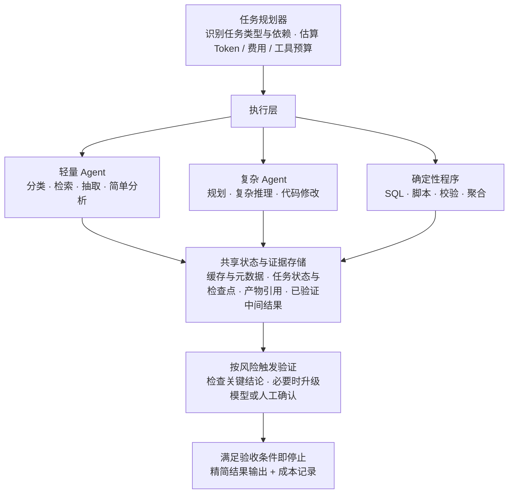

按成功任务算 Token 成本，和多数人默认的算法不一样。多数「Agent 太贵」的讨论起点就错了：大家在比「一次调用用了多少 Token」，而不是「一个任务成功做完花了多少」。这两个口径会给出完全相反的优化方向。

这篇讲清三件事：正确的成本口径是什么、哪些动作真的降本、以及怎么把降本效果量出来。这条思路和 [Anthropic 的上下文工程指南](https://www.anthropic.com/engineering/effective-context-engineering-for-ai-agents) 是同一个方向：上下文不是越多越好，而是一项需要主动设计的稀缺资源。

## 一、三个目标相关，但不等价

把「降 Token」当成一个目标，最容易踩的坑是把代理指标当成了最终目标。

| 目标 | 含义 | 常见误判 |
|---|---|---|
| Token 数下降 | 模型处理的输入/输出 Token 变少 | 以为这就是全部 |
| API 费用下降 | 计入单价、缓存折扣、输入输出价差后的费用 | 忽略缓存命中率与输入输出的价格差 |
| 任务总成本下降 | 模型 + 工具 + 重试 + 延迟 + 人工返工 | 只算 Token，返工成本被藏起来 |

三者相关，但推不出彼此。如果压 Token 的同时错误率上升、任务重跑、需要人工返工，那么「Token 变少了」很可能是把成本从账单挪到了人力上——总成本反而上升。

所以本文的判断标准统一成一个：**任务是否正确完成、总成本是否下降、结果是否可追溯、失败后能否可靠恢复**。Token 数量只是其中一个观测项，不是目标本身。

### Token 到底浪费在哪

省 Token 的手段不是「把提示词压短」，而是消除下面这几类结构性开销：

- 无效上下文与重复历史（每轮都重发全量对话）
- 不必要的模型调用（本来一句 SQL 能解决的事先问了一次模型）
- 过大的工具返回结果（把 5000 行日志丢回上下文让模型自己筛）
- 多 Agent 之间的冗余转述（子 Agent 把探索过程整段交回主 Agent）
- 失败之后的重复执行（一个字段名写错，重扫全量数据）
- 不必要的长输出与反思（每步都「反思、批判、再反思」）
- 缺少缓存、检查点、状态管理导致的重复工作

这七项里，只有第一项和提示词长短有关。其余六项都跟「让干什么活」「结果怎么交接」「什么时候停」有关。

## 二、10 个最高 ROI 的习惯

按投入产出比排序：前面的不需要改架构，后面的需要建机制。

### 2.1 最小化上下文

每次只给当前任务必需的东西：目标、约束、必要事实、当前进度、待解决问题。

- 不要每轮附带完整聊天记录，把历史**提炼成短小的任务状态**；
- 需要原始证据时再按需读取；
- 别把无关项目文档和历史结论塞进当前上下文。

### 2.2 按需检索，而不是一次加载全部

渐进式披露的四步：

1. 先读目录、元数据或摘要；
2. 定位相关文件、章节、表或代码符号；
3. 只读相关片段；
4. 局部信息不足时才扩大范围。

适用面很广：代码仓库、知识库、Skill 文档、数据库 Schema、日志、业务文档。

### 2.3 简单任务优先用规则、脚本和 SQL

计数、去重、排序、格式转换、字段校验、分页、聚合、模板生成——这些交给传统程序。LLM 只处理需要语言理解、模糊判断、规划或复杂推理的工作。

规则引擎比 LLM 便宜几个数量级，而且不会算错。

### 2.4 在工具端限制输出量

原则：**别先把大量数据交给模型，再要求模型过滤。**

| 数据源 | 做法 |
|---|---|
| 日志 | 只返回匹配行 + 必要上下文 |
| SQL | 只返回需要的列 + 有限行数 |
| 搜索 | 限制 Top-K，过滤低相关结果 |
| 代码 | 返回相关函数、片段或 diff |
| API | 字段投影、分页、服务端过滤 |

这一条是全文投入产出比最高的改动：它不需要改模型、不需要改 Agent 逻辑，通常只改一个查询。

### 2.5 多 Agent 只传结构化结果

子 Agent 不应该把完整对话和探索过程交回主 Agent。统一的交接契约长这样：

```json
{
  "conclusion": "结论",
  "evidence_refs": ["file:src/foo.ts#L10-30"],
  "risks": ["未覆盖的边界情况"],
  "confidence": "high | medium | low",
  "artifacts": ["path/to/output.md"],
  "next_actions": ["下一步动作"]
}
```

只传下游必需信息；**大结果放外部存储，用引用访问**。多 Agent 系统的头号浪费就是冗余转述。

### 2.6 保持稳定 Prompt，利用缓存

把上下文切成三层：

| 层 | 内容 | 变化频率 |
|---|---|---|
| 稳定前缀 | 角色、全局规则、工具定义、输出 Schema | 几乎不变 → 命中缓存 |
| 可复用上下文 | 项目架构、业务词典、表结构、已确认规则 | 慢变 |
| 动态任务输入 | 本次问题、实时数据、当前执行状态 | 每轮变 |

前缀稳定不代表「缓存一定命中」，具体命中条件、有效期、最低长度和折扣以对应模型的官方文档为准。但两件事要记住：缓存 ≠ 上下文不占窗口，也 ≠ 所有 Token 免费。

### 2.7 设置停止条件和执行预算

任务**开始前**就定义好：

- 什么条件算完成；
- 最多调用多少次工具；
- 最大重试次数；
- Token 或费用预算；
- 何时停止搜索；
- 何时升级到更强模型或请求人工确认。

证据已充分、验收条件满足时就该结束。无界搜索是成本黑洞。

### 2.8 控制输出长度

默认只输出四段：**结论 → 关键证据 → 风险/限制 → 下一步动作**。只有用户明确需要时才输出长篇分析。同时给输出上限留足空间，别让关键结果被截断。

### 2.9 失败时增量恢复

1. 保留已成功的结果；
2. 提取关键错误信息；
3. 定位失败步骤；
4. **只重试失败部分**；
5. 必要时从最近检查点恢复。

例：SQL 字段不存在 → 查表结构修正字段即可，不必重新扫描全部数据资产。

### 2.10 监控每个成功任务的成本

至少记录：输入/输出 Token、缓存命中 Token、模型调用次数、工具调用次数、重试次数、任务成功率、端到端延迟、模型与工具费用、人工返工率。

核心指标是**每个成功任务的总成本**，而不是 Token 总量。

## 三、9 项进阶技巧

前面是止血，下面是建机制。

**模型路由。** 按任务类型分层：固定规则和计数交给代码/SQL；简单分类抽取改写用低成本模型；普通规划用性价比合适的通用模型；复杂推理用高能力模型；高风险结论单独验证。按真实任务测准确率与总成本，别只比较单次调用价格。

**上下文压缩（Compaction）。** 触发时机：历史达阈值、任务进入新阶段、上下文窗口即将不足。压缩后必须保留：任务目标、已确认事实、已完成步骤、关键证据引用、未解决问题、下一步动作、重要约束、失败教训。不要每轮都压缩——压缩本身消耗 Token，而且要验证「继续执行所需的信息」是否还在。

**精简工具定义。** 工具名、描述、参数 Schema 都占上下文。删重复工具、缩短参数说明、统一参数风格。但别合并成一个含义模糊的「巨型工具」——那会显著增加误调用和重试。

**检查点。** 阶段结束时保存结构化状态 + 产物引用 + 完成标记，失败后从最近检查点继续，而不是从头执行。适用长时间运行的研究、代码开发、数据分析、多 Agent 工作流。

**共享检索结果和元数据。** 多个 Agent 分析同一仓库或数据域时共享已检索片段、Schema 元数据、搜索结果、已验证中间结论。共享结果必须带**版本、时间范围、数据源、权限信息**，避免用到过期缓存。

**控制推理强度。** 对支持思考预算/输出上限参数的模型按任务配置：简单任务低预算，复杂任务留足空间。盲目压低推理预算，可能因错误和重试反而增加总成本。

**分层记忆。** 工作记忆放当前任务状态，项目记忆放架构/规则/表结构，长期经验放验证过的方案与失败教训。先检索再按需加载；记忆必须可更新、可失效——过期或互相矛盾的内容不能当事实用。

**紧凑的中间数据格式。** 用必要字段 + 引用代替重复的大段自然语言/HTML/日志：

```json
{
  "table_id": "dwd_cost_daily",
  "partition": "2026-10-28",
  "evidence_ref": "query_result_003",
  "status": "verified"
}
```

对 SQL、代码、金额、时间戳和关键标识符，**不要为了压缩而破坏语义或精度**。

**Token 优化回归测试。** 建立固定任务集，对比优化前后的输入/输出 Token、缓存命中率、调用与重试次数、成功率、延迟、每个成功任务总成本、人工返工率。只有质量达标且总成本确实下降，才保留这个优化。

## 四、团队级多 Agent 架构

单 Agent 的优化天花板不高。任务一旦复杂到需要分工，成本结构就变成「多个 Agent 之间的交接」。



六条设计原则：

1. 规划器决定**是否需要调用模型**，避免所有步骤都交给 LLM；
2. 执行 Agent 只返回结构化结果和证据引用；
3. 大型数据、日志、代码和报告保存在外部存储；
4. 缓存与共享结果必须有版本、权限和有效性检查；
5. 仅在必要节点触发高成本推理和独立审查；
6. 通过检查点和增量恢复减少失败后的重复工作。

注意第 1 条：很多「Agent 系统」其实是把本该由代码做的事塞给了模型，规划器只是转发器。这是最常见也最容易修的一处浪费。

## 五、指标体系与成本公式

Token 优化如果没有指标，就只是一堆感觉。至少要有这九个指标：

| 指标 | 作用 |
|---|---|
| 输入 Token / 输出 Token | 观察模型上下文与生成量 |
| 缓存命中率 / 缓存 Token | 判断固定前缀复用效果 |
| 模型调用次数 | 发现不必要的调用链 |
| 工具调用次数 | 发现重复检索和低效操作 |
| 重试率 | 发现工具可靠性或规划问题 |
| 任务成功率 | 防止优化损害正确性 |
| 端到端延迟 | 衡量实际体验 |
| **单次成功任务总成本** | 衡量整体经济性 |
| 人工返工率 | 识别隐性成本转移 |

核心公式只有一个：

```text
单次成功任务成本 = 全部模型与执行成本 ÷ 成功完成的任务数
```

失败、重试、人工返工成本若不计入分子，这个指标就会**低估**真实成本——而且低估得越厉害，看起来越「优化成功」。

### 三个阶段的落地优先级

| 阶段 | 目标 | 行动 |
|---|---|---|
| **第一阶段**<br>低成本快见效 | 止血 | 限制工具返回量；删除无关历史上下文；精简 Agent 交接结果；设置最大重试次数和停止条件；记录每个任务的 Token 与调用次数 |
| **第二阶段**<br>系统级优化 | 建机制 | 固定 Prompt 前缀并验证缓存命中；建立三层记忆；长任务加上下文压缩和检查点；让代码/SQL 处理确定性问题；建立模型路由策略 |
| **第三阶段**<br>持续优化 | 闭环 | 构建固定任务评测集；优化前后 A/B；按任务类型分析成本与失败原因；调整缓存、推理预算与 Agent 数量；持续检查质量、延迟、总成本、人工返工率 |

## 六、反模式清单

见到就该改：

| 反模式 | 后果 | 对策 |
|---|---|---|
| 每轮附带完整聊天历史 | 上下文单调增长、成本线性上升 | 提炼成短任务状态 |
| 先取全量数据再让模型过滤 | 工具返回挤爆窗口 | 在工具端过滤 |
| 子 Agent 回传探索过程 | 多 Agent 冗余转述 | 结构化交接契约 |
| 无停止条件的搜索 | 调用次数无界 | 预算 + 验收条件 |
| 每步都要求自我反思 | 输出 Token 与延迟双涨 | 只在高风险节点检查 |
| 只考核 Token 总量 | 返工成本被隐藏 | 单次成功任务总成本 |
| 为省 Token 砍掉证据引用 | 结果不可追溯、无法复核 | 清理结果 ≠ 清理引用 |

还有几条边界要划清：

- 清理工具结果 ≠ 清空全部历史，必要证据保留引用；
- 批量请求 ≠ 把所有任务塞进一个超长 Prompt；
- 压缩上下文 ≠ 丢掉关键约束、未完成事项和证据来源；
- 降低 Token 不应以降低正确率、安全性、可追溯性为代价。

## 七、一套可直接复用的全局规则

上面这些落到日常协作里，可以压缩成十条规则贴在全局提示词里：

```text
1. Minimum Context:      Load only the context required for the current task.
2. No Repetition:         Do not resend or restate unchanged information unless required for correctness.
3. Bounded Tool Output:  Filter, aggregate, paginate, and limit tool results before passing them to the model.
4. Structured Handoffs:  Agents must exchange concise, structured outputs containing conclusions, evidence references, risks, and next actions—not full conversation histories.
5. Reuse Before Recompute: Reuse verified results, cached responses, project metadata, and existing artifacts whenever valid.
6. Deterministic First:  Use code, SQL, rules, and conventional tools for deterministic operations. Reserve LLM calls for tasks requiring language understanding or reasoning.
7. Stable Prompts:       Keep reusable instructions, tool schemas, and output formats stable to improve prompt-cache reuse.
8. Bounded Execution:    Define stopping conditions, retry limits, tool-call budgets, and escalation rules. Stop when acceptance criteria are met.
9. Incremental Recovery: Preserve successful intermediate results and retry only the failed step.
10. Quality-Adjusted Cost: Track input/output tokens, cached tokens, model calls, retries, latency, success rate, and cost per successful task. Never optimize token usage at the expense of correctness or reliability.
```

## 进阶阅读

- 进阶篇：[Agent Token 优化十层检查清单](/blog/agent-token-optimization-review-checklist/) — 上面每一条落到架构评审时具体该问什么
- 案例篇：[Reasonix 缓存优先架构解读](/blog/reasonix-cache-first-token-optimization/) — 一条真实会话如何把缓存命中率做到 99.8%
- 关联阅读：[团队级多 Agent 工作流：怎么选，怎么验](/blog/multi-agent-platform-selection-poc/) — 架构定了之后，选型与 PoC 怎么验
