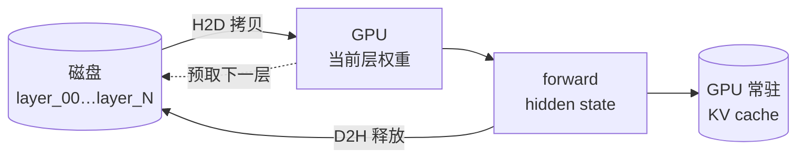
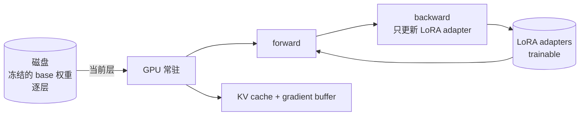

# AirLLM：把显存占用和模型规模解耦

[AirLLM](https://github.com/lyogavin/airllm) 把「70B 跑在 4GB 单卡」做到了工程级可复现。但它的真正卖点不是「显存小」——而是**把 VRAM 占用从「全模型大小」解耦到「单层大小」**。

> 数据快照（2026-10 整理）：36.7k star，Apache-2.0，Python 库，`pip install airllm`。

这是主流量化路线之外被忽略的一条：**主流推理栈（vLLM / TensorRT-LLM / SGLang）把模型装进显存，用算力和吞吐换速度；AirLLM 把模型留在磁盘，用带宽和延迟换容量。** 两句话概括本文：这条路线怎么实现，以及它明确不做什么。

## 一、核心机制：按层拆盘 + 单层流式

### 1.1 预处理：一次拆分，永久按层存盘

第一次 `AutoModel.from_pretrained(...)` 时，AirLLM 会把完整 checkpoint 拆成按 decoder layer 索引的小文件（`.safetensors` 分片）：

```text
~/.cache/huggingface/hub/models--Qwen--Qwen3-32B/
├── layer_00.safetensors
├── layer_01.safetensors
├── ...
├── layer_63.safetensors
├── lm_head.safetensors
├── embeddings.safetensors
└── (config + tokenizer)
```

代价有三处要提前知道：磁盘占用大约翻倍（`delete_original=True` 可回收一半）、拆分本身耗时分钟级且与模型规模线性相关、**磁盘才是真正的硬约束**——DeepSeek-V3（671B）拆完约 360GB。

### 1.2 推理循环：一次一层，预取下一层

```python
for layer_idx in range(num_layers):
    layer = self.layers[layer_idx].to(self.device)        # 1. 加载一层
    hidden = layer(hidden)                                 # 2. 计算
    self.layers[layer_idx] = self.layers[layer_idx].cpu()  # 3. 立即搬走
    if prefetch and layer_idx + 1 < num_layers:
        self.layers[layer_idx + 1].to_async(self.device)   # 4. 异步预取下一层
```

四个动作背后是两条工程决策：

1. **同步算、异步搬**：当前层算完立刻把权重 `cpu()` 释放，下一层用 overlap 预取。README 报的「~10% 速度提升」就来自这一步。
2. **KV cache 留在 GPU**：跨层的状态（attention 的 K/V）始终驻留显存，这是 hidden state 的接力棒。**只要 KV cache 撑得住，层数与显存就解耦。**

整条数据流是这样的：



底层实现用 N 个 CUDA Stream：PyTorch 默认流跑计算，第 i 个 stream 跑第 i 层的 H2D 拷贝，互不阻塞。稳态耗时因此等于 `max(单层计算时间, 下一层 PCIe 拷贝时间)`——拷贝慢时吞吐被 I/O 钉死，计算慢时计算主导。

有个容易踩的细节：卸载层的 `to('cpu')` 必须是**真正的 D2H 拷贝**，不能只改 device 指针，否则 PyTorch 会共享同一份 storage，显存不释放；紧接着还要 `torch.cuda.empty_cache()` 主动把峰值显存归还 driver，否则会跨层累积。

### 1.3 显存账：为什么 70B 跑得进 4GB

对一个 Llama-70B 风格模型：

| 组分 | 大小 |
|---|---|
| 单层权重（bf16） | ~640 MB |
| 单层激活（batch=1, seq=2048） | ~几十 MB |
| KV cache（seq=2048） | ~1–2 GB |
| 工作缓冲 + tokenizer | ~几百 MB |

单层 640MB + KV cache 1–2GB + 缓冲，落在 3–4GB。**模型是 70B 还是 405B，差别只在「层数」，而「层数 × 每层大小」被拆到了磁盘上。**

## 二、官方 VRAM 对照表（README 数据，2026-10 抓取）

| 模型 | 参数量 | GPU VRAM | 备注 |
|---|---|---|---|
| Qwen3 / Mistral / Phi ~8B | 8B | 1–2 GB | 单层极小 |
| Qwen3-30B / Mixtral | 30–47B | 1–3 GB | dense + MoE 都吃得下 |
| Qwen3.8-27B (dense VL) | 27B | 3.33 GB | 视觉塔外挂 |
| Qwen3-235B (MoE) | 235B | ~3 GB | MoE 激活少数专家 |
| Llama 3.x 70B | 70B | ~4 GB | 经典 demo |
| Qwen3.8-Flash-Next | ~180B | 5.95 GB | |
| Llama 3.1 405B | 405B | ~8 GB | |
| **DeepSeek-V3** | **671B** | **~12 GB** | 拆分后磁盘 ~360GB |
| Kimi K3 | 2.8T | < 4 GB | 极端 MoE，几乎只用激活 |

三个反直觉点：

1. **MoE 在 AirLLM 里特别划算**。DeepSeek-V3 / Qwen3-235B / Kimi K3 参数巨大，但每 token 只激活少数专家，单层 VRAM 反而比同尺寸 dense 小。671B 跑 12GB 不是黑魔法，是「只装一层 + KV cache」。
2. **405B 比 70B 多占的不是 6 倍显存，而是约 2 倍**——层数从 80 到 126，比例 1.6 倍，再加点工作缓冲。
3. **2.8T 的 Kimi K3 能跑在 4GB**，但代价是推理时几乎所有专家都要按层流过磁盘，**单 token latency 会很长**。

## 三、4bit 量化：一个独立的加速旋钮

`compression='4bit'`（或 `'8bit'`）与单层流式正交，它只压权重、不动激活、KV 和 embedding。原因很直接：**瓶颈是磁盘读**——单层 640MB 在 NVMe 上读一次要 50–100ms，量化到 4bit 后约 160MB，降到 20ms。3 倍速度直接来自 I/O 减半再减半。

方法上是 block-wise（按 64/128 元素分块求 scale），不是 GPTQ/AWQ 那种训练感知量化，精度损失主要是异常值误差。

关键区别在这里：

- **GPTQ/AWQ**：把整模型压成 4-bit 后常驻显存——**省显存，不省 I/O**。
- **AirLLM 的 4-bit**：层仍然流式，只是每次读的字节数变少——**省 I/O，但流式架构本身不变**。

工程结论：**消费级 GPU + 慢存储 → 4bit 几乎必开；NVMe + PCIe 5.0 → bf16 流式可能就够。**

## 四、训练侧：把同一套思路搬到 LoRA

「单层流式」也可以用来训练：base 权重全部冻结并逐层从磁盘读，**只有 LoRA adapter 反向传播**（rank=8/16 即可），不需要整个模型常驻。



GPU 显存里常驻四样东西：Embedding、当前 active layer 的权重、LoRA adapters（唯一可训练）、以及 KV cache 与梯度缓冲。

官方 benchmark 声称：Qwen3.8-Flash-Next（125B）训练用 **<6GB VRAM**，Qwen3.8-27B 在 seq=512 时约 **2GB VRAM**。

这条路和「小参数 + 大上下文」是同一个思路：**用磁盘带宽换显存容量。**

## 五、横向对照：AirLLM / llama.cpp / vLLM / GPTQ·AWQ

| 维度 | AirLLM | llama.cpp | vLLM | GPTQ / AWQ |
|---|---|---|---|---|
| 核心机制 | 单层流式 + 磁盘 | 全模型量化常驻 | PagedAttention + 连续 batching | 整模型权重量化常驻 |
| VRAM 下限 | 单层大小（~1–3GB） | 量化后全模型 | 量化后全模型 | 量化后全模型 |
| 最大模型支持 | 千亿–万亿级（流式无上限） | 受显存/内存限 | 受显存限 | 受显存限 |
| 吞吐 | 低（I/O 瓶颈） | 中（CPU 量化快） | 高（接近 GPU 极限） | 中 |
| 首 token 延迟 | 拆层首推更慢，稳态可接受 | 快 | 快 | 快 |
| 磁盘占用 | **2× 模型大小** | 1× | 1× | 1× |
| 硬件 | CUDA / MPS / CPU | CPU / Apple Silicon / CUDA | CUDA 优先 | CUDA 优先 |
| 不适用 | 高 QPS 服务、低延迟场景 | 极大模型 + 单机受限 | <8GB 显存的卡 | 同上 |

一句话选择指南：

- 显存 4–8GB、模型 70B+、偶尔推理 → **AirLLM**
- 显存 8–24GB、模型 7–70B、要高吞吐 → **vLLM + AWQ/GPTQ**
- 显存 <4GB 或纯 CPU → **llama.cpp + Q4_K_M**
- Apple Silicon → **llama.cpp + MLX**

## 六、它明确不做什么（这决定了它的定位）

| 能力 | 支持 | 原因 |
|---|---|---|
| Multi-GPU tensor / pipeline 并行 | ❌ | 架构前提是单卡够用，多卡并行会破坏「VRAM = 单层」的边界 |
| 持续 batching | ❌ | 流式架构是单请求独占流，多请求会争抢单层加载 |
| Beam search | ❌ | 每个 beam 单独维护 KV，KV cache 乘以 beam 数 |
| Speculative decoding | ❌ | 小模型+大模型要么全常驻（破坏流式），要么全流式（draft 模型吃 I/O） |
| PagedAttention | ❌ | KV 切页对单请求收益小，对流式架构的瓶颈（PCIe）无效 |
| Prefix / Prompt cache | ❌ | 跨请求共享 KV 需要全局 KV 池，破坏按请求独占流的隔离 |

这些「做不到」反过来定义了产品定位：**它不是 vLLM 的对手，而是 vLLM 跑不动时的兜底**——当模型大到必须把权重搬出显存、并且 QPS 不重要时，它才是唯一选项。

## 七、与 FlexGen：同一条路的两种工程哲学

FlexGen（Stanford / UC Berkeley / ETH / Together，ICML 2023）走的也是「offloading 大模型」，但工程路线不同：

| 维度 | FlexGen (2023) | AirLLM (2026) |
|---|---|---|
| 核心思想 | GPU/CPU/Disk 视为**层次化**资源 | 把 Disk 当模型本体，GPU 当工作集 |
| 调度粒度 | Block-level（每 N 层一组） | Layer-level（每 1 层一组） |
| 调度算法 | LP 求解最优 block 放置 | 固定顺序加载 + 预取下一层 |
| 量化 | 4-bit group-wise，**权重与 KV 都压** | 4-bit block-wise，**只压权重** |
| 多请求 | 支持 batch、聚合 I/O | 单请求独占，无 batch |
| 数学下界 | 证明接近理论 I/O 下界的 2 倍 | 无相应证明 |

**FlexGen 是 research artifact，重吞吐**——它试图在单 GPU 上榨出接近多卡的吞吐，代价是复杂的 LP 调度器和预先知道硬件规格；**AirLLM 是 production-leaning 的 Python 库，重简单**——把调度复杂度全推给「按层顺序加载」，换来极简 API。研究选 FlexGen，工程选 AirLLM。

## 八、什么时候用、怎么用

**适合**：边缘/离线/单卡推理且模型 ≥70B 但显存 ≤12GB；研究评估超大 MoE 模型（Kimi K3、DeepSeek-V3、Qwen3-235B）时「先跑起来」；没有多卡环境做一次性评估或生成；训练侧想 LoRA 微调 100B+ 模型。

**不适合**：生产级 LLM 服务（延迟敏感、高并发）；模型 ≤13B 且显存 ≥24GB（直接上 vLLM/AWQ 收益更高）；频繁重启服务的环境（每次首推都要重新加载第一层）。

调优清单：

```python
model = AutoModel.from_pretrained(
    "Qwen/Qwen3-32B",
    compression='4bit',                    # 慢存储必开；快存储可省
    layer_shards_saving_path="/nvme/...",  # 一定要放本地 NVMe
    delete_original=False,                # 调试期保留原模型
    prefetch=True,                         # 默认开
    profiling=False,                       # 第一次跑会慢，调试用
)
```

存储优先顺序：**NVMe SSD + PCIe 4.0+ 是底线**（机械盘和 USB 外接基本不可用）；4bit 与磁盘速度二选一最省事；`layer_shards_saving_path` 显式指向独立盘，不要和系统盘竞争；shard 不要放 NFS/SMB 远程挂载——`to_async` 预取的语义依赖本地文件系统的高效预读。

还有一条**重要的证据缺口**：README 没有任何与 llama.cpp / vLLM 的基准对比。3 倍加速来自「bf16 → 4bit」自身提速，与 llama.cpp 的 Q4_K_M 同档对比没有数据。要做选型决策，这是必须自己补的工程验证。

## 九、这条路线为什么值得知道

AirLLM 不只是「穷人卡工具」，它代表大模型推理栈里被主流遗忘的一条分支。这条路线在 2026 年变得有意义，是因为三个条件同时成立：

1. **NVMe 单盘带宽 7 GB/s 起**——读一个 640MB 的层不到 100ms，正好能 overlap 当前层的 forward。
2. **MoE 成为主流**——DeepSeek-V3、Kimi K3、Qwen3.8 都把「大参数」分散到少数激活专家，单层 VRAM 反而小，流式架构与 MoE 形态天然咬合。
3. **消费级 GPU 显存停滞在 8–16GB**——H100/A100 越来越贵，RTX 4090/5090 的 16–24GB 是个人开发者的上限。

三个条件的交叉点，就是这类工具的用武之地：**不是替代 vLLM，而是让「千亿模型跑在个人机器上」成为常态**，把超大模型从「云端 API」和「实验室多机」之间的鸿沟填上。

---

**来源**

- AirLLM GitHub：<https://github.com/lyogavin/airllm> ｜ PyPI：<https://pypi.org/project/airllm/>
- FlexGen（学术前辈，ICML 2023）：<https://github.com/FMInference/FlexGen>
- vLLM 量化支持：<https://blog.vllm.ai/2024/quantization-support>
- 相关阅读：[从 FLOPS 到美元：LLM 推理成本的数学推导](/blog/llm-inference-cost-deep-dive/) ｜ [算力与 Token 经济学](/blog/token-economics-explained/)
