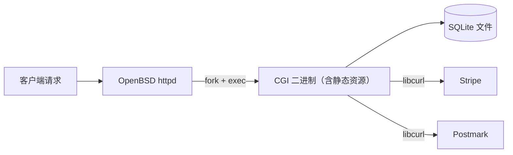

# 用 C 写现代 Web 应用：BCHS 栈与 CGI 复兴

> 原文：[A modern web app in c](https://prophitt.me/writing/a-modern-web-app-in-c) — prophitt, 2026
> 实战项目：[marketyour.games](https://marketyour.games/)——一个真实的商业产品

## 引言：三十年的轮回

1994 年，如果你想做一个动态网站，做法很简单：写一个 C 程序，丢进 `cgi-bin` 目录，让 Apache 每次请求 `fork` 一下它。

**三十二年后的 2026 年，prophitt 用本质上完全相同的技术栈，上线了一个商业产品**——[marketyour.games](https://marketyour.games/) 什么都有：用户账户、面向内容创作者的搜索面板、内容文件夹分类、Stripe 支付、Postmark 事务邮件，而且遵循渐进增强（progressive enhancement），**完全不需要 JavaScript**。

一切都是现代的——除了「它怎么被做出来」和「它怎么被服务」。

这篇文章想回答一个问题：**为什么一个资深工程师，在 2026 年，会主动选择 C + CGI + SQLite 这样的「老古董」组合去生产一个真实的商业产品？** 以及，这个选择反过来对今天的我们意味着什么。

## TL;DR

- **CGI 在 2004 年的衰落是合理的，但 2026 年的现状让那些理由站不住脚了**；
- **可以用 C 写现代 Web 应用，而且已经有人在这么做**（就是 prophitt 本人）；
- 整个产品 = 一个二进制 + 一个 SQLite 文件 + 三个依赖，**整套系统能装进你脑子里**；
- 这种「反框架」的工程哲学，放到 AI 时代，反而成了最被低估的**供应链安全 + 复杂度控制**范例。

## 一、技术栈：BCHS 是什么

prophitt 用的是 [BCHS](https://learnbchs.org/)：

| 字母 | 含义 | 角色 |
|------|------|------|
| **B** | OpenBSD | 操作系统，自带 httpd |
| **C** | C | 业务逻辑语言 |
| **H** | httpd | Web 服务器（OpenBSD 自带） |
| **S** | SQLite | 嵌入式数据库 |

外加三个轻量依赖：**libcurl**（所有出站请求，Stripe / Postmark）、**libsodium**（随机 ID、密码哈希、Stripe webhook 的 HMAC 校验）、**libcjson**（解析 JSON 响应）。

注意：这三个里**实际编译依赖只有 libcurl 和 libsodium**——libcjson 是一个 C 源文件、无外部依赖；SQLite 官方提供 amalgamation（单 C 文件）构建，两者都被**内嵌（vendored）进项目**。结果就是：干净构建只要几秒，增量重建不到半秒，整套系统的「运动部件」少到极致。

更巧妙的是：静态资源不再单独服务——**httpd 把所有流量都路由到 CGI 二进制**，每个静态资源（JS/CSS/图片）都被**编译进可执行文件、直接从内存里 serve**。零磁盘 I/O，零缓存配置，零 CDN。



## 二、为什么 2026 年还能用 CGI

prophitt 的整篇文章其实在回答一个隐含问题：**为什么 2004 年我们抛弃 CGI，2026 年又可以捡回来？**

### 1. 用基础概念，不用框架

CGI 不是框架——**它是 1.1 规范，2004 年发布，自此未变**。没有需要「内化」的 API，整个接口就是几个最基础的 HTTP 概念：request headers、request methods、query strings、body data。**你懂 HTTP，就懂 CGI**。而且 CGI 与语言、平台无关，学一次，永远能用。

### 2. 清晰的职责分离

典型的现代 Web 架构是 Nginx 反向代理 + 一个「应用服务器」（Ruby/Python/Go/Rust 写的）——**你有两个 Web 服务器，其中一个还负责业务逻辑**。CGI 给你完全不同的拓扑：

```
[httpd]  --(fork+exec)-->  [你的 C 二进制（一次请求 = 一个进程）]
```

一个 Web 服务器，直接调用你的业务逻辑，谁干什么清清楚楚。调试也因此变简单——应用就是一个普通 shell 程序：往 stdin 灌请求、看 stderr、用 gdb 单步，**没有「框架黑盒」，没有「魔法装饰器」**。

prophitt 顺手给出一个很妙的类比：**CGI 就像 serverless——监督进程为每个请求调用你的代码，塞给你一袋环境变量，再收回结果。** CGI 是 serverless，只是少了「供应商」（和「惊喜账单」）。

### 3. 极小的供应链风险

prophitt 直接点出了 2026 年的时代背景：

> With the rise of autonomous agents and weekly attacks on package repositories, it feels reassuring to have very few dependencies.

（随着自主 agent 的崛起和软件包仓库每周都在被攻击，**依赖少一点，睡觉都踏实**。）

大多数现代技术栈都自带包管理器和庞大生态：一两个直接依赖可能拉进来几百个间接依赖，每个都由一个你从没听过的人维护，他们的发布凭据可能还在用 2015 年就开始复用的密码。prophitt 的供应链清单是：**一个 C 编译器 + 三个库**。要攻破这条链，攻击者得攻破 libcurl——一个整个互联网都在盯着的项目——而不是一个「每周下载 11 次、2019 年维护者跑路」的野包。

### 4. 简单到不行的工具链

prophitt 用经典 Vim、零插件：没 LSP、没自动补全、没格式化、没 AI 辅助。配合极简栈，他根本不需要复杂工具——整个应用 = 一个 C 文件目录 + 一个 Makefile，打开一个文件读完就知道它在做什么。真需要工具时，sanitizers、valgrind、gdb、ctags、cscope 这些精炼了数十年的老牌工具装一个包就有。

### 5. 在 C 里写 HTML/CSS，没那么糟

这是意料之外的反直觉点。prophitt 列举了自己「为模板语言高亮而战的血泪史」：跟 Vim 死磕 Go `html/template` 高亮、跟 Helix 死磕 Go template、跟 RustRover 死磕 askama 里的 Jinja……**用 C 意味着根本没有「第二种语言」让你的编辑器半识别**——没有混合语法让高亮崩盘，没有「插件舞蹈」。

> It was refreshing to just write C. It isn't pretty, but neither is Tailwind.

### 6. SQLite 是一股清流

prophitt 承认过去一直默认选 Postgres——它确实好，但有运维负担：要守一个 server 进程、频繁版本升级。SQLite 完全没有：没有进程、没有配置、没有依赖，应用直接打开那个数据库文件。**运维负担最小化**，在 2026 年「小团队 / 独立开发者做 SaaS」语境下是巨大优势。

## 三、Prophitt 自己承认的不足

CGI 是 Web 服务器和应用之间的「接口」，不是框架也不是库——**意味着你几乎什么都要自己写**：Cookie 解析、Query 参数校验、Form 数据校验、输出转义（防 XSS）。他自己在一个头文件 `cgi.h` 里手撸了这些，但也不确定这是不是正确解法。他提到 [kcgi](https://kristaps.bsd.lv/kcgi/) 这类库，但采纳一个库意味着接受它的 API 和安全模型——这个权衡他还在犹豫。他期待一套像 [stb 系列库](https://github.com/nothings/stb) 那样「扔进去就用」的共享小工具。

## 四、为什么 2026 年的工程师应该重新看 CGI

prophitt 在结尾给出清醒的判断：

> CGI is old, but it's not forgotten. Most of the reasons we abandoned it in the early 2000s don't hold up today. **Process forking isn't nearly as expensive as it was; modern kernels optimize it heavily.**

我们在 21 世纪初抛弃 CGI 的那些理由，今天大多数都站不住脚了——进程 fork 的代价远没有以前那么贵，现代内核已经把它优化得很狠了。如果 fork 真成瓶颈，FastCGI 是「长驻进程版 CGI」的简单升级路径。而 marketyour.games 是这件事最实在的证据：一个**商业产品**跑在**一个二进制**上，使用一个** 2004 年官方标准化**的服务模型。

## 五、给中国工程师的额外视角

prophitt 写的是 BCHS（OpenBSD 生态），但有几条对国内工程师格外有共鸣：

1. **「少即是多」在 AI 时代更值钱。** 一个项目有 200 个 npm 依赖、每个 `package.json` 都能被 typo-squat 攻击时，「一个 C 编译器 + 三个库」的供应链几乎不可能被攻破。国内做政企/金融/医疗的工程师都知道等保/密评对供应链审查有多严——**少依赖不是政治正确，而是合规要求**。
2. **SQLite 在国内被严重低估。** 国内默认「Postgres + Redis + 一堆中间件」，但 SQLite 的 WAL 模式、JSON1 扩展、生成列、窗口函数早就是个「小 Postgres」，只是大家还在用过时的眼光看它。
3. **「CGI 像 serverless」的洞察非常中国。** 做云原生的工程师会对这个比喻会心一笑——prophitt 在写这段话时可能没意识到自己在用云原生的语言描述 1994 年的技术。
4. **渐进增强是真正的「反 AI 生成 UI」立场。** 大多数新项目默认 SPA、关掉 JS 就是白屏；在 AI 生成的 UI 越来越「看起来漂亮但行为诡异」的当下，**能用 HTML 表单完成的事就不要用 React**，反而成了对抗过度工程的最后堡垒。
5. **「老技术 + 正确场景」是国内工程师最该学的能力。** prophitt 不是反新技术的怀旧党——他过去用 Postgres、写过 Go、写过 Rust，只是识别出「2026 年，在这个具体场景下，BCHS 是最优解」。**不追新、不被「行业最佳实践」绑架、在每个具体问题上做最适配的技术选型**，这才是该学的能力。

## 速查清单：BCHS 极简栈能给你的核心能力

| 能力维度 | BCHS 给你的 | 对比「现代框架」栈 |
|---------|------------|----------------|
| **部署复杂度** | 一个二进制文件 | 容器镜像 + 编排 |
| **依赖数量** | 3 个（其中 2 个单文件 vendored） | 几十到几百个 |
| **冷启动延迟** | 进程 fork（微秒级） | 容器启动（秒级） |
| **调试直观度** | shell 跑、gdb 单步 | 框架黑盒、debug build |
| **供应链攻击面** | 几乎为零 | 巨大 |
| **新成员上手成本** | 懂 C + 懂 HTTP 即可 | 懂框架 + 懂生态 + 懂运维 |
| **扩展天花板** | FastCGI 是简单升级 | 已经是「现代方案」 |
| **不写 JS 也能用** | ✅（原始 HTML 表单） | ❌（SPA 默认） |

## 延伸思考

prophitt 提到的「fork 成本已经很低」，和 Linux 内核 [mm_struct 优化](https://lwn.net/Articles/936885/)、OpenBSD 的 `pledge`/`unveil` 沙箱 API 的成熟都有关。如果你正在设计一个「想要简单部署 + 强隔离」的内部工具，这套思路值不值得抄？用 Go/Rust 写一个「每个请求一个进程」的服务，是不是比 K8s + 微服务更适合你的场景？

他自嘲的「在 C 里写 HTML」那段，戳中了一个更深的点——**当编辑器永远在「半识别」你的模板语言时，生产力是被悄悄偷走的**，这件事在 AI 时代反而被放大了。而「单语言、纯文本」的工作流，会不会是一种被低估的工程美学？prophitt 期待有人「像 stb 那样」做一套可扔进去就用的 C Web 工具集——在 C/CGI 复兴的早期，先占住「标准工具集」的位置，就是占住了未来十年的生态位。
