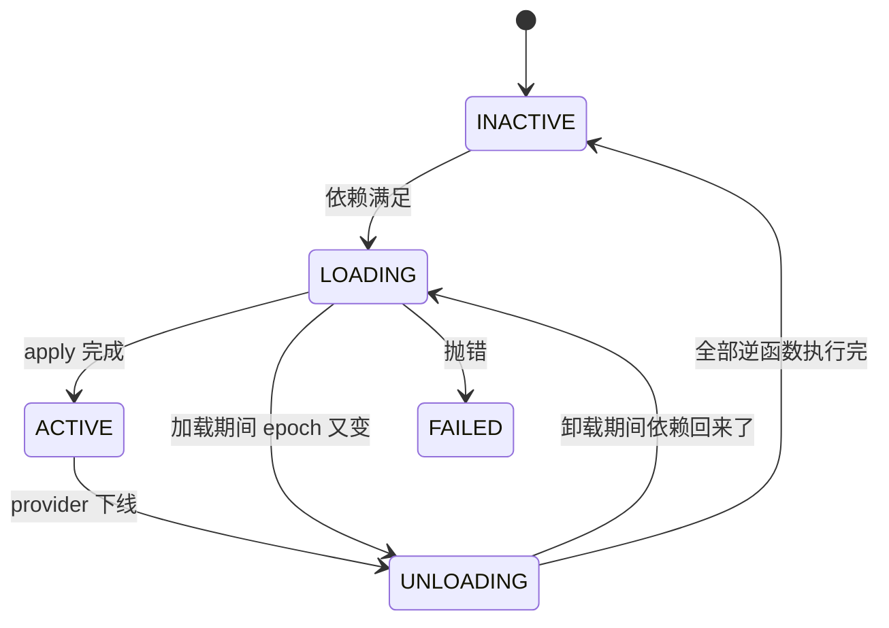

# Cordis：时空可组合性——动态组合的形式化

> 论文：*A Programming Paradigm for Spatiotemporal Composability*
> Yifan Shi, Wei Zhang, Tianyi Cui — Peking University & DeepSeek-AI，arXiv:2608.25512

几乎所有程序员都理解「静态组合」：函数调用、模块 import、类继承，编译时确定，运行时不变。但现代软件越来越需要**动态组合**——插件系统、热更新、Agent 运行时：组件在运行时加载、卸载、重配置，而现有实践往往只能靠「重启进程」兜底。

这篇论文的贡献是给动态组合一套**严格的数学形式化**：不是拍脑袋的设计，而是从 λ 演算推导出来的类型系统与运算规则，能证明其正确性。读懂它，你就理解了 DSH「一切皆插件」背后的形式化根基，而不只是记住几个 API 名字。

本文是 [拆解 DeepSeek Harness](/blog/deepseek-harness-agent-runtime/) 那篇的理论续篇——那篇讲 PTC、创造模式和 Cordis 的时间/空间两个维度，这篇把那两个维度挖到底。

## 一、问题：静态组合有两个维度，动态世界两个都缺

| 维度 | 静态世界怎么保证 | 动态世界的困难 |
|------|----------------|------------|
| **时间**（Temporal） | RAII、bracket 模式，词法作用域保证清理 | 组件效果的生命周期不与词法作用域绑定——插件可能在任何时候被卸载 |
| **空间**（Spatial） | 模块 import 依赖解析 | 依赖在运行时出现、消失、切换身份——A 依赖 B，但 B 可能还没加载，甚至被替换 |

论文拿 VSCode 插件系统当反面案例，两个失败都很具体：

**时间维度失败**：`deactivate` 钩子只在**进程终止时**才调用，意味着插件无法在进程存活时热卸载。87% 的热门扩展包含可执行代码，卸载它们必须重启 VSCode。更深的问题在于**关注点局部性（locality of concern）**被破坏——清理逻辑（deactivate）和创建逻辑（activate）分散在两处，作者必须手动保证两者对称，正确性完全依赖个人 diligence。

**空间维度失败**：VSCode 提供了 `extensionDependencies`，但前 100 个热门扩展中只有 7 个使用它。原因是扩展之间通过 `vscode.extensions.getExtension(...).exports` 交互，返回值是 `any`——依赖方无法依赖接口契约，VSCode 只把扩展导向固定的宿主扩展点。

对比两种范式就很直观：

```typescript
// VSCode 方式：静态声明 + 无类型交互
const fooExt = vscode.extensions.getExtension("publisher.foo-extension")
const api: any = fooExt?.exports   // any，编译器帮不了你
api?.doSomething()                 // 运行时崩溃风险

// Cordis 方式：类型安全的依赖声明 + 自动生命周期
export function apply(ctx: Context, config: Config) {
  const foo = ctx.foo        // 类型：FooService，不是 any
  foo.doSomething()
  ctx.provide('bar', new BarService(ctx))
}
```

关键差异：VSCode 的静态声明只做「存在性检查」，运行时拿到的是 `any`；Cordis 的声明同时做到**编译时类型检查** + **运行时自动生命周期绑定**——`foo` 的提供者下线时，依赖它的 `bar` 自动停用。

至于兜底方案（重启进程、K8s 冗余）的代价也很清楚：重启丢失全部进程内状态，容器编排无法表达共享地址空间的组件间依赖，还引入本不必要的网络开销。**Cordis 要在地址空间内部解决动态组合。**

## 二、理论工具：Effect 与 Coeffect，以及它们为什么不够

**Effect**（Moggi, 1989）描述计算对环境的影响。静态视角下每个带副作用的操作类型是 `M T`（M 是 monad）；论文采用的动态视角更朴素——任意不纯函数 `f: X ⇝ Y` 都可以转成纯函数 `f': Γ × X → Γ × Y`，其中 Γ 是 context，副作用就是 `γ → γ'` 这个变换。

Effect 落在 Γ → Γ 变换的幺半群上：闭合性（两个 effect 顺序组合还是 effect）、结合律、单位元 `id_Γ`。

**Coeffect** 是 effect 的数学对偶，描述程序**依赖**什么环境：环境 comonad `D(X) = E × X` 依赖固定环境，流 comonad `D(X) = ℕ → X` 依赖时间序列。带等级的版本（Petricek et al.）用预有序半环 S 量化每个变量的使用方式：0 未使用、1 线性使用、n 有限次、∞ 无限制。

对应关系一目了然：

```text
时间可组合性 → Effect（需要逆）    → revertible effects（本论文）
空间可组合性 → Coeffect（声明依赖） → reactive coeffects（本论文）
```

**关键转折**：经典 Effect/Coeffect 系统是**静态**工具——effect 在词法作用域内追踪，coeffect 在编译时注解验证。但动态组合要求这些保证在**运行时**成立，对抗不断演化的 context。论文的解法是把 typing context 提升为运行时一等公民：**将 typing context reify 为 first-class runtime type**，让运行时直接操作这些结构。

## 三、Revertible Effects：时间可组合性

普通 effect 是 `Γ → Γ`，可逆 effect 多交出一个东西：

```text
Γ → Γ × (Γ → Γ)
返回 (γ', g)：γ' 是变换后的 context，g 是逆向函数，满足 g(γ') = γ
```

直观理解：每个 effect 在做变换时**同时交出一个 undo 函数**，运行时持有它。

累积器 `∂Γ = Γ × (Γ → Γ)` 就是「当前状态 + 迄今为止所有逆函数的复合」：

```text
track_Γ(f, g)(γ, φ) = (f(γ), φ ∘ g)     执行变换，同时累积逆
recover_Γ(γ, φ)     = (φ(γ), id_Γ)      应用累积逆，恢复并重置
```

**Theorem 7** 给出 soundness invariant：对任意满足 `g(f(γ)) = γ` 的 effect，`recover(track(f,g)(γ,φ)) = recover(γ,φ)`——恢复前后读到的结果一致。

组合方式叫 **twisted composition**，逆序累积：

```text
(f₁, g₁) ∘ (f₂, g₂) = (f₁ ∘ f₂, g₂ ∘ g₁)
                        ↑顺向    ↑逆序
```

逆序是因为 LIFO：最后加载的组件先卸载，它的逆函数应该先执行。

而 effect 序列（effect iterator）的类型是 `ℑΓ ≅ μℑ. Γ → Γ × (Γ → Γ) × Maybe(ℑ)`——这正是 **delimited continuation**，主流语言用 `yield` 暴露它（Python、JavaScript 的 generator）。所以这个理论直接映射到已有语言特性，不需要发明新语法。

**Theorem 16（局部保证）**：按顺序应用 `e₁, …, eₙ` 并按逆序撤销，则每次撤销恢复到它自己产生的状态，且所有中间状态都满足 soundness invariant。这就是 Cordis 的 `ctx.effect()` 在做的事。

## 四、Reactive Coeffects：空间可组合性

依赖表是一个有限偏函数：`Σ ≔ (k: K) ⇀ 𝒱_k`，从 dependency key 到 typed value。三个操作：`get(k)` 读取、`set(k, v)` 注册（前提是 k 未注册）并**返回逆函数**、移除绑定。

**关键发现：`set` 本身就是一个 revertible effect。** 也就是说注册依赖是 effect（需要逆函数撤销），而 effect 可逆——因此 dependency registration 自动获得 revertibility。这是两个维度协同的第一个体现。

源码里这一点非常直白：`ctx.provide()` 的整个函数体被 `ctx.fiber.effect(...)` 包裹，注册服务时立即返回注销逆函数：

```typescript
provide(name: string, value?: any) {
  return this.ctx.fiber.effect(() => {
    // —— 正向：注册服务 ——
    this.store[key] = impl
    if (this.ctx.fiber.state === FiberState.ACTIVE) this.notify([name])

    // —— 逆向：注销服务（这就是逆函数 g）——
    return async () => {
      delete this.store[key]
      const fibers = this.notify([name])
      await Promise.allSettled(fibers.map(fiber => fiber.await()))
    }
  }, `ctx.provide(${JSON.stringify(name)})`)
}
```

**注册服务 = 施加 effect，注销服务 = 执行逆函数。** 注意逆向部分又调了一次 `notify`——这就是时间维度与空间维度协同的物理接口：撤销 effect 的动作本身会触发依赖重新分类。

分类规则很清晰。coeffect specification `d` 是组件声明的依赖 key 集合，satisfaction 谓词 `σ ⊧ d` 表示所有声明的 key 都有绑定；任何修改 σ 的 effect 都会触发通知：

- `activating`：`σ ⊭ d` 且 `σ' ⊧ d`，激活组件
- `deactivating`：`σ ⊧ d` 且 `σ' ⊭ d`，停用组件
- `neutral`：其他情况，什么都不做

两个扩展机制值得单独记：

**Isolation** 把依赖表拆成两层：`ρ: K ⇀ R`（key → realm 标识符）和 `σ: R ⇀ 𝒱`（realm → 值），解析路径变成 `k → ρ(k) → σ(ρ(k))`。`ctx.isolate('db', Symbol('tenant-A'))` 让同一个 logical key 在不同隔离上下文解析到不同值——多租户、测试环境、组件沙箱都靠这个。实现上是 `Object.create(父级表)` 的原型继承，**丢弃派生 context 就自动恢复父级行为**，所以恢复是隐式的，不需要写逆函数。

**Interception** 是依赖访问的横切行为：context 携带元数据 `ι`，provider 函数表按 `σ(k)(μ ⊕ ι(k))` 合并后返回。用于依赖访问日志、访问计数、缓存失效通知——注意它作用在**依赖解析层**，不是调用链层，这一点和 AOP / middleware 不同。

## 五、Context Paradigm：把两个维度装进一个 context

统一后的 context 就是三样东西：

```text
Context = Γ × (Γ → Γ) × Σ
        = 状态 + 累积器 + 依赖表
```

所有 effect 和 coeffect 都通过这个统一媒介：`ctx.effect(callback)` 变换状态并累积逆函数，`ctx.set/get` 修改依赖表并触发 notify，notify 驱动组件生命周期。

统一带来一条重要性质——**观测等价性**：直到 effect 执行完毕，coeffect 的读结果不变。换句话说，在 `ctx.effect` 的 callback 执行期间，依赖解析被「冻结」，组件在自身加载过程中不会因为依赖被并发修改而看到不一致状态。

## 六、Fiber：组件实例、惯性与三条定理

论文用一个七元组描述 fiber（组件的运行时实例）：`⟨d, p, e, π, σ, τ, θ⟩`——依次是 inject（声明的依赖集合）、provide（提供的 key 集合）、apply（effect iterator，组件主体）、parent uid、committed view（提交时的依赖解析快照）、状态、以及 inertia（飞行中的异步转换句柄）。

状态机有五个状态，核心是两条转移链：



**惯性（inertia）** 是整个设计里最容易被忽略的巧思：一旦进入转换（LOADING/UNLOADING），必须运行到完成才能响应新的 target 变化。源码里 `inertia` 就是一个 Promise 句柄——转换完成前所有新的 `_setEpoch` 调用在 `if (this.inertia) return` 处直接放弃；而转换结束时如果发现 epoch 又变了，不清空 inertia，而是**链入一个新的转换**（`_unload` 里链 `_reload`，反之亦然）。

这样状态机永远不会抖动：一个转换要么完成，要么把新目标排队到当前转换之后。这种「串行化转换」就是论文 Theorem 73（终止性）和 Theorem 80（Quiescence）在代码里的样子。

三条定理合起来给出了整个论文的工程价值：

| 定理 | 保证 |
|------|------|
| **Theorem 16** | 按逆序撤销，每个逆函数恢复到它自己产生的状态 |
| **Theorem 70** | 组件激活时读到的依赖，在其整个生命周期内不变（Coeffect ordering） |
| **Theorem 73** | 无论加载顺序如何，系统最终达到 quiescence（终止性） |
| **Theorem 80** | 从任何配置到任何配置的转换，最终状态只取决于最终配置 |

## 七、落地：理论在源码里的四个对应点

**1. 逆序执行 = `DisposableList.clear()` 的 `reverse()`。**

```typescript
export class DisposableList<T extends WeakKey> {
  private map = new Map<number, T>()       // 序列号 → 值
  private weak = new WeakMap<T, number>()  // 值 → 序列号

  push(value: T) { const sn = ++this.sn; this.map.set(sn, value); this.weak.set(value, sn) }
  delete(value: T) { return this.map.delete(this.weak.get(value)!) }
  clear() { const values = [...this.map.values()]; this.map.clear(); return values.reverse() }
}
```

`clear()` 返回 `values.reverse()`——**fiber 卸载时按注册顺序的反序拿到所有 wrapper**，这就是 twisted composition 的工程实现。

**2. fiber 的 dispose 是父 fiber 的一个 effect。** `Fiber` 构造函数里 `this.dispose = parent.fiber.effect(...)`，因此子组件的整个卸载过程（包括它所有 effect 的逆序执行）被注册为父 fiber 的一个 effect——**卸载父组件会自动级联卸载子组件**，不需要额外管理。

**3. epoch 字符串编码依赖身份。** `_refresh()` 把每个依赖的 `impl.fiber.uid` 拼成 `':3:7'` 这样的字符串；`_setEpoch` 拿它和旧值比较：`INACTIVE → 非 INACTIVE` 是 activating（reload），反向是 deactivating（unload），**字符串相同就是 neutral**。这意味着如果只是 logger 对象内部状态变了、但提供者 fiber 没变，组件不会被无谓重启——这正是 Theorem 70 的运行时保证。

**4. `ctx` 是 Proxy。** `Context` 构造函数最后 `return new Proxy(this, ReflectService.handler)`，所以每个 `ctx.foo` 访问都过代理层：先查 isolation 表得 realm，再查 store 得实现，检查 fiber 处于 ACTIVE，然后沿 fiber 链向上查找（`while(true)` 循环就是依赖解析本体），合并 isolation 过滤和 inject 类型检查。

一个完整的服务实现能把这些串起来。`TimerService.timeout` 就是最小样板：

```typescript
timeout(callback: () => void, delay: number) {
  const dispose = this.ctx.effect(() => {
    const timer = setTimeout(() => { dispose(); callback() }, delay)
    return () => clearTimeout(timer)   // ← 逆函数 g
  }, 'ctx.timeout()')
  return dispose
}
```

四个特征：每个副作用操作都返回逆函数（`clearTimeout`）；`ctx.effect()` 把它收集进 `DisposableList` 按 LIFO 执行；fiber 卸载时自动清理，无泄漏；fiber 已卸载时新注册 effect 会直接报错——不会出现「僵尸定时器」。**作者不需要写 uninstall 路径，正确性由抽象保证。**

顺带一个产物：Cordis 的 HMR 不需要开发者标注「接受边界」。传统 Webpack/Vite HMR 的正确性依赖人工标注哪些模块可热替换；Cordis 里一个 fiber 已经绑定了组件的全部 effects 和 coeffects，模块替换 = dispose 旧 fiber + 从重载模块实例化新 fiber，正确性由 revertible effects 保证。

## 八、边界：哪些 effect 被追踪

一个必须回答的问题：不是所有副作用都能撤销。论文用「系统边界」来划分——

- **内部位置**：系统可以独占修改并恢复，效果被追踪、可以撤销；
- **外部位置**：系统无法独占修改或无法恢复，效果不追踪，作为 `id_Γ` 静默处理。

Cordis 的具体决策：追踪 `ctx.store` 写入、ctx 上的 event listener 注册、文件内容缓存；不追踪 stdout、数据库写入、网络请求。

而 **Coeffect 是移动边界的工具**：把外部位置 reify 成 coeffect key，就把它纳入系统管理范围。比如数据库连接池本是外部位置，注册成 `ctx.set('db', pool)` 之后，它就变成可追踪的 coeffect 了。

## 九、为什么这不只是理论

**验证案例**：Koishi 是基于 Cordis 的聊天机器人框架，四年积累 4000+ 社区插件。它验证了两件事——表达力与通用性（每个功能都是 Cordis 上的插件，Koishi 只贡献聊天领域词汇；同一模型也跑在浏览器端的 Web Console 上），以及跨开放生态的组合（独立作者写的插件通过 coeffect 连接，零协调即可装配）。

**与传统概念的对照**能帮助迁移：

| Cordis 概念 | 熟悉的类比 | 关键区别 |
|------------|-----------|--------|
| `ctx.effect` | `try/finally`、`defer` | 逆函数在**卸载时**执行，不是函数退出时；跨组件累积 |
| `ctx.set/get` | Spring IoC、Angular DI | 依赖可以运行时**消失/替换**，触发组件生命周期重调 |
| `ctx.use` | 微内核插件加载 | 子组件卸载由父组件卸载**自动级联** |
| `fiber.dispose` | 析构函数、`close()` | dispose 是**累积的**：每个 effect 注册自己的逆，卸载时全部执行 |
| HMR | Webpack/Vite HMR | **无需标注接受边界**，正确性由形式化保证 |
| Isolation | 多租户隔离、测试 mock | 派生 context，恢复是隐式丢弃，无侵入 |
| Interception | AOP、Middleware | 在**依赖解析层**，而不是调用链层 |

最后是这篇论文真正的价值，用一句话概括：

```text
以前（经验主义）：
  "我们相信插件的 deactivate 能清理干净"      → 正确性 = 个人 diligence = 不可靠
Cordis（形式化保证）：
  Theorem 16 / 70 / 73 / 80                  → 正确性 = 数学证明 = 可靠
```

这就是 DeepSeek Harness 敢于宣称「一切皆插件」的底气——不是设计者聪明，而是形式化保证了组合的安全性。

---

**参考资料**

- 论文：*A Programming Paradigm for Spatiotemporal Composability* — Yifan Shi, Wei Zhang, Tianyi Cui（PKU & DeepSeek-AI），arXiv:2608.25512
- 源码对照：`cordis/src/{fiber,reflect,context,registry,utils,service,events}.ts`、`timer/src/index.ts`、`loader/src/config/isolate.ts`
- 前置：[拆解 DeepSeek Harness](/blog/deepseek-harness-agent-runtime/)
