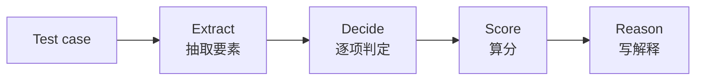
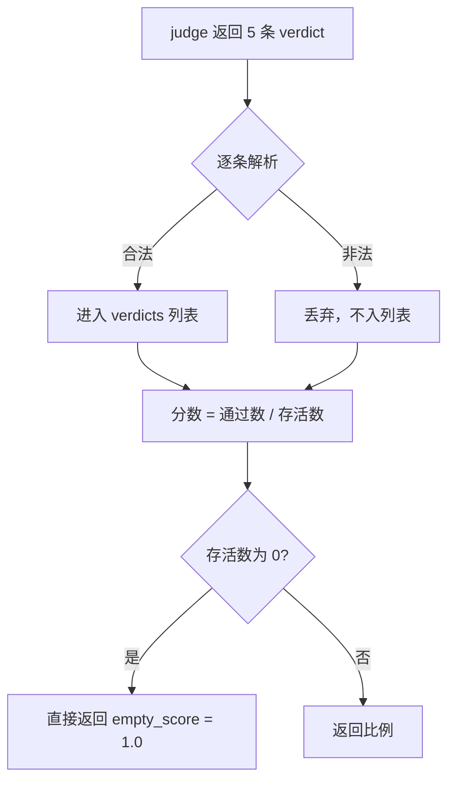

如果你按中文教程装过 DeepEval，大概率会踩同一个坑：教程里的写法跑不起来。

不怪教程作者偷懒。DeepEval 从 v1 到 v4 换过一次定位——早期它是一个 `evaluate(test_cases, metrics)` 的 RAG 指标库，现在是一个以 pytest 为宿主、能把 Agent 执行轨迹也纳入评测的 harness。`observed_component`、`@metrics` 装饰器、`evaluate_async()`、`ChecklistMetric`、`GPTModel` 这些写法，在 v4 的全部 151 个文档页里已经零命中。

本文基于 v4.3.2（PyPI 上传于 2026-10-27）的官方文档和 commit `90e230cb` 的源码。文中带「源码级」标记的结论来自读源码，官方文档没有写。

## 一、它真正解决的问题：让评测获得测试的工程地位

LLM 应用缺的从来不是指标，是**可回归的工程约束**。

传统测试的范式是 `assert` 一个确定值。LLM 输出没有这个性质：同一份 prompt，换个模型、换个 temperature、换个检索结果，答案就变，你没法写 `assert answer == "巴黎"`。

工程团队的三种常见替代方案各有硬伤：

| 做法 | 问题 |
|---|---|
| 人工看几个例子 | 不可回归、进不了 CI，样本量一上来就崩 |
| BLEU / ROUGE / BERTScore | 面向翻译和摘要，对开放式生成几乎没有判别力 |
| 自己在代码里拼 prompt 问模型 | 没有统一阈值语义、没有统一报告、每次重写 |

DeepEval 的答案是：别自己搭评测管道，把评测做成 pytest 用例。

```python
def test_rag_quality():
    assert_test(test_case=tc, metrics=[FaithfulnessMetric(threshold=0.7)])
```

这个转化的意义不在语法糖，而在于评测拿到了和单元测试完全相同的位置——同一个 runner、同一套 fixture、同一条 CI 流水线、同一种失败报告。这是它与 RAGAS 这类「评测库」的根本差异：那些工具本质是 CLI 加报告，DeepEval 本质是测试。

代价也有：`deepeval` 通过 `pytest11` entry point 注册成 pytest 插件（源码级）。只要环境里装了它，**任何 pytest 项目的 conftest 都会自动加载**。同一个虚拟环境里跑别的项目测试时，它会跟着生效。

## 二、v4 的分水岭：三种 Eval Mode

这是 v4 最重要的架构变化，也是当前公开资料几乎没覆盖的部分。

官方把所有 LLM-as-a-judge 指标的执行过程抽象成四步：



三种模式的区别，就是「这四步由谁来做」：

| 模式 | 抽取 | 判定 | 打分 | 说明 |
|---|---|---|---|---|
| `llm` | LLM | LLM | 代码 | 传统路径，需要 LLM API Key |
| `hybrid` | Jev | Jev 优先 | 代码 | Jev 失败时静默回落到 LLM 决策 |
| `system_one` | Jev | Jev | 代码 | 全程不调 LLM，但需要 TypeSafe AI 的 Key |

`system_one` 模式用的是 Jev——TypeSafe AI 的 System One 模型。它不是生成式模型，只回答有界问题并给出校准概率，一次请求跑完整条指标流水线。官方宣传口径是「不需要 LLM API Key」，这句话成立，但换个角度看只是换了供应商：你从 OpenAI 换到了 TypeSafe AI，而 Jev 的定价、可用性、模型版本在文档里都没提。

同一套思路在开源侧也有对应探索，可以对照 [Jev 开源生态调研与复现手册](/blog/typesafe-jev-open-source-guide/) 看它的替代实现。

三个使用约束值得先记住：

- `system_one` 没有任何兜底。超过 32k token 直接报错，Jev 的错误原样抛出，多模态请求直接拒绝。
- `hybrid` 的降级是静默的。Jev 调不通就改由 LLM 决策，事后只能靠 `metric.system_one_fallback_reason` 发现。
- **跨 eval mode 的分数不可比**。切模式等于重置基线，趋势图不能混着画。

## 三、指标体系的坑：没有证据时默认满分

官方指标页面有 61 个 metric、14 个 classifier。逐个核完之后，最该警惕的不是「哪个指标不准」，而是一类设计取向。

### 空集通过

`PlanAdherence` 在 trace 里抽不到 agent 的计划时，直接返回 1 分：

```python
# deepeval/metrics/plan_adherence/plan_adherence.py:117-119
if len(agent_plan.plan) == 0:
    self.score = 1
    self.reason = "There were no plans to evaluate within the trace ..."
```

`ToolPermission` 同理——一次工具都没调用时：

```python
# deepeval/metrics/tool_permission/tool_permission.py:82
score = 1.0 if total == 0 else (total - len(unauthorized)) / total
```

这两处都不是 bug，是设计选择：指标体系里没有「证据不足」这个状态，缺失一律当作满分。

后果在 CI 上很具体。你的 agent 根本没产出计划、根本没调用工具，指标拿不到证据，于是给 1.0，测试通过，门禁悄悄放行。

能做的两件事：

- 在 test case 层面自己断言（比如检查 `tools_called` 非空），不要只依赖指标分数；
- 别用 `threshold=None` 或 `flaky=True` 去「绕开」——前者破坏 pass/fail 语义，后者只是把问题藏起来。

### 命名和分数方向反着来

`Hallucination`、`Bias`、`Toxicity`、`PIILeakage` 这几个名字听起来都是「越少越好」，但公式分子是「好」的那部分，**分数越高越安全**。写阈值的时候按名字直觉来，必然配反。

### 官方自己劝你别堆指标

原文是 "no matter how tempting, try to limit yourself to no more than 5 metrics"。建议 2 到 3 个系统级加 1 到 2 个用例级。指标重叠也很严重：`AnswerRelevancy` 和 `ContextualRelevancy` 的公式完全相同，只是一个抽 `actual_output`、一个抽 `retrieval_context`，两个都上就是双计。

## 四、源码级发现：判决越乱，分数越高

这一条不在任何文档里，是读 `deepeval/metrics/utils/qag.py` 时发现的，也是全文最值得单独拎出来的部分。

所有 QAG（question-answer-generation）类指标都走同一条链路：judge 逐项返回 verdict，解析成结构化对象，再算通过比例。问题出在解析失败时。

**第一步**，非法 verdict 被整条丢弃：

```python
# qag.py:100-110
def _verdicts_from_json(data, verdict_cls, allowed):
    verdicts = []
    for item in data.get("verdicts", []) or []:
        verdict = verdict_from_json(item, verdict_cls, allowed)
        if verdict is not None:
            verdicts.append(verdict)   # 非法的直接不进列表
    return verdicts
```

`normalize_qag_verdict` 的 docstring 写明了意图：返回 `None` 是为了让调用方「drop it from scoring rather than miscount it」——从打分里摘掉，而不是算错。

**第二步**，分母只算活下来的那些：

```python
# qag.py:113-138
def score_qag_verdicts(metric, verdicts, *, passing, empty_score: float = 1) -> float:
    verdicts = [v for v in verdicts if v is not None]
    if len(verdicts) == 0:
        return empty_score          # 默认 1.0
    passed = sum(1 for v in verdicts if normalize_qag_verdict(v.verdict, passing) is not None)
    return passed / len(verdicts)   # 分母 = 存活下来的条数
```

**第三步**，结论：非法判决既不计入分子，也不计入分母。它不是被记为失败，而是被当作不存在。



于是分数随无效判决数量单调上升：

| judge 实际输出 | 合理分数 | 实际分数 |
|---|---|---|
| 5 项全 YES | 1.0 | 1.0 |
| 3 YES + 2 项格式非法 | 0.6 | 1.0 |
| 1 YES + 4 项格式非法 | 0.2 | 1.0 |
| 5 项全部格式非法 | 0.0 或「无法判定」 | 1.0 |

为什么这条特别危险：judge 输出格式非法通常发生在换模型、改 prompt、换 provider、schema 变更之后。这个时间点上所有 QAG 类指标会同时开始虚高，CI 全绿，看起来像模型变好了。框架不统计「本次有多少判决被丢弃」，也没有任何告警。

按性价比排序的三个应对：

1. 在自己的 metric 封装层里统计 judge 返回条数 vs 解析成功条数，把 drop rate 做成独立 CI 断言，比如超过 2% 就 fail；
2. 升级 judge 模型、改 prompt、换 provider 之后，先跑一次固定小样本对比分数，不要直接看 CI 绿灯；
3. 把「judge 输出解析失败」当成一等公民监控项——它比任何一个指标分数都更接近「评测系统本身是否健康」。

这和前面的空集通过是同一种病：缺失一律当满分。一处是「没有证据」，一处是「证据格式错了」，两处都静默。

## 五、两个被低估的能力：DAG 与 Classifier

### DAG：分数映射由你定

`DAGMetric` 把评判标准拆成决策树，分支由 LLM 判定，**但最终分数映射完全由你定义**。官方把它称为专有技术，也确实是最有区分度的能力。

```python
from deepeval.metrics.dag import BinaryJudgementNode, DeepAcyclicGraph
from deepeval.metrics import DAGMetric

correctness = BinaryJudgementNode(
    criteria="Is the actual output correct for the input?",
    evaluation_params=[
        SingleTurnParams.INPUT,
        SingleTurnParams.ACTUAL_OUTPUT,
    ],
)
correctness.add_verdict(verdict=True, score=10)
correctness.add_verdict(verdict=False, score=0)

metric = DAGMetric(name="Correctness", dag=DeepAcyclicGraph(root_nodes=[correctness]))
```

但别把它当成确定性评测。官方对照表最后一行自己写了："Branch decisions remain LLM-based, but score mapping is controlled"。**DAG 让「打几分」确定了，没让「判得对不对」变确定。**

选型判据很清晰：合规、安全、退款资格、工单路由这类**分数路径已知**的场景用 DAG；文案质量、语气、创造性这类**难以枚举**的场景用 `GEval`。

### Classifier：官方推荐新手从这里起步

Metric 输出 0 到 1 的分数，Classifier 输出一个你定义的标签。官方原话是 "if quantitative metrics feels overwhelming, we'd recommend starting here"。

理由很实在：分类判官给的是「拒绝 / 升级 / 越权 / 泄漏」这样的标签加原因，比一个 0.73 的分数更可解释、更可行动。

内置的 14 个 classifier 分六类：Custom、Behavioral（Refusal / Escalation / ScopeAdherence / Clarification / Resolution）、Grounding（Abstention）、Security（PromptInjection / DataLeakage）、Policy & Brand（ForbiddenCommitments / ToneAdherence / RequiredDisclosure）、Format & Completion（ResponseLanguage / InstructionCompleteness）。

有个默认值要注意：`allow_none` 默认 `False`，会强制系统必须落到某个标签上。做「拒答」这类场景时通常要显式设成 `True`，否则会拿到一个错误的最近邻标签。

## 六、落地时真正会咬人的几个点

### 阈值必须和人工基线对齐

DeepEval 给的是相对分数，不是绝对质量。`threshold=0.7` 到底意味着什么，只有和人工标注比过才知道。最低成本的做法是：先标 50 到 100 条，校准阈值，再上 CI。没有人工基线的阈值就是自嗨。

### 把 judge 模型版本写进 CI 配置

阈值是在特定 judge 模型、特定 eval mode、特定 prompt 版本下校准出来的。换 judge 模型等于阈值失效。PyPI 上历史发布 531 个版本，2026 年 7 月起大约每周 1.5 到 2 个版本——小版本之间改行为完全可能。CI 里 pin 精确版本（`deepeval==4.3.2`），别用 `>=`。

### 成本随数据集线性增长

100 条用例乘 5 个指标等于 500 次 judge 调用，每次 CI 都跑。务实的分层是：CI 只跑 10 到 20 条的冒烟集，全量集放 nightly。

### 遥测默认开启

CI 和生产环境一律设 `DEEPEVAL_TELEMETRY_OPT_OUT=1`。trace 数据默认落在本地（JSON 和 SQLite），注意别把含 PII 的 trace 提交进 git，用 `.gitignore` 排掉 `deepeval.db`。

### 缓存是个陷阱

缓存默认关闭，而且缓存键里不含 judge 模型版本、prompt 模板版本、库版本。模板一改，命中旧缓存就会得到与当前 prompt 不一致的结果。本地开了缓存、CI 没开，两边分数不同且极难排查。

## 七、生态现状与它的软肋

数据快照（2026-11-02 抓取）：

| 维度 | 数据 |
|---|---|
| GitHub Star | 19,250 |
| Fork | 2,163 |
| 首次提交 | 2023-08-10 |
| PyPI 最新版 | 4.3.2（2026-10-27 上传） |
| 历史发布数 | 531 |
| License | Apache-2.0 |

star 数不承载论点，列在这里只是为了说明它不是弃坑项目。真正值得看的是包结构：51 个 metric 子目录、52 个 Jinja2 模板、16 家 LLM provider、19 个 benchmark、9 个框架集成——这个体量说明它确实在做 harness，而不是指标库。

护城河在三个地方：pytest 语义、Agent 轨迹评测（trace/span/trajectory）、本地优先且结果能被 coding agent 读取。前两个是工程取向，第三个是 2026 年的新形态。

软肋同样清楚：

- **Jev 路线有商业依赖**。`system_one` 只是把供应商从 OpenAI 换成 TypeSafe AI；
- **官方比较页面是自述**。「被 Google、OpenAI、Microsoft 的团队采用」这句话在文档里没有任何案例、引用或链接支撑，选型时得自己求证；
- **分数稳定性没有承诺**。`system_one` 改善了复现性，但没消除 judge 本身的偏差（位置偏差、长度偏差、自我偏好），它只是把偏差从「LLM 生成」挪到了「Jev 判定」；
- **文档不能当契约**。`JsonCorrectness` 页面的公式段写的是 `PromptAlignmentMetric`（复制粘贴 bug）；`ContextualPrecision` 的必填参数和公式对不上。任何参数名、必填字段的结论都得回源码复核。

## 八、什么情况下别用 DeepEval

如果你的评测需求只是「跑一批 prompt 看看输出」，一个脚本加几十行断言就够了，引入一个近千文件的依赖不划算。

如果你的团队还没有人工标注的基线，先别急着上 CI 门禁——你只是把一个没校准过的阈值固化成了阻塞项。

如果你需要跨框架比较分数，别做。不同框架的分数互不可比，只能在同一框架内做 A/B。

反过来，这些场景它很合适：RAG 系统要进 CI，挑 `Faithfulness` 加 `ContextualRecall` 再加 `AnswerRelevancy` 里的两三个，配 pytest；Agent 和工具调用系统，先把 trace 埋点做起来，再上 `TaskCompletion`、`ToolCorrectness`、`PlanAdherence`；合规和策略检查，把规则写成 DAG，分数映射自己定。

## 参考

- DeepEval 官方文档：<https://deepeval.com/docs/introduction>
- 全站文档合集（151 页 Markdown，约 2.5MB）：<https://deepeval.com/llms-full.txt>
- 源码仓库 commit `90e230cb`：<https://github.com/confident-ai/deepeval/tree/90e230cb>

同一套 judge 思路在别的框架里也有讨论，可以对照 [Agent 评估与进化体系](/blog/ai-agent/ai-agent-series-04-evaluation-evolution/) 和 [把 Linux 当作 Agent 来运维：评估篇](/blog/linux-is-the-agent/04-evaluation/) 一起看。想了解评测在更大的上下文工程里处于什么位置，[Loop Engineering](/blog/loop-engineering-agent-loops/) 讲的是循环里的验证环节。
