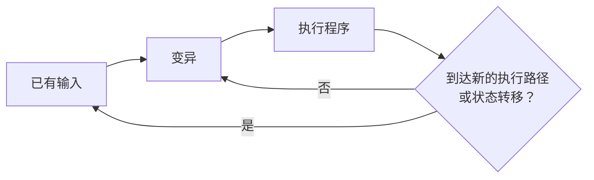

软件质量保障这件事，在生成式编程时代变得比以往任何时候都更关键：模型把「写出来」的成本压到了接近零，「验证它是对的」却一点没变便宜。这篇整理自南京大学《生成式软件工程》2026 秋第 11 讲「软件质量保障 (1)」（主讲：jyy），[原始讲义](https://jyywiki.cn/GSE/2026/lect11.md)。讲义给了一个值得单独拿出来讲的框架——错误的传播链，以及测试、断言、差分测试、模糊测试分别作用在链条的哪一环。文中所有代码都在本地实跑过，正文印的输出是真实结果。

## 一、生成得快，不等于生成得对

讲义开篇把全课主线拉回来：**意图（intent）→ 规格（spec）→ 实现（implementation）** 之间始终存在两道距离——我们可能没有准确表达自己要什么（intent-spec gap），也可能表达清楚了却没有正确实现（spec-impl gap）。生成式 AI 大幅降低了修改软件的成本，**却没有让这两道鸿沟自动消失**。

这带来的一个直接后果是：我们可能逐渐失去对软件的掌控。只知道它在几次演示中表现如何、不知道内部发生了什么，就可能一路走到某个离谱的错误面前才第一次发现。

讲义接着抛出一个反直觉的观察：**人类程序员也会一本正经地写出错误代码**。Shell 命令敲错、变量名看错、从上一段复制来的代码漏改一个字母——都是日常。讲义给的例子看起来十分眼熟：

```c
for (int i = 0; i < n; i++)
    for (int j = 0; j < n; i++) {   // ← 内层递增的是 i，不是 j
        // 对每一对 (i, j) 做点事情
    }
```

内层循环应该递增 `j`，却递增了 `i`。讲义给了一句值得反复读的心理学观察：**人的眼睛很容易把实际写出的代码，自动补全成自己以为写出的代码。** 模型同样不能仅凭「感觉」得到正确程序，尤其是一次写出几百行、还要照顾许多关联约束时。

这段代码的语义我用等价的 Python 复现了一遍（讲义的 C 版本我也用 clang 编译实跑过，行为一致）：

```python
def buggy_count(n, limit=100):
    """复现讲义里的错误循环：内层该递增 j，却递增了 i。"""
    count = 0
    i = 0
    while i < n:              # 外层循环
        j = 0
        while j < n:          # 内层循环：j 永远停在 0
            count += 1
            i += 1            # ← bug：本该是 j += 1
            if count > limit: # 真实运行不会退出，这里只是防止死循环
                return count
    return count

print("n = 0 时内层循环体执行次数：", buggy_count(0))
print("n = 3 时内层循环体执行次数：", buggy_count(3), "（真实运行会一直不退出）")
```

```text
n = 0 时内层循环体执行次数： 0
n = 3 时内层循环体执行次数： 101 （真实运行会一直不退出）
```

`n = 0` 那一行是这段代码最值得注意的地方：**缺陷明明白白写在源码里，一次都没被执行**。讲义把这一点留作后文伏笔——有缺陷，不等于这次运行一定会出问题。而 `n = 3` 时内层的 `j` 恒为 0，循环无法推进，`i` 一路涨下去直到有符号整数溢出，进入 C 的未定义行为。

讲义对生成能力的评价其实很慷慨：相比过去已经近乎神迹，我们甚至开始嫌模型跑得慢。但它随即划出本讲的核心区分——**「生成得快」和「生成得对」仍然是两件需要分别检验的事**。

## 二、错误的三层传播链：Fault、Error、Failure

讲义用三个概念把「错误」这件事拆开，为后面所有技术立了一个统一场论：

| 概念 | 定义 | 上面的例子 |
|------|------|-----------|
| **Fault** | 程序中存在的缺陷，也就是通常说的 bug | 把 `j++` 写成 `i++` |
| **Error** | 程序执行时进入了**违反规格的状态** | 循环变量没有按要求更新 |
| **Failure** | 在**选定的观察边界上**能看到的异常 | 程序卡住、崩溃或输出错误结果 |

**这三个不是同义词，它们构成一条传播链，每一环都可能断。**

有 fault，不代表这次运行一定出现 error（上面 `n = 0` 就是）。出现 error，也不代表用户立刻看得到 failure——讲义的购物车例子讲得很细：添加商品时程序错误地把缓存里的总价算成了两倍，这是 error 已经发生；但**如果结账前总价会从商品清单重新计算，最终账单可能仍是正确的；如果界面直接显示那个缓存值，错误就暴露给了用户**。

于是讲义提炼出一条观察论：**有没有 failure，既取决于后续执行，也取决于你观察什么。**

质量保障不能只等用户投诉。讲义把手段按它们作用在链条上的位置分成三类：

- 更好的架构、语言约束和防御性编程——**减少某些缺陷产生的机会**（压低 Fault 出现的概率）；
- 测试——**主动寻找能触发缺陷的输入**（推动 Fault → Error）；
- 断言——**把本来可能隐藏很久的错误状态，尽早变成可观察的测试失败**（帮助 Error → Failure）。

这两条箭头是全讲后面所有技术的总纲，差分测试、模糊测试、物理闭环测试都是在给它们装更强的引擎：


断言的具体形态讲义给了一个购物车的例子：**在更新购物车后检查「缓存总价等于各项金额之和」**，就不必等到错误账单出现才发现问题。这条链和本博客此前写的契约式设计是同一件事的两个层次——[UML 建模五问：哪些意图必须写下来](/blog/uml-design-questions-modeling-practice/) 讲的是把 require/ensure/invariant 写进模型，断言则是把它变成运行时可观察的失败。

## 三、「在我机器上能跑」到底说明了什么

讲义先承认测试的表面便宜：顺便运行几次呗。然后拆台——**但运行一个程序，需要的条件比命令行参数多得多**。

**第一层：你的环境不是别人的环境。** Windows、macOS 和 Linux 不同，硬件、编译器、解释器和依赖库的版本也不同。一份源码在开发者电脑上能跑、搬到另一台电脑启动失败，并不稀奇。这就是依赖锁文件存在的原因：以 npm 为例，[`package.json`](https://docs.npmjs.com/cli/v11/configuring-npm/package-lock-json/) 描述项目的依赖要求，`package-lock.json` 记录实际解析出的依赖树（包括直接和间接依赖的具体版本）。但讲义给的那句边界同样重要：**锁住依赖树不等于锁住整个运行环境**，操作系统和运行时版本仍需另行考虑。

**第二层：即使环境相同，你的运行也不是别人的运行。** 文件内容、系统负载、`gettimeofday()` 返回的时间、网络延迟与中断、两个线程谁先跑到哪里被切走——都可能改变执行结果。讲义用了并发里最经典的例子：两个线程同时执行「读取计数器、加一、写回」，如果都先读到 0，最后就可能只得到 1；**单线程测试重复运行一万次，也不会覆盖这种交错**。我把这个交错固定下来跑了一遍：

```python
import threading

state = {"counter": 0}
barrier = threading.Barrier(2)      # 让两个线程都先读到 0

def bump():
    v = state["counter"]            # 读
    barrier.wait()                  # 两个线程都读到 0 之后才继续
    v += 1
    state["counter"] = v            # 写回

ts = [threading.Thread(target=bump) for _ in range(2)]
for t in ts:
    t.start()
for t in ts:
    t.join()

print("两个线程各加一，最终 counter =", state["counter"], "（期望 2）")
```

```text
两个线程各加一，最终 counter = 1 （期望 2）
```

用 `Barrier` 把交错固定住之后，这个 bug 每次必现——**这是确定性复现，不是靠运气撞上**。讲义把这层收束成一句对测试空间的重要扩围：**时间、网络响应和线程调度也是程序的输入，测试要探索的空间远远不止函数参数的取值。**

那么「跑对了」的标准是什么？讲义给的是完整口径：**希望程序在规格约定的任何环境、任何输入下，都符合 specification**。这里既有功能性要求（结果符合设计、合法操作不崩溃），也有非功能性要求（性能与安全）——「登录能成功一次」和「高负载下仍能及时响应、用户无法越权访问」是不同的要求。

而**有限次测试通常不能证明这个「任何」**：测试发现一个反例，就足以说明程序有错；运行一万次没发现反例，却不能说明第一万零一次一定正确。这就是「测试能显示 bug 的存在，而不能显示 bug 的不存在」这句名言的含义。

但不要因此低估测试。讲义的辩护很精确：**程序是严格执行的过程，合适的输入能非常有效地排除错误实现**。它举的例子是：一个所谓的排序函数原样返回输入。遇到**已经排好序的数组**时它会蒙混过关；对 `n` 个不同元素的**均匀随机排列**，它碰巧正确的概率只有 `1/n!`。我把这个概率算了出来：

```python
import itertools
import math

def fake_sort(xs):
    return xs          # 假排序：原样返回

n = 5
perms = list(itertools.permutations(range(n)))
ok = sum(1 for p in perms if fake_sort(list(p)) == sorted(p))
print(f"n = {n}，均匀随机排列共 {len(perms)} 个")
print(f"假排序函数碰巧正确的排列数：{ok}")
print(f"实测概率 = {ok}/{len(perms)} = {ok / len(perms):.6f}")
print(f"1/n!    = 1/{math.factorial(n)} = {1 / math.factorial(n):.6f}")
```

```text
n = 5，均匀随机排列共 120 个
假排序函数碰巧正确的排列数：1
实测概率 = 1/120 = 0.008333
1/n!    = 1/120 = 0.008333
```

`n = 5` 时假排序函数只有 1/120 的概率蒙混过关。讲义对这个计算加了诚实的限定：**这个计算针对的是这种具体的错误实现，不能推广成「所有 bug 都很难通过随机测试」**——但它很好地解释了为什么**选择有区分力的输入**如此重要。

最后落到 Agent。讲义引用 [SWE-agent 的研究](https://arxiv.org/abs/2405.15793)：它把「写代码、运行、观察结果、再修改」这种交互能力落实为专门的 **Agent-Computer Interface（ACI）**，让模型能够浏览仓库、编辑文件、执行测试和其他程序（论文摘要给出的 pass@1 是 SWE-bench 12.5%、HumanEvalFix 87.7%）。结论句是：**质量改进依赖于这个反馈过程，而不只是一次生成的自信程度。** 这正是 Ralph Loop 的质量版本——循环的每一步都要有证据进入，而不是让模型「感觉写对了」。本博客此前写的 [Agent Native 开发：为智能体设计工作环境](/blog/agent-native-development-practices/) 讲的是同一件事的流程侧。

## 四、测什么，以及怎样知道测对了

分层回答的是「在哪看」，本节回答「看什么」。

**按观察范围分四层。** 讲义用贯穿全课语境的**选课系统**做例子：

| 层次 | 检查什么 | 选课系统里的例子 | 特征 |
|------|---------|----------------|------|
| **单元测试** | 一个函数或模块 | 给定已修课程和先修要求，判断是否给出正确结果 | 尽量小、快，容易把错误定位到局部 |
| **集成测试** | 模块连接起来以后是否协作正确 | 先修检查返回的字段，选课服务是否理解？数据库记录的课程编号与接口传来的编号是否一致？ | 两个模块单独正常，不代表接起来一定正常 |
| **系统测试** | 完整系统在目标环境中走完流程 | 登录、查询课程、选课、刷新页面，再确认结果仍然存在 | 真实的服务、存储、身份验证和界面共同参与 |
| **验收测试** | 这些行为满足用户需求和验收标准吗 | 课程已满时系统仍允许超额选课？选课结果没有对学生清楚呈现？ | 技术上「提交成功」，不代表业务上「选课成功」 |

集成测试那一段有一句对「接口」的深化：**接口不只是数据能传过去，还包括双方对数据含义、单位、错误情况的理解。** 验收测试则把检查接回需求侧——系统可能违背了用户真正关心的规则，而每一层技术测试都是绿的。讲义给的反模式警告也很直接：**把所有检查都塞进完整界面流程，通常既慢，又难以解释一次失败到底发生在哪里。**

**黑盒视角**从规格出发，两种基本手法：**等价类划分**（把预计由同一种规则处理的输入分成一组，每组挑代表——比如一个最多接受 100 个元素的接口，空数组、范围内的非空数组、超过上限的数组）加**边界值分析**（重点检查 0、1、99、100、101 这些容易出现差一错误的位置）。规则涉及多个条件时用**决策表**（选课时「是否有余量」和「是否满足先修要求」四种组合逐一写清接受还是拒绝）；行为依赖历史时用**状态转换**（未选 → 已选 → 退回未选，那么重复选课、重复退课、退课后重选各自该怎样处理）。

**但这里有一个先决条件，讲义说得毫不含糊：测试之前必须知道预期结果。** 超过上限时应该拒绝、截断，还是返回某种错误？这是规格问题。**若测试作者也不知道答案，运行程序只是观察现象，还没有完成验证。**

**白盒视角**关注三种覆盖：语句覆盖（执行过一行代码）、分支覆盖（一个条件的不同分支是否走过）、路径覆盖（多次判断组合出的执行路径）。讲义同时给出穷尽的不可能性：**循环和并发很快就会使路径数量大到无法穷尽。**

然后是本节最锋利的反例——**覆盖率高不等于正确**：

```python
def add(a, b):
    return a - b

# 只调用，不检查：计算语句被覆盖，错误完全没被发现
print("add(1, 2) =", add(1, 2))

# 有断言，但输入没有区分力：断言通过，错误依然在
assert add(1, 0) == 1
print("assert add(1, 0) == 1  ->  通过（断言在，错误也在）")

# 换个有区分力的输入：错误暴露
try:
    assert add(1, 2) == 3
except AssertionError:
    print("assert add(1, 2) == 3  ->  失败（同样的覆盖度，区别只在输入）")
```

```text
add(1, 2) = -1
assert add(1, 0) == 1  ->  通过（断言在，错误也在）
assert add(1, 2) == 3  ->  失败（同样的覆盖度，区别只在输入）
```

讲义把这件事拆成三个各管一件事的分工：**覆盖告诉我们代码有没有被执行，断言告诉我们被观察到的结果是否符合要求，输入的选择则决定错误有没有机会暴露。** 上面三行输出正好各演示一次：语句覆盖 100% 的错误实现，`add(1, 0) == 1` 的断言照样通过，只有换成有区分力的输入才暴露。

**用例的完整形态**是三个动作：准备环境和输入、执行操作、检查结果。缺了最后一步，就容易出现 Agent 跑一大堆命令、得到一大串日志，**却没有真正核对核心行为**的情况。

讲义以「测试工程师走进酒吧」的笑话收尾：零杯、负数杯、极大数量、各种奇怪点单都测了，普通顾客进门问厕所在哪里，酒吧却出问题了。讲义对笑话的解读很克制：**不是说边界值没有用，而是说测试者可能把全部精力放在「怎样点酒」上，却漏掉了用户实际会走的另一条流程。** 输入再刁钻，也不能代替对使用场景的理解。

## 五、让测试成为日常工程

前面讲的是单次测试怎么做，这一节讲测试怎样成为**工程**。四个组件：

**测试金字塔**是一种常见的组织方式：大量快速的单元测试、适量集成测试、少量端到端测试。规律是**越靠近局部，越容易控制条件、定位失败；越靠近完整系统，涉及的真实因素越多，代价也越高**。讲义特别防了一手误读：它强调的是**分工**，不是要求所有项目遵守一个固定比例。

**Stub / mock 替身**用来对付难以控制的依赖。测试下单逻辑时不必每次真的发起支付，可以让替身稳定返回「成功」「超时」或「余额不足」，检查相应处理。两者的分工：**stub 常用于提供预设响应；mock 还可以检查交互是否符合预期**，例如同一操作有没有被调用两次。讲义紧接着给出替身的责任边界——**替身正确模拟了什么、遗漏了什么，需要开发者负责；最终仍然要用真实依赖检查集成**。

**回归测试**是修 bug 时的必做项：把触发它的场景留下来。讲义给出的验收标准可以称为最有说服力的检查——**确认同一个用例在修复前失败、修复后通过**。反面判据同样锋利：**一个从来抓不住原始错误的「回归测试」，只是在增加测试数量。**

**持续集成（CI）**把这些检查变成每次修改后自动发生的事情。**反馈越早，越容易把失败与刚刚引入的改动联系起来。** 这是「重新发明 CI/CD」的内容侧：红灯要能亮，先得有值得亮的东西。本博客此前写的 [Agent Native 开发](/blog/agent-native-development-practices/) 详细写过 CI 门禁与「验证器修改权不能交给被验证的一方」这条边界。

讲义最后提醒**测试本身也需要维护**，三条标准：用例尽量独立、环境和数据可重复、失败信息能帮助定位。以及一条信心衰减定律：**如果每次失败都要先猜「是不是测试自己又抽风了」，测试提供的信心就会不断被削弱。**

## 六、架构决定了质量

讲义在这一节从教科书走进生成式编程的现场，案例是向 Agent 许愿做一个 CS:GO 风格的游戏——典型的 **long-horizon task**：生成代码、启动程序、操作界面、截图检查、再根据观察继续修改。

然后是执行轨迹里的异常：**Agent 并没有偷懒，它反复截图验证，直到请求出现 413，也就是请求体过大。**

讲义把追问的方向掰正：**这里值得追问的不是「有没有做测试」，而是这些测试到底观察到了什么。**

截图这种观察手段的能与不能，讲义列得很具体：截图能判断场景有没有显示、角色是否出现在预期位置；却很难验证射击规则、弹药消耗、碰撞判定、计时和胜负条件。**而且反复从整个游戏界面出发，意味着每次检查都要同时依赖渲染、输入处理和游戏逻辑——三层耦合在一起，任何一层出错都会污染观察。** 系统越大，越难通过全系统整合测试覆盖它的行为。

于是有了本讲、也可能是全讲最重的一个断言：**架构决定了质量。这句话的分量在于——架构决定哪些错误容易发生，也决定发生以后能不能被便宜而准确地检查出来。所有模块都应该尽量具备明确的接口，能够脱离系统其他部分单独测试。**

架构的可测试化改造讲义用游戏本身示范了三步：

**（1）游戏逻辑写成状态转换。** 输入旧状态和一个动作，输出新状态。收益立竿见影：**测试「开枪后少一发子弹」，就不需要启动渲染器、移动鼠标再观察画面。** 弹匣为空能不能继续射击、目标生命值为零以后能不能再次受伤，也可以直接检查状态。

**（2）纯函数。** 结果只由显式输入决定，不偷偷依赖或修改外部状态；同样输入得到同样输出，使局部推理和复现都容易得多。讲义澄清了一个常见误解：**它不要求游戏没有状态，而是把状态作为数据明确传入、返回，让状态变化有可检查的边界。**

**（3）时间和随机性同样处理。** 冷却时间不必真的等几秒，而是把时钟作为依赖传入、由测试推进时间；随机战斗控制随机数来源，使某一段战斗能够重放；支付重试围绕操作标识设计去重规则，让重复请求不会轻易变成重复扣款。

本节的收束句把「架构」从图纸拉回故障现场：**架构在这里不是画几张模块图，而是为真实的故障条件提供可控制、可观察的接口。** 这也是第 6 讲「让结论可解释」那条线索在质量领域的对应物——[事件溯源、CQRS 与需求变化的位置](/blog/event-sourcing-and-explainable-conclusions/) 讲的是让每个结论都能回答「我是怎样算出来的」，这里讲的是让每个错误都能回答「它是在哪一步、哪个状态上冒出来的」。

## 七、差分测试与模糊测试：把难以观察变成可检查的证据

讲义先承认教科书与现场之间的距离：面对真实系统时，背完测试分类还不足以知道下一步该做什么。「所有测试理论都失效了，你需要的是灵光一闪」，说的就是这种距离——**我们还得找到一个适合当前系统的实验方式，把难以观察的行为变成可检查的证据。** 接下来三个案例就是三种已经验证过的实验方式。

**差分测试（Differential Testing）**的想法很直接：让两份实现从对应的初始状态出发，处理相同输入，再比较结果。背景是 jyy 自己课程里的老朋友 NEMU——一个用于教学的处理器模拟器。困境很具体：**把程序跑在自己实现的模拟器上，运行了很久才发现游戏画面不对，应该从哪里开始找？最终画面距离某条指令的实现错误，可能已经隔了大量执行步骤。**

差分测试改写的正是这个问题：

| 原来 | 现在 |
|------|------|
| 「为什么游戏跑飞了」 | 「为什么执行这一条指令之后，两边的状态不同」 |

**为什么两个实现可以互相当裁判？** 因为**两份独立实现的 bug 偏好可能不同**：一方把操作数写反，另一方漏处理符号扩展，错误未必发生在同一个地方。因此不必先由人手工写出整个复杂程序每一步的正确答案，就有机会发现异常——它绕开的正是测试理论里最难的 oracle 问题。

但讲义立刻给了双重限定，诚实得值得全文照录：**两边也可能误解手册中的同一句话；结果一致是有用证据，却不是绝对正确的证明。出现分歧以后，还要分析哪一方违反了规格。**

这套思路已经进入真实处理器的验证。[香山的 DiffTest 框架](https://docs.xiangshan.cc/zh-cn/latest/tools/difftest/) 让待测设计与 NEMU、Spike 等参考模型协同仿真，官方文档写得很清楚：**在每条指令执行后比对二者验证状态，覆盖 32 种检查状态**（指令提交、TLB 检查、缓存一致性、向量化、虚拟化等）。课堂举出的经历是一个很有分量的数字：**运行了 4 亿个时钟周期之后，发现香山的 `mstatus` CSR 状态不一致**（CSR 是控制与状态寄存器，`mstatus` 保存处理器的一些关键运行状态）。同一份官方文档还记录了另一组数字：DiffTest 的 FPGA/Emulator 加速工作已开源并用于香山处理器开发验证，**发现 151 处复杂 Bug**。

差分测试的关键贡献，是提供一种**检查结果的机制**：我们不必等到最终应用表现异常再从海量历史里倒查，而是可以沿执行过程持续追问——两边是否仍然一致？对照第二节的 Fault/Error/Failure 框架，差分测试做的是**把观察边界从「最终画面」推进到「每一条指令之后」**：failure 被人为地、密集地制造出来，错误就无处可藏。

**模糊测试（Fuzz Testing）**解决另一半问题：有了检查机制，还要让程序经历足够多、足够有价值的情况。讲义的形容很形象：**把软件按在地上「摩擦」——不断生成、变异输入，试着把隐藏的错误逼出来。** 它本质上是一个**搜索问题**：所有文件内容、参数组合和操作序列构成巨大的输入空间，我们只能搜索其中很小一部分；如果每次都完全盲目地随机生成，许多输入可能刚到格式检查就被拒绝，根本进不到复杂逻辑。

[AFL](https://github.com/google/AFL) 提供的是一种**带覆盖反馈的搜索思路**，机制是一个闭环：



AFL 的 README 把这个机制说得更精确：它是一个「brute-force fuzzer coupled with an exceedingly simple but rock-solid **instrumentation-guided genetic algorithm**」，用改进过的**边覆盖（edge coverage）**来捕捉程序控制流的细微变化；算法的一步是——**如果某个变异产生了插桩记录到的新状态转移，就把变异后的输出作为新条目加入队列**。讲义把它类比为遗传算法、说「执行反馈提供选择压力」，与官方描述是同一件事。讲义给的具体例子很实用：**对一种文件格式的解析器，保留正确文件头、逐渐扰动长度字段和数据区，可能比每次生成一堆完全随机的字节更容易触及深层解析逻辑。**

要点句：**这里的重点不是随机数越多越好，而是反馈能否引导我们探索尚未见过的行为。**

然后讲义做了一个必须做的切割——**搜索反馈和正确性检查仍然是两件事**：

| 信号 | 说明什么 | 不说明什么 |
|------|---------|-----------|
| 执行到新代码 | 这个输入**值得继续探索** | **并不说明它已经找到 bug** |
| 崩溃、超时、断言失败，或与另一实现产生分歧 | **提供了进一步检查错误的线索** | —— |

于是两种技术自然组合：**模糊测试负责找输入，差分测试负责比较结果。** 而无论哪种方式发现了失败，讲义都要求同一个动作：**留下能重现问题的输入**，才能把偶然撞见的异常变成可以调试、可以回归的工程资产——这与第五节的回归测试首尾呼应。

**第三个案例把测试拉出屏幕。** 课堂最后的例子是做一个能由软件控制的小装置，让 SD 卡插入、拔出，再把它接进闭环测试。这个装置的价值不在于机械动作复杂，讲义点出的是它的本质：**它把原本依赖人的操作变成了程序能够重复安排的输入。** 软件发出操作 → 装置执行插拔 → 测试观察系统反应 → 再进行下一轮。收益是：**反复插拔时才有机会出现的问题，终于可以持续追踪，而不必靠一个人坐在那里碰运气。**

沿着这个思路，测试者可以进一步安排操作序列——「正在访问卡时拔出」「拔出后再次插入」——并记录出现异常时的条件。但讲义照例给出限定：**买了设备不等于有了质量，仍然需要知道观察什么、怎样判断异常、怎样复现它。**

讲义最后把物理机器人接回生成式时代：今天可以把类似愿望交给 Agent，让它帮忙编写测试程序、记录日志、控制设备或生成输入。然后是那个成本转移的判断：**代码生成成本下降以后，更值得投入精力的是那个实验设计——怎样让难以触发的条件可控制，让内部错误可观察，让一次偶发现象可以再次发生。**

## 八、它不解决什么

- **一致不等于正确。** 差分测试的天花板就是两份实现共享的那份理解。如果两边都误解了手册里的同一句话，差分测试只能发现「不同」，不能裁决「谁对」。**一致性证据的上限，取决于 spec 本身有多清楚**——intent-spec gap 没解决之前，检验工具再精巧，也只是在 spec 的阴影里工作。
- **覆盖率不是质量的代理指标。** 语句覆盖 100% 的 `add` 函数可以是错的；`1/n!` 那个计算也只针对一种具体的错误实现，不能推广成「所有 bug 都都难被随机测试发现」。
- **模糊测试找输入，不做判定。** 执行到新代码只说明「值得探索」，崩溃、超时、断言失败才说明「这里错了」。**搜索永远替代不了判定。**
- **替身会泄漏。** stub/mock 模拟了什么、遗漏了什么，由开发者负责。替身正确不等于集成正确，最终仍然要用真实依赖检查集成。
- **物理装置不会自动发现错误。** 它提供的是可重复安排的输入条件，判断标准仍要人来定。
- **本讲只覆盖质量保障的一半。** 讲义标题里的「(1)」说明质量保障是一整个板块；本篇讲的是错误模型、测试分层、输入设计与三种实验方式，形式化验证（从运行程序到证明程序）是另一讲的主题。

## FAQ（六、常见问题）

**Q：覆盖率要到多少才够？**

A：覆盖率不是质量的代理指标。它只回答「代码有没有被执行过」，不回答「结果对不对」——上面那个 `add` 的例子语句覆盖 100% 却是错的。更根本的是，讲义第一节已经说明：**有 fault 不代表一定触发 error**（`n = 0` 时错误代码根本没跑），所以「没覆盖到」也不等于「没 bug」。覆盖率应当当作**发现未测代码的工具**，而不是验收指标。

**Q：差分测试能不能取代写规格？**

A：不能。差分测试外包的是 **oracle**（预期结果从哪来），不是 **spec**（要求是什么）。它把「人肉写出每一步正确答案」这个负担转移成「两份实现互相比较」，但两份实现共享的规格理解依然是上限。分歧出现之后，仍然要回头分析**哪一方违反了规格**。

**Q：模糊测试是不是随机生成就行？**

A：不是。AFL 是 instrumentation-guided genetic algorithm，靠**边覆盖反馈**把变异引向没走过的路径。讲义讲得很清楚：**重点不是随机数越多越好，而是反馈能否引导我们探索尚未见过的行为。** 没有反馈的随机搜索会把预算全烧在浅层（很多输入刚到格式检查就被拒）。

**Q：单元测试该写到什么粒度？**

A：讲义给的三条判断标准可以叠加用：用例要包含**准备输入、执行操作、检查结果**三个动作（缺第三步就只是观察现象，不是验证）；测试金字塔是**分工**不是固定比例；回归测试的验收标准是**同一个用例修复前失败、修复后通过**。

**Q：生成式 AI 写的代码，测试策略要不要变？**

A：要变的是「谁来写测试」和「验证成本没有跟着生成成本一起下降」这件事本身。ACI 让「写代码 → 运行 → 观察 → 再修改」的反馈过程可以被模型自己驱动，但错误传播链和上面那些判据一条都没变。**变化的是执行者，不是标准。**

## 延伸阅读

- [《生成式软件工程》2026 秋第 11 讲：软件质量保障 (1)](https://jyywiki.cn/GSE/2026/lect11.md) —— 本文整理自这一讲（主讲：jyy）
- [SWE-agent: Agent-Computer Interfaces Enable Automated Software Engineering](https://arxiv.org/abs/2405.15793) —— ACI 的原始论文
- [香山 DiffTest 协同仿真框架文档](https://docs.xiangshan.cc/zh-cn/latest/tools/difftest/) —— 每条指令后比对参考模型状态，覆盖 32 种检查状态
- [google/AFL](https://github.com/google/AFL) —— instrumentation-guided genetic algorithm 与边覆盖反馈
- [npm 的 package-lock.json 文档](https://docs.npmjs.com/cli/v11/configuring-npm/package-lock-json/) —— 依赖树锁定与其边界
- 相关：[从测试到证明：形式化验证能证明什么，不能证明什么](/blog/formal-verification-testing-to-proof/) —— 第 12 讲：测试揭示 bug 的存在，不能证明它不存在；以及「证了个寂寞」为什么是形式化世界的 reward hacking
