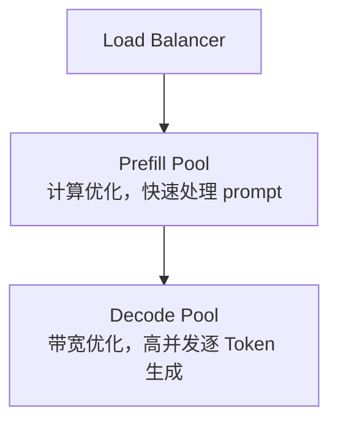

# 从 FLOPS 到美元：LLM 推理成本的数学推导

这是 Token 经济学的进阶篇——不讲生活类比，只讲能算的数字。如果你还没建立基本直觉，先看 [算力与 Token 经济学：用生活类比讲透 AI 的真实成本](/blog/token-economics-explained/)。本篇只处理那篇没展开的部分：单层 FLOP 公式怎么推出来、算术强度怎么划出计算受限与内存受限的分界线、CPM 与 Spot 的真实报价，以及架构级优化 Prefill-Decode 分离。

## 一、从线性代数拆 Self-Attention 的 FLOP 成本

语言先被变成矩阵：n 行（每行一个 token），d 列（特征维度）。以 Llama 3.2 1B 为例，d = 2048，这个数在后续几乎所有成本公式里都会被平方。

每个 token 通过三个投影矩阵获得三个角色——Query（我在找什么）、Key（我能提供什么）、Value（被选中后传递的内容）：

```text
Q = XW_Q,  K = XW_K,  V = XW_V
```

矩阵乘法规则是 (a × b) × (b × c) = 2abc FLOPs（每对元素一乘一加）。逐操作拆开：

| 操作 | FLOP 成本 | 1B 模型 @ 4K context |
|------|----------|---------------------|
| Q/K/V 三个投影 | 6nd² | ~103 GFLOPs |
| 分数矩阵 QKᵀ | 2n²d | ~68 GFLOPs |
| Value 聚合 | 2n²d | ~68 GFLOPs |
| 输出投影 | 2nd² | ~34 GFLOPs |
| **Attention 合计** | **8nd² + 4n²d** | ~273 GFLOPs |
| MLP（SwiGLU） | 16nd² | ~274 GFLOPs |
| **单层总计** | **24nd² + 4n²d** | ~547 GFLOPs |

所以单层成本是 **24nd² + 4n²d**：24nd² 是线性项（任何模型都绕不开），4n²d 是二次项。

### 二次项的统治力

二次项在总成本中的占比随上下文急剧攀升：

| 上下文长度 | 二次项占比 |
|-----------|----------|
| 1K | ~8% |
| 4K | ~25% |
| 32K | ~73% |
| 128K | ~92% |

短上下文便宜，是因为线性项主导、随 n 温和增长；长上下文贵，是因为二次项完全接管。这也解释了为什么 RAG 不会因为上下文窗口变长而过时——把大量大多不相关的 token 塞进上下文，在这个速率下要付真金白银。

**交叉点在 n = 2d。** 对 d = 2048，n = 4096——这正是 4K 成为多年标准上下文长度的原因。

### FlashAttention 没有改变数学

FlashAttention 把注意力计算分块放进高速片上 SRAM，避免在慢速 HBM 中物化完整的 n×n 矩阵。这是内存访问模式的真正工程优化，**但数学运算次数完全不变，计算仍然是二次的**。它更好地利用了硬件，没有改变底层数学。

### GQA 是纯粹的经济决策

Grouped Query Attention 让多个 query head 共享较少的 KV head。Llama 3.2 有 32 个 query head 却只共享 8 个 KV head——KV Cache 直接砍掉 4 倍，质量损失极小。几乎所有生产模型都用 GQA 的某种变体，因为**内存节省直接转化为更低的 per-token 成本**。

## 二、2N 与 6N：推理和训练差在哪

对典型稠密 Decoder-only Transformer，**每 token FLOPs ≈ 2N**（N = 参数量）：7B 约 14 GFLOPs/token，70B 约 140，405B 约 810。

| 阶段 | 每 Token FLOPs | 构成 |
|------|---------------|------|
| **推理** | ~2N | 仅前向传播 |
| **训练** | ~6N | 前向 2N + 反向传播与梯度 4N |

产业视角的差异比数字更重要：训练是阶段性集中投入（大规模工程建设），推理是长期、持续、高频发生的运营成本（长期运营系统）。**训练能力决定模型能不能被造出来，推理能力决定模型能不能以可承受成本服务真实用户。**

## 三、算术强度：划出两台机器的分界线

算术强度 = 每字节内存搬运对应的 FLOP 工作量。这是理解 Prefill 与 Decode 差异的关键。

**Prefill（处理 prompt）**：所有 token 已知，可以打包成一个大矩阵乘法。QKV 投影的算术强度 = 2n / B_p（B_p 为每参数字节数，FP16 是 2）。n = 4096 时算术强度为 **4096**——每搬运 1 字节做 4096 FLOPs 有用工作，GPU 计算核心饱和，属于**计算受限**。

**Decode（逐 token 生成）**：每步依赖上一步，无法跨 token 打包，做的是矩阵乘向量而不是矩阵乘矩阵。算术强度骤降到 2 / B_p = **1 FLOP/byte**（FP16），INT4 也只有 4。计算核心几乎一直空闲在等数据，属于**内存受限**。

### Roofline 的量化判断

每个处理器有两个独立性能上限：峰值算力（FLOPs/s）与内存带宽（bytes/s）。H100 是 989 TFLOPs @ FP16 / 3350 GB/s，比值约 **295 FLOPs/byte**——这就是分界线：

| 操作 | 算术强度 | 与 295 比较 | 状态 |
|------|---------|------------|------|
| Prefill @ 4K | 4096 | 远高于 | 计算受限 |
| Decode @ FP16 | 1 | 远低于 | 内存受限 |
| Decode @ INT4 | 4 | 远低于 | 内存受限 |

H100 在 decode 阶段（也就是用户正盯着屏幕等文字出现的阶段）以约 1% 的理论峰值运行。在这个体制下翻倍芯片算力毫无意义——瓶颈从来不是算术，而是数据搬运。

两个体验指标因此对应两个完全不同的优化方向：

| 体验指标 | 主导阶段 | 瓶颈 | 优化方向 |
|---------|---------|------|---------|
| 首 Token 延迟（TTFT） | Prefill | 算力 | 更多算力 / 更精简架构 |
| 持续生成速度（tok/s） | Decode | 内存带宽 | 更多带宽 / 更小模型 / 更小 KV Cache |

所有推理芯片创业公司攻击的都是这个比率：Groq 用大容量片上 SRAM 提供远超 HBM 的带宽，Cerebras 用晶圆级芯片加分布式内存，Etched 做 Transformer 专用 ASIC。它们都在把算力/带宽平衡点往下推，让 decode 更接近计算受限——代价是放弃训练所需的原始 FLOPS。**NVIDIA 继续卖训练，推理芯片创业公司赌的是 decode 瓶颈大到足以支撑独立硬件生态。**

## 四、KV Cache 的精确账

```text
KV_cache = 2 × L_attn × g × d_k × n × B_p
```

除 n 以外所有项在部署后固定，所以每 token 的增长是一个固定税：**2 × L_attn × g × d_k × B_p 字节/step**。

以 1B 模型（16 层、8 个 KV head、d_k=64、INT8）为例：4K 上下文约 67 MB，32K 约 512 MB，128K 约 2 GB。**在 128K 时 KV Cache 已经超过模型自身 INT4 权重的 3 倍——持有上下文的东西变得比做推理的东西还大。**

并发上限因此是硬约束。H100 80GB 部署 7B INT4 模型：

| 上下文长度 | 每会话 KV Cache | 并发用户数 |
|-----------|---------------|----------|
| 4K | 268 MB | ~278 |
| 32K | 2.1 GB | ~34 |
| 128K | 8.4 GB | ~8 |

上下文翻倍，用户减半，没有架构技巧能打破这个关系（除非减少注意力层）。这就是为什么长上下文功能贵——**贵在失去的并发，不是失去的速度**，prefill 的算力完全跟得上。

也正因如此，GQA、Multi-Query Attention、Sliding Window、Hybrid Attention/State-Space 这些设计全都瞄准同一个数字：每 token KV Cache 字节数。判断一个架构创新是否真的改变经济学，只需看它有没有动这两个数之一——**每 token KV Cache 字节，或每 decode 步加载权重字节**。

## 五、CPM：每百万 token 的真实报价

把 FLOPs 换成钱，以 14B 级模型（INT4、32K context、GQA 8 KV heads）为例：权重约 7 GB + KV Cache 约 2.1 GB = 每 decode 步搬运约 9.1 GB；H100 的 3350 GB/s 对应约 2.7 ms/token，理论约 370 tok/s，实际（40–60% 利用率）150–220 tok/s。

| 利用率 | 每百万 token 成本 |
|--------|-----------------|
| 100% | ~$0.004 |
| 30% | ~$0.013 |
| 10% | ~$0.038 |

**利用率是推理经济学里最大的杠杆，超过几乎所有架构决策。** 同一硬件同一模型，10 倍成本差异纯粹来自利用率。

Llama 3.1 70B 按不同 GPU 算 CPM（按需计费）：

| GPU | $/hr | 吞吐（tok/s） | CPM |
|-----|------|-------------|-----|
| A100 SXM4 80GB | $1.64 | ~500 | ~$0.91 |
| H100 SXM5 80GB | $2.90 | ~2,000 | ~$0.40 |
| H200 SXM5 141GB | $4.50 | ~2,900 | ~$0.43 |
| B200 SXM6 192GB | $7.43 | ~5,000 | ~$0.41 |

竞价实例（Spot）把这张表彻底改写：H100 Spot CPM 约 **$0.11**（省 73%），B200 约 **$0.10**（省 76%）。**用别人的闲置算力，成本只有按需的 1/5。**

计费模型怎么选：

| 工作负载 | 推荐计费 |
|---------|---------|
| 开发/基准测试 | 按需 |
| 稳定推理（>70% 利用率） | 预留 |
| 突发/可变流量 | 按需 |
| 批量推理、延迟不敏感 | Spot |

## 六、Prefill-Decode 分离：架构级优化

既然 Prefill 受算力限制、Decode 受带宽限制，把它们放在同一批 GPU 上就是互相迁就。分离部署是自然的解法：



在长上下文场景下，这个架构可提升吞吐 **60–75%**。

## 七、结论：只有两个数字值得关心

把全篇压成一句可执行的判断标准：

> **一个架构如果不改变「每 token KV Cache 字节数」或「每 decode 步加载权重字节数」，无论论文怎么声称，底层经济学没变。**

其余结论按重要性排列：

1. **单层公式 24nd² + 4n²d 是一切成本的源头**：24nd² 绕不开，4n²d 是真正的优化目标——SSM、线性注意力、混合架构都在攻击这个二次项。
2. **交叉点 n = 2d 解释了 4K 的统治地位**：它不是审美选择，是成本曲线拐点。
3. **Prefill 和 Decode 是两台不同的机器穿着同一套权重**：算术强度 4096 vs 1。
4. **$30,000 的 GPU 在 decode 时以约 1% 利用率运行**，因为瓶颈是带宽。
5. **利用率是最大杠杆**，Spot 是它的极端形态。
6. **FlashAttention 优化的是搬运，不是算术**——判断任何 kernel 优化的价值，先看它动的是算力还是带宽。

---

**参考来源**

- [知乎：大模型推理的芯片算力账——一个 token 需要多少 FLOPs？](https://zhuanlan.zhihu.com/p/2071524008995054100)
- [Spheron: Token Factory on GPU Cloud — Tokens per Watt Guide](https://www.spheron.network/blog/token-factory-gpu-cloud-tokens-per-watt-guide/)
- [Medium: The Real Cost of Running AI — From FLOPs to GPUs to the KV Cache](https://machine-learning-made-simple.medium.com/the-real-cost-of-running-ai-from-flops-to-gpus-to-the-kv-cache-8db8a57e3069)
