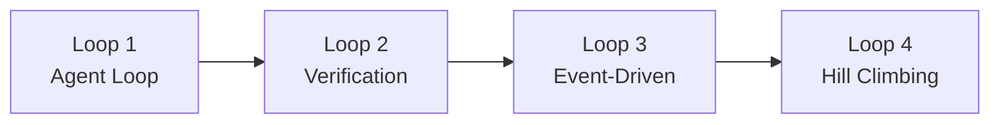

# Loop Engineering：Agent 循环工程化

用过 Claude Code、Cursor、Codex 的人都经历过同一个落差：演示时惊艳，自动化时崩溃。让它每天早上自动 review PR，它跑了一次再没动静；让它每天生成更新日志，它把所有 commit 搅成一锅；让它并行修三个 bug，三个 worktree 的改动互相覆盖。

问题往往不在模型不够强，而在于**你还在用手工 prompt 的方式操作 Agent**。

Anthropic 工程师 Boris Cherny 和 SaaS 专家 Peter Steinberger 的说法几乎一致：

> "我不再手动 Prompt Claude 了。我设计了循环系统，让系统自动生成 Prompt，告诉 Claude 做什么。" — Boris Cherny
>
> "你不应该再去 Prompt 编码 Agent 了。你应该去设计那些替你对 Agent 发指令的循环系统。" — Peter Steinberger

Loop Engineering 的核心就是这句话的反面：**不把人变成 Agent 的操作员，而是把人的判断封装成可重复运行的循环系统。** Addy Osmani 的表述更直接——"Loop Engineering replaces you as the agent prompter. You design the system that prompts instead."

## 一、四大循环类型：从单步执行到自我进化

LangChain 把 Agent 循环按复杂度分成四层，越往后价值越大。



**Loop 1：Agent Loop。** 模型反复调用工具直到任务完成：模型 → 工具调用 → 观察结果 → 判断是否完成。这是所有 Agent 系统的基础结构，局限也很明显——没有质量校验，模型说什么就是什么。

**Loop 2：Verification Loop。** 执行完成后由独立的评分器（grader）对照评分标准（rubric）检查，不合格就打回重试并附上反馈。LangChain 推荐的触发点是 `after_agent` 钩子。代价是延迟和 token 成本上升，换来质量可控——质量比速度重要时用这一层。Addy Osmani 对此的表述更狠：**"Retries should not be relied upon as a reliability mechanism"**，重试不是可靠性机制（Agent 输出非确定性），真正可靠的机制是独立验证器。

**Loop 3：Event-Driven Loop。** Agent 不再由人触发，而是被定时任务、Webhook 或系统消息激活，结果直接写回真实系统：CI 失败日志触发诊断、`#docs-plz` 频道消息触发文档生成、PR 合并触发 Changelog。这一层的 Agent 是持续运行的系统组件，输出会进入下游（工单、PR 评论、Slack），因此必须留人工审批节点。

**Loop 4：Hill Climbing Loop。** 最前瞻的一层——**用生产 trace 自动改进 Agent 系统配置**：收集完整执行路径 → 分析出配置问题（某工具超时率高、某 prompt 在特定场景效果差）→ 修改配置 → 重新部署。未来方向是与 RL 结合，用 trace 和评估结果作训练信号。LangChain 的战略建议是：**重点应该转向 Loop 3 和 Loop 4**，因为价值在那里才复利。

## 二、补充框架：Goal Engineering

cobusgreyling 提出的 Goal Engineering 位于 Loop / Context / Harness Engineering 之上，核心是设计「让任务持续运行直到可验证完成」的系统。xAI 在 Grok Build 里引入的 `/goal` 命令就是这个思路的落地。

四原语：

| 原语 | 要求 |
|------|------|
| **Objective** | 单句描述 + 可验证的完成条件 |
| **Verifier** | 测试、技能或评审子 Agent，独立于实现者 |
| **State** | `GOAL.md` 在上下文压缩后仍能跨会话保持进度 |
| **Budget** | 轮次上限、Token 指引、熔断开关 |

配套命令是 `/goal status`、`/goal pause`、`/goal resume`、`/goal clear`，`update_goal` 工具让 Agent 自行记录里程碑。

两者的分工可以概括成一句：**Loop 负责发现工作，Goal 负责完成工作。** 决策树是——这个工作能定义「完成」吗？不能就先规划；能的话，是周期性调度任务吗？是就走 Loop Engineering，否就走 Goal Engineering。生产中的典型组合：每日 Triage Loop 发现 CI 失败并分诊，可修复的条目交给 `/goal` 执行到完成。

## 三、六大基础设施组件

无论用 Claude Code、Codex 还是 Cursor，构建循环系统都绕不开这六块。

| 组件 | 作用 | 关键点 |
|------|------|--------|
| **Automations** | 循环的心跳：定时发现和分拣任务 | `/goal` 的停止条件必须可验证，且由**另一个模型**判定完成 |
| **Worktrees** | 并行安全：`git worktree add fix-bug-1 feature/auth` | Claude Code 用 `--worktree` / `isolation: worktree`，Codex 内置 per-thread worktree |
| **Skills** | 记忆：`SKILL.md` 写明某类任务怎么做 | "Tight, boring descriptions work better than clever ones" |
| **Plugins / MCP** | 工具连接：读写 issue、查库、调 API | MCP 协议跨工具兼容，但需要沙箱运行不受信代码 |
| **Sub-agents** | 分工：Planner / Writer / Reviewer 分离 | "The model that wrote the code is too nice grading its own homework" |
| **Memory / State** | 持久化：状态必须在对话之外 | "The agent forgets, the repo doesn't" |

State 文件是最容易被忽视、也最致命的一环。推荐结构：

```markdown
# STATE.md
## Last Run: 2026-07-08
## CI Sweeper
- [x] Fix: memory leak in cache.py
- [ ] In Progress: timeout in auth.py
- [ ] Pending: flaky test in test_integration.py
## Daily Triage
- Processed: 3 issues
- Filed: 1 bug report
```

## 四、七个生产级循环模式

开源项目 [cobusgreyling/loop-engineering](https://github.com/cobusgreyling/loop-engineering) 提供了七个可直接部署的模式和配套 CLI：

| 模式 | 触发频率 | 复杂度 | 典型成本 |
|------|---------|--------|---------|
| Daily Triage（每日分诊） | 1 天–2 小时 | L1（纯报告） | 低 |
| PR Babysitter（PR 保姆） | 5–15 分钟 | 高 | 高 |
| CI Sweeper（CI 清洁工） | 5–15 分钟 | 很高 | 很高 |
| Dependency Sweeper（依赖扫描） | 6 小时–1 天 | 中 | 中 |
| Changelog Drafter（日志生成） | 1 天或 tag 触发 | 低 | 低 |
| Post-Merge Cleanup（合并后清理） | 1 天–6 小时 | 低 | 低 |
| Issue Triage（工单分诊） | 2 小时–1 天 | 低 | 低 |

```bash
npx @cobusgreyling/loop-init . --pattern daily-triage --tool claude
npx @cobusgreyling/loop-cost --pattern daily-triage --level L1
npx @cobusgreyling/loop-audit . --suggest
```

配套六个 CLI：`loop-init`（脚手架）、`loop-audit`（就绪度评分）、`loop-cost`（token 估算）、`loop-sync`（STATE 与 LOOP 漂移检测）、`loop-context`（带熔断器的状态记忆）、`loop-worktree`（每次修复尝试独立 worktree）。

## 五、三个最危险的坑

这三个坑的共同点是：**循环跑得越顺畅，它们越严重。**

**坑 1：验证全靠循环自己。** "Verification is still on you. A loop running unattended makes mistakes unattended." 无人值守的错误会被规模化——一次错误变成一百次错误。解法是始终保留 Loop 2 和 Loop 3 的人工审批节点。

**坑 2：理解债务。** "Comprehension debt grows." 用 Agent 高频产出代码时，代码库膨胀速度远超你的理解速度。本地手写时代代码量和理解是同步增长的，循环系统打破了这个平衡。解法是每个 Skill 维护一份「设计意图」文档。

**坑 3：认知投降。** "Cognitive surrender is dangerous. When the loop runs itself, it's tempting to stop having an opinion." 最微妙的一个——**"Designing the loop is the cure when you do it with judgement and the accelerant when you do it to avoid thinking."** 设计循环是解药，但前提是带着判断力去做。

## 六、可观测性：LLM 监控远远不够

传统监控（token 消耗、响应延迟）对 Agent 系统不够用，因为故障模式更隐蔽：Agent 返回 HTTP 200 但做了错事；工具调用超时后不降级，硬返回一个看起来合理但完全错误的答案；上下文在第 47 步被污染，只有看到完整 trace 才能发现。

必须监控三个维度：

1. **Run-level**：每次运行的输入、完整 trace、输出，以及这次运行是「成功」还是「看起来成功」。
2. **Agent 行为**：路由决策、工具选择频率、循环次数、上下文窗口使用率。
3. **生产链路**：多 Agent 系统里 trace 必须跨 planner、specialist、tool spans——一次用户请求对应一条完整 trace，而不是散落在多个孤立日志。

标准是 OpenTelemetry，trace 和 metrics 需包含 GenAI 字段：模型名与提供商、操作类型（embedding/generation/tool_call）、token 计数、工具调用成功率与延迟。

## 七、安全红线与真实教训

### 路径黑名单（绝对禁止自动修改）

```text
.env, .env.*, **/secrets/**, **/credentials/**,
**/*_key*, **/*_secret*, .terraform/**, k8s/production/**,
**/migrations/**, auth/**, payments/**, billing/**
```

### 自动合并白名单（默认不允许）

| 允许自动合并 | 禁止自动合并 |
|------------|------------|
| 注释/doc 中的 typo | 行为变更 |
| test 文件的 lint 自动修复 | 依赖版本升级 |
| import 顺序调整 | lockfile 变更 |

连接器权限同样要最小化：GitHub 只读 issues/PRs/checks，写 comment/label（禁 merge）；Slack 只发往 `#loop-escalations`；数据库禁止生产写。**必须人工审批的触发点**：安全/认证/授权、支付账单 PII、基础设施生产环境、依赖升级、改动超过 10 个文件、同一条目连续失败 3 次。

### 五个真实教训

- **CI Sweeper 差点搞挂生产**：深夜自动「修复」了一个涉及数据库迁移的测试失败——它删掉了一个看起来冗余、实际是迁移后数据校验的测试。教训：必须有 Token 预算上限、分支白名单、panic button，且**验证器必须匹配 CI 实际运行环境**。
- **PR Babysitter 的三件套**：State 记录每个 PR 的处理历史 + 单次修复尝试上限（超过 3 次升级人工）+ 独立验证器跑完整测试套件，让自动化 PR 质量从 40% 提升到 85%。
- **Daily Triage 不能跳级**：直接从 L2（自动修复）开始、跳过 L1（分诊报告），结果 Agent 忙着修低优先级 CI 失败，真正关键的 P0 没人处理。**必须先 L1 再 L2。**
- **Dependency Sweeper 的环境不匹配**：验证器在 Node 16 跑测试、CI 用 Node 18，本地通过、CI 失败。验证环境必须与 CI 完全一致，最好复用同一个镜像。
- **Changelog Drafter 是最佳第一个循环**：只读、输出草稿必须人工编辑、token 成本低——用最小风险验证循环系统本身可行。

另外，每个新循环上生产前至少准备 **30 个评估案例**（成功路径 + 边界 + 失败场景）。

### 十大失败模式速查

| 失败模式 | 根本原因 | 应对 |
|---------|---------|------|
| 无限修复循环 | 验证器太弱 / 诊断错根因 / 测试是 flake | 尝试次数上限 + 独立验证模型 |
| 状态腐化 | 没有清理步骤 / 运行时不读 State | 每轮清理已合并条目，与 Live API 校验 |
| 验证剧场 | 验证器不跑测试 / 与实现者共享上下文 | 强制执行测试，"找理由拒绝"而非"找理由通过" |
| 通知疲劳 | 每次运行都发警报 | 只在需要人工决策时通知 |
| Token 燃烧 | 分钟级触发 + 重型 Agent + 无提前退出 | 先轻量分诊再调重型 Agent + 每日预算上限 |
| 越界操作 | minimal-fix 太宽松 / 无路径控制 | 路径黑名单 + 最小可能 diff |
| 理解债务 | 高速产出不理解代码 | 每个 Skill 维护设计意图文档 |
| 认知投降 | "循环会处理"的思维 | 设计者保持判断力参与 |
| 并行冲突 | 多 Agent 无 worktree 隔离 | `isolation: worktree` + 锁住处理中的条目 |
| 升级失败 | 最大尝试次数未实现 / 升级只写未读的状态 | 连接器直接 ping + 超 24 小时强制警报 |

## 八、结语

Loop Engineering 的本质是把人的判断力封装成系统——不是让人退出，而是让人退到更高层的设计位。自动化不等于去掉人：LangChain 四大循环里，人工介入点分别落在敏感操作执行前、边界 case 评分、输出放行审批、harness 配置变更 review。

Addy Osmani 的结尾句值得作为原则记住：

> **"Build the loop. But build it like someone who intends to stay the engineer, not just the person who presses go."**
>
> 建这个循环，但你要像一个打算继续当工程师的人那样去建它，而不是一个只想按启动键的人。

---

**参考来源**

- [Addy Osmani — Loop Engineering](https://addyosmani.com/blog/loop-engineering/)
- [LangChain — The Art of Loop Engineering](https://www.langchain.com/blog/the-art-of-loop-engineering)
- [cobusgreyling — Loop Engineering / Goal Engineering](https://cobusgreyling.substack.com/p/loop-engineering)
- [cobusgreyling/loop-engineering（GitHub）](https://github.com/cobusgreyling/loop-engineering)
- [groundcover — AI Agent Observability](https://www.groundcover.com/learn/observability/ai-agent-observability)
