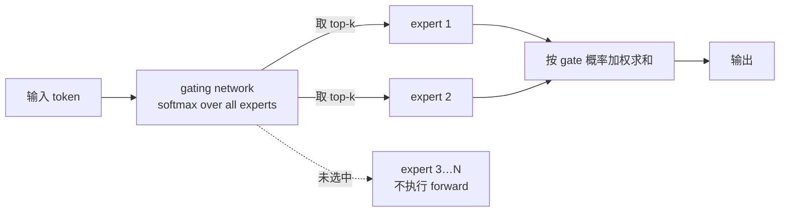

# MoE、LoRA 与数值精度：从零实现一遍

> 整理自南京大学《大语言模型基础：从零到一实现之路》第 8 讲（主讲：徐经纬，2025 学年讲义），[原始幻灯片](https://njudeepengine.github.io/llm-course-lecture/2025/lecture8.html)。本文的演示代码与预期输出为整理时补充，并在 CPU 版 PyTorch 2.14.0 下逐行 diff 校验过。

这一讲讲三件事：MoE（Mixture-of-Experts）、LoRA（Low-Rank Adaptation）、以及数值精度与量化。表面上松散，实际上是一条完整的工业主线：

- **MoE 解决参数量怎么扩张**——用 $M$ 倍体积换近乎不变的单次计算；
- **LoRA 解决微调成本**——冻结主干，只训练一条低秩旁路；
- **低精度与量化解决推理成本**——把权重和激活换成更少的比特。

三者都是同一句话的不同版本：**怎么让模型更便宜。**

## 一、MoE：分而治之与它的账

### 1.1 稀疏性到底换来了什么

传统组合理论里，MoE 的思路很朴素：把问题拆成多个子问题，每个子问题交给自己的专家（备考高考要分语文、数学、英语、物理……）。模型里的「专家」就是若干子网络，由一个可学习的 gating network 决定当前输入该走哪几个。

关键在稀疏二字。设单专家体积为 $s$、单专家计算开销为 $c$：

| | 体积 | 单次计算开销 |
|---|---|---|
| 传统模型 / 单专家 | $s$ | $c$ |
| Sparsely-Gated MoE（$M$ 个专家） | $Ms$ | $c$ |

于是得到两个方向的收益：**不显著增加计算开销地提升模型体积**，以及**在总参数量不变时降低每次推理的计算量**。后面所有 MoE 的工程设计，都是在兑现这两条。

### 1.2 结构：Gating 与 Top-k

MoE 层的输出是专家输出的加权和：

$$y=\sum_{i=1}^{n} G(x)_i E_i(x), \qquad G(x)=\text{softmax}(x\cdot W_g)$$

$G(x)$ 是可学习的路由器。稀疏性靠 **Top-k Gating** 实现——只保留得分最高的 $k$ 个专家（通常 $k=1$ 或 $2$）。

Switch Transformers 的做法是**把 Transformer 里的 FFN 换成 MoE 结构**（不是改 Attention），T5 系一路从 8 个专家扩到 2048 个。Mixtral 8x7B 是这一思路的开源代表：8 个专家，每次激活 2 个。主流模型的规模：

| 模型 | #Experts | top-k | 备注 |
|---|---|---|---|
| Mixtral 8x22B | 8 | 2 | 专家更大，推理仍保持稀疏 |
| DeepSeek-V3 (670B-A37B) | 256+1 | 8+1 | 开源中文 MoE |
| Qwen3-235B-A22B | 128 | 8 | 阿里开源 |

路由的实现很小，但有两个容易写错的细节：

```python
class TopKGating(nn.Module):
    def __init__(self, hidden_dim, num_experts, k=2):
        super().__init__()
        self.router = nn.Linear(hidden_dim, num_experts, bias=False)
        self.k = k

    def forward(self, x):
        scores = self.router(x)                      # (T, E)
        topk_scores, topk_idx = torch.topk(scores, self.k, dim=-1)
        probs = torch.softmax(topk_scores, dim=-1)   # 只在选中的 k 个上归一化
        gate = torch.zeros_like(scores)
        gate.scatter_(-1, topk_idx, probs)
        return gate, topk_idx, scores
```

**softmax 只在 top-k 切片上做，不是对全部专家归一化**——所以选中专家的概率和为 1，其余为 0。这就是「稀疏」在张量层面的体现：12 个 token × top-2 = 24 次路由，在 12×8 的 gate 里只有 25% 非零，被选中的专家之外的 forward 完全不执行。



### 1.3 训练必须做 load balancing

MoE 训练前，每个专家只是随机初始化，毫无含义。如果不加控制，每次只训 top-2 的专家，就会出现**被选得多的专家拿到更多梯度，进而被训得更好，于是被选得更多**的自我强化循环。

解决办法是 load balancing：训练中让每个专家分到近乎相同样本量。Switch Transformer 用 auxiliary loss；**DeepSeek-V3 改用共享专家 + 容量约束（capacity factor），没有额外引入 auxiliary loss**——这一点在 2024 年之后的 MoE 实践中已成趋势（Qwen3 等同样弱化了 auxiliary loss 的权重）。

实测也能看到负载不均：12 个 token × top-2 的路由里，理想是每个专家 3 次，实际最大的被选 5 次、最小的 1 次——不均衡正是 load balancing 要处理的对象。

## 二、LoRA：冻结主干，只训一条低秩旁路

### 2.1 数学：用 AB 近似 ΔW

全量微调是 $W_{updated}=W_{old}+\Delta W$，其中 $\Delta W$ 是 $[4096,4096]$。LoRA 的做法是把 $\Delta W$ 近似成两个瘦长矩阵的乘积：

$$\Delta W \approx AB, \quad A:[4096,r], \ B:[r,4096], \quad W_{updated}\approx W_{old}+\alpha AB$$

$r$ 通常取 8。推理时 $x\cdot W_{updated}\approx x\cdot W_{old}+x\cdot\alpha AB$——**LoRA 分支可以合并回主权重，不引入额外延迟**。

参数量账（4096×4096，$r=8$）：全量微调 16,777,216 个参数，LoRA 只要 65,536 个，**压缩 256 倍**。

但 $r$ 不能随便取大：在 64×32 的小矩阵上，$r=64$ 时 LoRA 参数（6144）反而**超过**全量微调（2048）。$r$ 必须远小于维度才有意义。

### 2.2 初始化：$B$ 必须为零

这是最容易被漏掉的一行：

```python
class LoRALayer(nn.Module):
    def __init__(self, in_dim, out_dim, rank, alpha):
        super().__init__()
        std_dev = 1 / torch.sqrt(torch.tensor(rank).float())
        self.A = nn.Parameter(torch.randn(in_dim, rank) * std_dev)
        self.B = nn.Parameter(torch.zeros(rank, out_dim))   # ← 关键
        self.alpha = alpha

    def forward(self, x):
        return self.alpha * (x @ self.A @ self.B)
```

$B$ 零初始化保证 $A@B=0$，训练起点的输出与原模型**逐位相同**，微调不会一上来就破坏预训练能力。

但**输出为零不等于梯度为零**：$\partial L/\partial B = \alpha (x@A)^\top \partial L/\partial y \neq 0$，所以第一步之后 $B$ 立刻偏离 0。这也解释了为什么 $A$ 不能零初始化——$A=0$ 会让 $B$ 的梯度也恒为 0，参数永远学不动。

实跑验证（40 步 Adam，$r=2$）：

```text
step 0: A@B 全零 ? True      | 输出 == 原模型 ? True   | ||Δy||=0.000000 | loss=1.203854
step 1 | B.abs().max()=0.050000 | ||Δy||=3.193365 | loss=0.874208
step40 | B.abs().max()=0.311206 | ||Δy||=4.863192 | loss=0.242049
W 全程未被改动: True | W.grad = None
```

预训练权重一个比特都没动，模型的全部变化来自 $AB$ 这条旁路。

顺带解释 $\alpha$ 的作用：`alpha=4.0` 放大了 $AB$ 的贡献，等价于把 LoRA 分支的学习率放大 4 倍——实际调参时看的是 $\alpha/r$ 这个比值，而不是 $\alpha$ 本身。

## 三、数值精度：指数位决定范围，尾数位决定精度

三种浮点格式的位布局对比：

| 格式 | 尾数 | 指数 | 数值范围 | 常见场景 |
|---|---|---|---|---|
| FP32 | 23 | 8 | 1.18e-38 ~ 3.4e38 | 全精度训练、关键评估 |
| BF16 | 7 | 8 | 1.18e-38 ~ 3.4e38 | 大规模训练，保留 FP32 动态范围 |
| FP16 | 10 | 5 | 6.10e-5 ~ 6.55e4 | 混合精度训练、推理 |
| FP8 (E4M3 / E5M2) | 3 / 2 | 4 / 5 | 2.4e-2 ~ 4.48e2 / 5.96e-4 ~ 5.73e4 | 新 GPU 上的高效推理/训练 |

一句话收束：**指数位（5 位 vs 8 位）决定动态范围，尾数位（10 位 vs 7 位）决定有效精度。** fp16 范围小但小数更准，bf16 范围大但小数更糙——所以大规模训练选 bf16，小数敏感的推理/评估选 fp16。

### 三组实测，把差异钉死

**溢出**：60000 的平方（fp16 上限 65504）

```text
fp32: 60000 → 3.6e+09   (inf=False, 相对误差 0.0000%)
fp16: 60000 → inf       (inf=True )
bf16: 59904 → 3.59032e+09 (inf=False, 相对误差 0.2688%)
```

60000 本身在 fp16 里存得下（正好 $60000=1875\times32$），但平方直接变成 `inf`。训练中一旦出现 `inf`，梯度会被污染成 `NaN` 且无法恢复——**这就是 fp16 训练必须配 loss scaling、而 bf16 不用的根本原因**。bf16 不溢出，但 60000 被截成 59904（尾数只有 7 位），误差 0.2688%——不溢出，也不精确。

**下溢**：$10^{-8}$（fp16 最小次正规数 5.96e-8）

```text
fp32: 1e-08        相对误差 0.00%
fp16: 0            相对误差 100.00%   ← 梯度凭空消失
bf16: 1.00117e-08  相对误差 0.12%
```

fp16 下溢等于梯度凭空消失，训练会在某个 step 悄悄停止学习。

**有效精度**（最反直觉的一组）：$1.0 + 0.001$

```text
fp32: 和 = 1.001       相对误差 0.0000%
fp16: 和 = 1.00098     相对误差 0.0023%
bf16: 和 = 1           相对误差 0.0999%   ← 恰好等于 1.0
```

bf16 里 1.0 附近的间隔是 $2^{-7}=0.0078125$，远大于 0.001，加上去被完全吸收；fp16 的间隔是 $2^{-10}\approx0.000977$，还能保住 1.00098。

## 四、量化：把浮点映射到整数网格

量化的核心只有一行公式：

```text
x_q = round(x / scale + zero_point)
```

`scale` 是 fp32 的缩放因子，`zero_point` 表示「浮点域里的 0 对应哪个整数值」。作用是压缩显存与带宽占用。

主流组合策略是：**混合精度训练（BF16/FP32）→ 推理阶段量化（INT8/INT4）**。INT8 是服务器推理的主流选择，兼顾吞吐与精度；INT4 用于边缘/移动部署，通常要配合蒸馏或量化感知训练。具体用哪种，取决于模型规模、硬件指令支持与误差容忍度。

要提醒的是，讲义只给了线性量化的核心公式，没有展开 PTQ（训练后量化）/ QAT（量化感知训练）的分类；而在工程实践中，GPTQ/AWQ 这类 weight-only 方法已经是 LLM 部署的主流——那是另一个话题，值得单独读。

## 五、把这三件事连起来看

| | 解决的问题 | 交换的东西 | 代价 |
|---|---|---|---|
| **MoE** | 参数量如何扩张 | $M$ 倍体积 ↔ 不变的单次计算 | 路由均衡、通信、显存 |
| **LoRA** | 微调成本 | 全量参数 ↔ $O(r)$ 参数 | rank 需调、合并回主权重有精度细节 |
| **低精度 / 量化** | 推理成本 | 比特数 ↔ 有效精度 | 溢出/下溢风险、需 loss scaling 或 QAT |

它们在工程上还有一个共同点：**都在把「计算」换成「别的资源」**——MoE 用通信换参数、LoRA 用冻结换显存、量化用精度换带宽。选型时问的问题也就一样：**我这里最稀缺的是算力、显存，还是带宽？**

---

**来源**

- 课程主页：<https://njudeepengine.github.io/llm-course-lecture/> ｜ 讲义源码：<https://github.com/njudeepengine/llm-course-lecture>
- [Outrageously Large Neural Networks: The Sparsely-Gated Mixture-of-Experts Layer](https://arxiv.org/abs/1701.06538) — MoE layer 开山之作
- [Switch Transformers](https://arxiv.org/abs/2101.03961) — 把 MoE 替换进 Transformer FFN 的代表论文
- [LoRA: Low-Rank Adaptation of Large Language Models](https://arxiv.org/abs/2106.09685) — LoRA 原论文
- 延伸阅读：[AirLLM：把显存占用和模型规模解耦](/blog/airllm-single-layer-streaming-inference/)（4bit 流式量化的工程实现）｜ [从 FLOPS 到美元：LLM 推理成本的数学推导](/blog/llm-inference-cost-deep-dive/)（Roofline 与算术强度）
