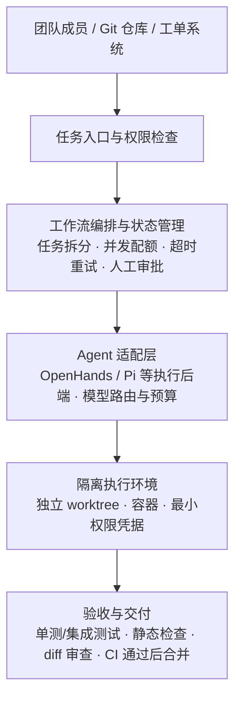

# 团队级多 Agent 工作流：怎么选，怎么验

> 说明：本文是一份**选型验证框架**（整理于 2026-10-26），不是实测报告。三个候选项目的功能细节会随版本变化，正式选型时应固定 commit/tag 并重新核对对应版本文档。

大多数团队在选择多 Agent 方案时，评估的是这几件事：能同时起多少个 Agent、演示时能不能自动写出代码、工作流画布好不好看、单次任务跑得快不快、模型吐了多少行代码。

这些指标全都**不指向交付**。真正决定一套方案值不值的是另外五个数：复杂任务的验收通过率、失败恢复能力、人工介入成本、隔离与审计能力，以及**每个被接受交付物的总成本**。

这篇文章给的就是围绕这五个数展开的一套选型与验证方法——两个现成工作台先比、三个统一测试任务、八个验收门槛、四步决策规则。

## 一、把需求写成可验证的边界

核心需求列成七条，每条都要能在 PoC 里被打到：

1. 团队级使用，不是单个开发者的临时脚本
2. 多个复杂任务能够并行执行
3. 支持任务依赖、状态跟踪、失败处理和人工审批
4. 开源、支持自托管，允许必要的源码定制
5. 交付可通过 Git diff、自动化测试、代码审查和 CI 验证
6. 能限制 Agent 对文件、网络、凭据和生产环境的访问
7. 能核算模型、计算资源、人工复核和平台维护成本

如果某条需求在 PoC 里找不到对应的验证动作，它就不是需求，是愿望。

## 二、三个候选的真实定位

### OpenHands Agent Canvas —— 团队任务控制台候选

定位是**团队级 Agent 协作与任务执行环境**，更接近面向任务执行的控制中心。要考察的是：能否把复杂任务分发给不同 Agent 或后端、是否支持本地/容器/远程运行环境、自动化触发能否与仓库和任务流程衔接、沙箱隔离与任务管理够不够、部署升级与权限运维复杂度是否可接受。

风险也很具体：实际部署模式下的权限隔离是否足够细；复杂任务的依赖、重试、恢复、审批能否满足团队流程；多 Agent 并行时的资源消耗、冲突处理和可观测性。**具体功能随版本变化，以锁定版本的文档和实测为准。**

### ThinkRail + Pi —— 工程开发工作台候选

定位是**面向工程师的 AI 开发工作台**，贴近实际软件工程流程，可围绕 Git、worktree、任务拆分和代码审查定制。要考察的是：Git worktree 能否隔离并行任务、规格说明与任务图是否适合团队复杂开发、多个 Pi 会话与子 Agent 协作是否稳定、能否接入现有 review/测试/CI、团队共享部署时身份认证与审计如何补齐。

这里有一个必须分清的坑：**不要把生态里的独立组件误认为 ThinkRail 的内置能力。** `pi-dag` 是独立可复用的 DAG 后端，不等于 ThinkRail 自带完整工作流 UI；如果服务进程与 Agent 会话跑在同一进程里，要评估崩溃影响和隔离边界；「能访问服务」也不等于完整的团队权限体系。

### LangGraph —— 自定义编排框架，不是开箱即用的平台

它的价值在于构建**有状态、可恢复、需要人工审批**的自定义工作流：显式控制节点、边、条件分支与重试，服务重启后继续执行，为特定业务搭建稳定可审计的流程。

代价同样明确：它不自带团队开发平台所需的任务 UI、用户权限、工作区管理、审计、资源配额和部署运维，这些都要团队自己承担。而**如果实际需求只是并行开发任务和 worktree 管理，自建编排层就是纯增加的复杂度**。

## 三、能力对比：用来定验证方向，不是结论

| 维度 | OpenHands Agent Canvas | ThinkRail + Pi | LangGraph |
|---|---|---|---|
| 主要定位 | Agent 任务与协作控制台 | 工程开发工作台 | 工作流编排框架 |
| 多 Agent 并行 | 重点验证 | 重点验证多会话与任务隔离 | 自行实现调度 |
| Git worktree | 需实测集成 | 核心验证点 | 需自行集成 |
| 任务依赖图 | 需验证实际调度与状态语义 | 验证规格/任务图与依赖处理 | 可显式建模 |
| 持久化与恢复 | 需实测异常恢复语义 | 需实测服务与会话故障影响 | 可围绕状态持久化设计 |
| 人工审批 | 需验证具体工作流 | 需结合开发流程验证 | 可自行建模 |
| 团队权限与审计 | 需做安全评估 | 需做安全评估 | 通常需自建 |
| 自定义程度 | 在项目边界内扩展 | 适合开发工作流定制 | 最高，维护成本也最高 |
| 推荐角色 | 任务控制中心候选 | 工程师工作台候选 | 有明确缺口时再引入 |

读这张表的正确方式是：**每一格「需验证」都是一个 PoC 任务，不是一句评语。**

## 四、目标架构与六条原则

不管最后选谁，团队级工作流的骨架是同一套：



六条架构原则，每一条都是踩过坑才写得出来的：

1. **Agent 不直接拥有生产权限。** 先在隔离环境完成任务，生产变更必须走既有发布流程。
2. **每个并行任务有独立工作区。** 独立 worktree 或独立容器，减少文件冲突与上下文污染。
3. **编排状态与 Agent 进程分离。** 不能依赖某个长跑进程的内存来记录任务状态。
4. **交付以验收结果为准。** Agent 宣称「完成」不等于任务通过。
5. **高风险动作需要人工审批。** 生产发布、删数据、改权限、访问敏感凭据。
6. **从一开始记录成本和日志。** 否则无法比较不同工具的真实经济性。

## 五、两周 PoC：不要搭平台，要出结论

PoC 的目标不是搭出一个大平台，而是用有限的真实任务找出哪个方案更适合团队。

### 阶段一（第 1–2 天）：把环境钉死

选一个**非关键**仓库做试验项目；准备独立 Linux 虚拟机或容器；固定操作系统、运行时、依赖和工具版本；准备测试用 API 凭据并设预算；配好测试分支、自动化测试和 CI；**使用无生产权限的测试账号**；部署 ThinkRail + Pi 与 OpenHands Agent Canvas；准备一个最小 LangGraph 原型（只为比较编排缺口，不必先开发 UI）。

记录每个方案的安装时间、配置步骤、失败点、资源占用和升级难度——这些是后面成本表的第一手数据。

### 阶段二（第 3–4 天）：三个统一测试任务

为了避免「不同工具做不同任务」导致结论失真，三个方案用同一组任务、同一模型、同一验收标准。

**任务 A：互相独立的并行任务。** 比如为三个独立模块补测试、修独立小缺陷、更新不同模块文档。验证：能否并行、是否出现文件或分支冲突、结果能否独立审查、汇总合并是否方便。

**任务 B：有依赖的跨模块任务。** 比如先改共享接口，再更新两个调用模块和对应测试。验证：依赖是否正确表达、下游是否会在上游未完成时错误启动、上游失败时下游是否暂停或取消、冲突能否被发现处理。

**任务 C：故障恢复与人工审批。** 模拟 Agent 中途失败、执行服务重启、模型超时或预算耗尽、测试不通过、任务需要人工审批。验证：状态能否恢复、重试是否会重复执行有副作用的动作、能否取消、审批记录与失败原因能否追踪。

### 阶段三（第 5–7 天）：重复，然后只信重复出来的数

每类任务至少重复 3–5 次，保持任务描述、模型、测试数据和验收标准一致；每次保存输入、diff、测试日志、模型用量、人工干预次数和最终结论；盲审或至少用统一代码审查清单。

关键一条：**分别记录「第一次成功率」和「人工修正后的最终成功率」**——只看后者会把人工兜底的成本藏起来。

### 阶段四（第 8 天）：安全与运维验收

并行任务之间不能意外共享可写工作区；Agent 默认没有生产写权限；凭据不进日志、提交记录或不可信上下文；任务有超时、取消和资源限制；失败后能定位状态、日志和责任环节；服务重启后状态符合预期；有人工审批与合并门禁；能按团队/用户/任务限制成本；可导出审计记录；依赖漏洞、容器权限和网络访问范围已评估。

### 阶段五（第 9–10 天）：复盘出结论

每个候选方案输出一页评估：哪类任务最好/最差、失败主要来自模型还是编排/环境/权限/测试设计、需要多少人工介入才能达标、崩溃后能否恢复、并行数提高后成功率与成本如何变化、改了多少源码且后续升级是否困难、哪些团队能力必须自建、**是否有充分证据证明需要 LangGraph 或其他自定义编排层**。

## 六、八个验收门槛

| 指标 | 建议初始门槛 | 说明 |
|---|---:|---|
| 任务验收通过率 | ≥ 8/10 | 按统一标准计算，不按 Agent 自报完成算 |
| 工作区隔离 | 100% 符合预期 | 并行任务不得意外覆盖他人文件 |
| 高风险动作审批 | 100% | 未审批不得执行受控动作 |
| 任务可追踪性 | 100% | 输入、状态、日志、diff、结果可追溯 |
| 失败恢复 | 通过所有预设故障用例 | 不要求自动恢复，但必须安全可诊断 |
| 代码质量 | 不低于团队基线 | 测试、静态检查、人工审查都纳入 |
| 预算控制 | 不突破设定上限 | 单任务与整体预算都可控 |
| 人工介入成本 | 逐步下降 | 记录每个任务的人工修正时长 |

这些是建议门槛，不是对任何工具当前表现的承诺。**样本小时不能据此宣称统计意义上的普遍成功率。**

## 七、成本口径：算「每个被接受的交付物」

成本要分五项记，少一项就会得出乐观结论：模型（token、工具调用、重试）、计算（VM/容器/CPU/内存/存储的峰值与均值）、人工（提示词调整、代码修复、审查、运维工时）、平台维护（升级、故障排查、权限与安全补丁的每周时间）、机会成本（建平台挤占的业务开发）。

核心公式只有一个：

```text
单个被接受交付物成本 =
（模型成本 + 计算成本 + 人工成本 + 平台维护成本）/ 被验收通过的交付物数量
```

配套三个比率：任务有效率 = 验收通过数 / 总任务数；人工介入率 = 需人工修正或接管的任务数 / 总任务数；恢复成功率 = 按预期恢复的故障场景数 / 总故障场景数。

**没有实测数据时不要给统一的月度成本数字。** 实际成本取决于模型、任务规模、并行数、重试率和审查强度。

控制手段六条：每任务设调用预算和执行超时；限制全局并行数（并观察并行提高是否真的提升交付效率）；简单任务路由到便宜模型；重试设上限；缓存可安全复用的检索结果与测试产物；**把人工审查时间计入总成本，不能只看 API 账单**。

## 八、四步决策规则

**第一步：先选现成工作台。** 并行评估 OpenHands 与 ThinkRail + Pi，不要一上来就对两个项目做大规模源码改造。

**第二步：确定团队真正缺的能力。** 主要痛点在仓库内并行开发、worktree、任务拆分与审查 → 优先看 ThinkRail 的工程工作流；主要痛点在多 Agent 任务入口、不同后端、执行环境与自动化触发 → 优先看 OpenHands 的团队控制能力。

**第三步：只在出现明确缺口时引入 LangGraph。** 触发信号是具体的：任务依赖与条件分支复杂到现有工具无法可靠表达；必须支持服务重启后的持久化恢复；审批、重试、取消、补偿需要严格控制；要把 Agent 工作流嵌进现有业务系统并提供稳定 API；需要跨工具统一状态、审计与执行策略。**如果这些在 PoC 里没出现，不要为了「架构完整」提前建。**

**第四步：推广前补齐平台治理。** 身份认证与权限、仓库/文件/网络/凭据隔离、模型预算与并发配额与超时、日志指标追踪审计、人工审批与 CI 门禁、失败恢复与重复执行控制、版本锁定与升级回归。

## 九、这份计划的边界

它是框架，不是结论。三件事目前给不出答案：哪个方案在你的团队更好（取决于你的任务形态和工程文化）、真实成本是多少（取决于实测）、LangGraph 是否必要（取决于现成工具的缺口有多大）。

唯一能确定的是判断方式：**如果现成工具能稳定完成团队的大部分任务，就先用它并补齐最小治理；只有真实任务暴露出明确编排缺口后，才投入建设自定义工作流层。**

---

**参考**

- OpenHands：<https://github.com/All-Hands-AI/OpenHands> ｜ <https://openhands.dev/>
- ThinkRail：<https://github.com/ThinkRail/ThinkRail> ｜ <https://thinkrail.dev/>
- LangGraph：<https://github.com/langchain-ai/langgraph> ｜ <https://docs.langchain.com/oss/python/langgraph/overview>
