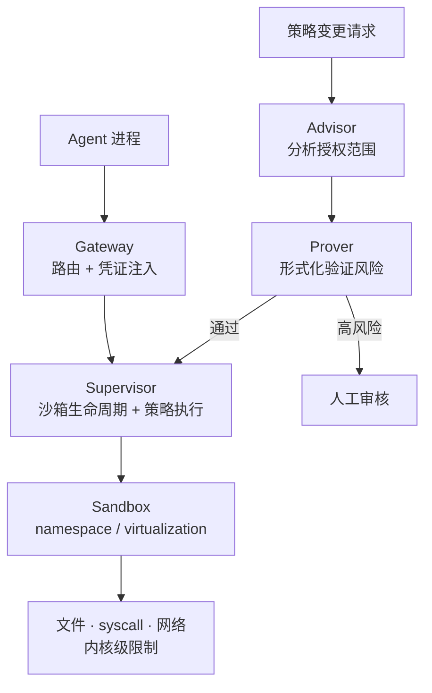

# NVIDIA OpenShell：Agent 的安全运行时

> 数据快照（2026-09-30 整理）：GitHub `NVIDIA/OpenShell`，Apache 2.0，约 10.8k stars

把 Codex、Claude Code、Cursor 这类编码 Agent 放进 CI 或本地跑，会遇到一个绕不开的矛盾：**要真正干活，Agent 得能读代码、装依赖、调 API、用密钥；但把 `sudo` 级权限交给一个会犯错的 LLM，等于开门揖盗。**

传统做法要么完全信任（危险），要么完全沙箱化（Agent 什么都干不了）。[OpenShell](https://github.com/NVIDIA/OpenShell) 走中间路线：**策略驱动的受控执行**。

它的核心理念可以概括成一句话：**Agent 不应该拥有「默认自由」，一切权限由策略授予，策略变更需经过形式化验证。**

## 一、两层强制机制

OpenShell 的架构是两层互补的 enforcement：



### 1. 内核级隔离（Runtime Enforcement）

每个 Agent 跑在独立沙箱里，内核层面控制三类资源：

| 资源 | 控制粒度 |
|---|---|
| **文件** | 哪些路径可读 / 可写 / 不可见 |
| **系统调用** | 哪些 syscall 被允许（seccomp 级别） |
| **网络** | 出站连接必须经过策略检查 |

这里最有价值的设计是**凭证注入**：Agent 永远看不到真实凭证。OpenShell 只在请求发往已批准端点时，才把凭证注入 HTTP 头。**Agent 无法把 `GITHUB_TOKEN` 发到外部**——它连这个变量的值都读不到。

### 2. 形式化验证的策略变更（Policy Advisor + Prover）

策略不是一成不变的：Agent 经常需要申请新权限（「我要访问这个新仓库」）。OpenShell 在策略变更生效前做三件事：

1. **Advisor** 分析新策略授予的访问范围；
2. **Prover** 形式化验证是否存在风险（例如新策略让 Agent 能访问某主机、同时持有凭证）；
3. **高风险变更路由到人工审核**。

这相当于给 Agent 的权限升级装了一道「形式化防火墙」——注意它验证的是**策略本身**，不是 Agent 的行为。

### 系统组件

| 组件 | 职责 |
|---|---|
| **Gateway** | 入口，路由请求 + 凭证注入 |
| **Supervisor** | 管理沙箱生命周期 + 策略执行 |
| **Sandbox** | 隔离执行环境（Linux namespace / macOS virtualization） |

## 二、策略模型：声明式权限

策略是声明式的，控制 Agent 能做什么：

```yaml
# 概念示例
filesystem:
  read: ["/workspace", "/usr/lib"]
  write: ["/workspace/output"]
  deny: ["/etc/secrets", "~/.ssh"]

network:
  allow_hosts: ["api.github.com", "registry.npmjs.org"]

providers:
  - name: github
    credential: GITHUB_TOKEN
    endpoints: ["api.github.com"]
```

凭证 Provider 系统的规则是三句话：每个 provider 绑定一个凭证 + 一组允许的端点；凭证只注入到匹配端点的请求中；**Agent 进程环境里根本不存在这些变量**。

另外两点值得留意：沙箱内可以使用 GPU（对需要本地跑推理的 Agent 场景很关键）；遥测是匿名的，只收集操作类别和计数，明确不收集沙箱名、主机名、文件路径、prompt 内容、凭证、模型名，可用 `OPENSHELL_TELEMETRY_ENABLED=false` 关闭。

## 三、快速上手与部署

```bash
# 安装
curl -LsSf https://raw.githubusercontent.com/NVIDIA/OpenShell/main/install.sh | sh

# 创建沙箱（默认镜像是精简 Ubuntu，不含任何 Agent）
openshell sandbox create --name demo
```

支持平台：Linux（完整支持）、macOS Apple Silicon、Windows via WSL2（实验性）。依赖容器运行时：Docker / Podman / Host virtualization。

SDK 覆盖四种语言：

| 语言 | 安装 |
|---|---|
| Python | `uv add openshell` |
| TypeScript | `npm install @nvidia/openshell-sdk` |
| Go | `go get github.com/NVIDIA/OpenShell/sdk/go@latest` |
| Rust | `cargo add openshell-sdk --git ... --tag <release>` |

注意 SDK 只负责连接 Gateway、不安装 CLI，且 SDK 与 Gateway 应使用相同版本。

部署有两条路：**本地开发**用 CLI + Docker/Podman 沙箱；**生产环境**用 Helm chart 部署到 Kubernetes，要求 CNI 支持 NetworkPolicy enforcement，支持多 Agent 并发隔离。

## 四、和其他方案差在哪

| 维度 | OpenShell | 传统 VM / 容器 | Claude Code 本地 | OpenSandbox |
|---|---|---|---|---|
| 隔离粒度 | syscall + 文件 + 网络 | 整个 OS 级别 | 无 | 类似 |
| 凭证管理 | 注入式，Agent 不可见 | 手动管理 | Agent 可见 | — |
| 策略变更 | 形式化验证 + 人工审核 | 无 | 无 | — |
| Agent 体验 | 透明（有策略即可） | 重 | 最轻 | — |

它真正独特的地方是**策略的形式化验证**——其他方案不具备这一层。它试图回答一个根本问题：**Agent 请求的新权限，会不会让它变得危险？**

## 五、五点观察

1. **切中痛点**。随着 Agent 大量进入 CI/CD 和开发环境，「Agent 权限管理」正在成为真实的安全问题，而不只是论文里的威胁模型。
2. **策略即代码的延伸**。声明式权限 + 变更审计 + 形式化验证，这套组合拳本质是 Infrastructure as Code 在 Agent 领域的延续——IaC 领域已经证明过它有效。
3. **形式化验证的野心**。用形式化方法验证策略变更的安全性在工业界还很少见；做得好，它有机会成为 Agent 安全的「金标准」。
4. **生态位清晰**。它不是 Agent 框架，也不是 LLM 平台，而是**Agent 的运行时安全层**——可以和 Codex、Claude Code、Cursor 等任何 Agent 工具集成。
5. **与 NVIDIA 战略的关系**。NVIDIA 在补「芯片 → 模型 → 工具」这条链上的安全执行拼图，与 NIM、NeMo 互补。

## 六、它解决不了什么

形式化验证策略 ≠ 保证 Agent 行为安全。OpenShell 管的是**权限边界**：Agent 拿不到它没被授予的能力。但它不解决另两类问题：

- **提示注入导致角色混淆**——模型可能把外部文本误判成指令，进而以自己的身份去请求它本来就有权限的操作。权限合法，但意图被劫持。相关分析见 [提示注入不是谎言，而是角色混淆](/blog/prompt-injection-role-confusion/)。
- **人在循环中的审批质量**——策略写对了，但审批节点形同虚设，Agent 仍然能造成损失。循环与审批节点的工程化见 [Loop Engineering：Agent 循环工程化](/blog/loop-engineering-agent-loops/)。

换句话说，OpenShell 是**必要但不充分**的一层：它把「Agent 拿到了不该有的能力」变成不可能，剩下的「Agent 用它该有的能力做错事」要靠别的层解决。

---

**来源**

- OpenShell 仓库与文档：<https://github.com/NVIDIA/OpenShell>
- RFC Board（设计决策）：<https://github.com/NVIDIA/OpenShell>
