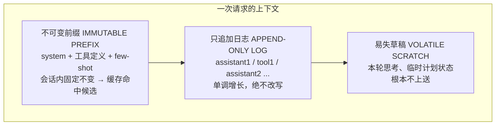

Reasonix 这个项目值得单独拆解，原因很直接：大多数「Agent 很贵」的根因不在模型，而在上下文——每轮都重新发送的内容没被缓存，于是每一轮都在按未命中价付费。

DeepSeek 官方文档里有一句关键描述——**缓存命中的输入按未命中价的一部分计费**。这句描述听上去平淡，但它意味着一件事：Agent 循环的每一次「重发」，都在直接乘上一个成本系数。

本文拆一个把这件事做到极致的开源项目：Reasonix（MIT 协议，npm 包名 `reasonix`，仓库 `esengine/DeepSeek-Reasonix`）。它的自述目标很直白：**一个便宜到可以一直挂着的编码 Agent**。

> 说明：本文数据来自上游仓库的 `docs/ARCHITECTURE.md`、`benchmarks/real-world-cache/README.md` 与 DeepSeek 官方定价页，价格与版本信息抓取于 2026-11-03。

## 一、缓存命中率是成本的第一性变量

先看价格，这是 Reasonix 全部设计的起点。DeepSeek 现行价目表（`deepseek-flash`，每百万 token）：

| 项 | 非高峰 | 高峰 |
|---|---|---|
| 输入 · 缓存命中 | $0.003 | $0.006 |
| 输入 · 缓存未命中 | $0.15 | $0.30 |
| 输出 | $0.60 | $1.20 |

命中价是未命中价的 **2%**。上游架构文档里的说法是「约 10%」，与现行价目表对不上——大概是更早的价格快照。比例在持续变，方向没变：**同一段前缀重复发送一万次和一次，账单差两个数量级**。

于是优化问题的形状变了。不是「怎么少用 token」，而是「**哪些字节必须重复发送，哪些绝对不能重复发送**」。

大多数 Agent 循环在这件事上天然失分。原因也常见：每轮把工具结果内联进对话、把时间戳注入上下文、把 system prompt 重新拼一遍——任何一处字节漂移，前缀缓存的键就变了，下一轮重新冷启动。

上游文档给了一组客户端对照（出自 `benchmarks/real-world-cache/README.md`；原文没有交代这组数字的取样方式，只能当作量级参考）：

| 客户端 | 长会话缓存命中率 |
|---|---|
| DeepSeek 自家网页对话 | 单次会话内 60–80%，换会话掉到 0% |
| Cherry Studio / Open WebUI / 通用 OpenAI 形态 SDK | 30–60% |
| Cline / Continue 等 XML 工具调用客户端 | 更低 |
| Reasonix | **99.82%** |

差距不在 API，在客户端。**缓存是服务商的，命中率是客户端的。**

## 二、Reasonix 的前提：只支持 DeepSeek

这一点必须先说清楚，否则后面的设计看不懂。

Reasonix 的架构文档开篇写：*Reasonix is opinionated, not general. Every abstraction is justified by a DeepSeek-specific behavior or economic property.* 它只支持 DeepSeek 后端，官方文档明确把「支持非 DeepSeek 后端」列为非目标。

这不是封闭，是**为了把一个变量压到极致**。前缀缓存、自动缓存、思考块里逃逸的工具调用，这些都是 DeepSeek 侧的具体行为，把它们吃透比兼容十家协议更划算。

顺带一个现状：仓库 `main` 分支是旧版 TypeScript 线（已进入维护模式），活跃开发已迁到 Go 重写版 `main-v2` 分支。npm 上当前版本是 2.57.0。

## 三、Pillar 1：缓存优先的循环

整个项目的核心是一个上下文分区设计。上游把它画成三段：

三条不变式：

1. **前缀每会话算一次**，哈希后钉住；
2. **日志条目只按追加顺序序列化**，不重写、不原地编辑；
3. **草稿先被蒸馏，再折叠进日志**——避免污染下一轮的前缀。

第三条最容易被忽略。推理模型的思考内容是每轮变化的，如果直接进历史，下一轮的前缀必然不同，缓存立刻归零。Reasonix 的做法是把草稿完全排除在上送之外，只把「蒸馏后的结论」写进只追加日志。

配套的度量指标是 `prompt_cache_hit_tokens / (hit + miss)`，逐轮暴露、按会话聚合，直接显示在 TUI 顶栏的缓存单元里。**指标不可见，行为就不会被优化。**

## 四、Pillar 2：工具调用修复的四道 pass

缓存保住了，但模型仍然会犯蠢。这一层解决四个具体的失败模式：

| Pass | 处理的问题 | 做法 |
|---|---|---|
| `flatten` | 参数 >10 个或嵌套 >2 层时参数被丢 | 注册时自动检测，把 schema 改成点号记法呈现给模型，调用前再还原嵌套 |
| `scavenge` | 工具调用 JSON 被写进了思考块，没进 `tool_calls` | 拿正则 + JSON 解析器去扫 `reasoning_content`，把漏掉的调用捞回来 |
| `truncation` | `max_tokens` 截断导致 JSON 括号不闭合 | 检测不平衡并补齐，或请求续写 |
| `storm` | 同一工具同一参数反复调用 | 滑动窗口内命中相同 `(tool, args)` 就抑制，注入一次反思轮 |

`scavenge` 这一道最值得抄。推理模型有时会把完整工具调用写进思考文本而不是输出字段——**token 已经付掉了，产出却被丢弃**，还得再调一次模型重新生成同样的调用，等于双倍付费。从思考块里正则捞回来，是把已经花钱买的东西用上。

注意 `flatten` 是个取舍：把复杂 schema 压成点号记法是为了让模型填得对，代价是牺牲了 schema 的严格性。`storm` 的抑制同理——抑制错误调用比多花一次调用便宜，但抑制过度会卡住合法重复。

## 五、Pillar 3：成本控制

第三道防线在模型选择和上下文收缩上。

**flash 优先的分级预设。** 上游给三个预设：flash（1×）、auto（默认，flash 遇难题升 pro，1–3×）、pro（~12×）。关键细节是：所有辅助调用——摘要生成、子 Agent 派生、截断修复重试——**硬编码 flash + 高 effort**，不管用户选的是哪个档位。「把工具结果润色成散文」这种事不该按 pro 价计费。

**轮末自动压缩。** 日志里任何超过 3000 token 的工具结果，在轮次结束时被缩到该上限。模型在读它的那一轮已经看过全文了，后续轮次看摘要即可，需要时再重读。上游的说法很直白：多跑一次 `read_file` 远比在之后每个 prompt 里拖 12KB 便宜。长轮次内部还会在上下文占用 40% 时提前预缩，80% 是应急阈值。

**模型自报告升级。** 模型自己判断任务超出当前档位时，在回复首行输出 `<<<NEEDS_PRO>>>` 标记，当前 flash 调用中止并用 pro 重试这一轮。上游明确说明这是**纯自报告**：没有失败计数阈值，不基于工具错误自动升级。理由也写在文档里——**任何自动升级都必须让用户看见**，静默升级曾被评估过并否决了。

## 六、真实账单：99.82% 是怎么来的

上游公开了一份单个真实用户单日（2026-05-01）的 DeepSeek 账单，anonymized 并获授权：

| | Token |
|---|---:|
| 输入 · 缓存命中 | 435,033,856 |
| 输入 · 缓存未命中 | 767,616 |
| 输出 | 179,763 |
| **当日合计** | **435,981,235** |

命中率 `435,033,856 / 435,801,472` = **99.82%**。

按上游文档给出的 v4-flash 价格算，这个用户当天花了 $1.38，而同一份负载在零缓存下要 $61.06——省下 $59.68，约 **97.7%**。（上游 README 在同一场景给出的对比是「~$12 instead of ~$61」，与 case study 文档口径有出入，大概率来自不同时间点的价格快照；本文采用逐项可加总的 case study 数字。）

真正值得看的是**输入未命中只有 76.8 万**。4.36 亿 token 的当日负载里，模型真正新读进去的输入不到 77 万（输出另有约 18 万）——其余全是同一段前缀被反复消费。

上游把这个结果归因于四个设计选择：

1. **`ImmutablePrefix`** — system prompt 与工具定义在会话开始时冻结，每轮字节序列完全一致；
2. **`AppendOnlyLog`** — 轮次只追加，不重排、不原地编辑；
3. **`VolatileScratch`** — 思维链与临时状态待在缓存前缀之外，永不污染下一次命中；
4. **Auto-compact** — 上下文接近上限时旧轮折叠成摘要消息；摘要请求本身复用主 Agent 已缓存的 system/工具/历史前缀，紧随其后的主 Agent 请求只为新合成的摘要段付一次冷启动。

这四条与 Pillar 1 的三段分区是同一件事的两种说法：前者讲「怎么组织」，后者讲「怎么落地」。

## 七、迁移到自己 Agent 的三条做法

不是所有东西都能照搬——Reasonix 依赖 DeepSeek 的自动前缀缓存，而且有意识地把产品限定在单厂商。但三条做法是通用的：

**一、把 system prompt 和工具定义当成不可变资产。** 它们应当在会话开始时冻结并钉住，而不是每轮重新拼装。如果你的框架每次请求都重新序列化工具列表，哪怕内容一样，也要确认序列化结果逐字节一致——顺序、空格、末尾换行都可能改变缓存键。

**二、给易变内容单独开一段。** 时间戳、请求 ID、临时计划、思考摘要这些每轮都变的东西，不要混进历史消息。给它们一个独立区域，历史就保持单调追加。

**三、把「已付出的推理产出」捞回来。** 工具调用写错位置、参数被截断这类问题，排查成本远低于直接重调一次模型。哪怕只做正则扫描思考块这一件事，也是在把已经付费的 token 变成有效产出。

对照 [按成功任务算 Token 成本](/blog/agent-token-cost-per-task/) 里的指标体系，缓存命中率应当和工具返回大小、重试率并列成为第一梯队指标——它直接决定重复劳动的价格。

## 八、边界与我的判断

三件需要说清楚的事：

**它的天花板依赖供应商。** 99.82% 是在「自动前缀缓存 + 缓存命中价 2%」这两个前提下取得的。换成没有自动缓存、或缓存命中价与未命中价接近的模型，同样的架构拿不到同样的收益。所以这套设计可以借鉴思路，但收益不能照搬。

**自报告升级有它的代价。** 模型自己判断「这题需要 pro」，它可能判断错。上游选择了让用户看见所有 pro 调用，而不是靠失败计数自动升级——这是产品判断，不是技术最优。

**「便宜到能一直挂着」是这个项目的目标函数。** 这解释了它为什么愿意在多处牺牲严格性换缓存稳定性：schema 压平、相同调用抑制、思考块不进历史。对一个后台长期跑的编码 Agent，这些取舍成立；如果你的场景更看重「一次做对」，同一套取舍未必划算。

把这份解读折回方法论层面，它其实只强调了一件事：**成本优化不是压缩输出，而是管理重复**。该重复的（稳定前缀）让它字节级稳定地重复，不该重复的（易变状态）永远不进缓存。做到这两条，账单会自己降下来。

## 进阶阅读

- 基础篇：[按成功任务算 Token 成本](/blog/agent-token-cost-per-task/) — 成本口径、10 个高 ROI 习惯与指标体系
- 进阶篇：[Agent Token 优化十层检查清单](/blog/agent-token-optimization-review-checklist/) — 把上面每条做法变成可勾选的评审项
- 项目地址：[esengine/DeepSeek-Reasonix](https://github.com/esengine/DeepSeek-Reasonix) · [DeepSeek 模型与价格](https://api-docs.deepseek.com/quick_start/pricing)
