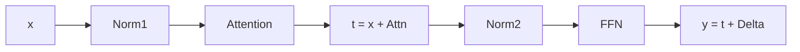

RMSNorm 与 SwiGLU 是 Llama Decoder Layer 里最容易被跳过、又最能改变你对「模型在算什么」理解的两个组件。一个决定激活值的尺度往哪走，一个决定每个 token 在前馈网络里被加工成什么样。

本文整理自南京大学《大语言模型基础：从零到一实现之路》第 5 讲（主讲：徐经纬），[原始幻灯片](https://njudeepengine.github.io/llm-course-lecture/2026/lecture5.html)。演示代码与输出为整理时补充，已在 CPU 版 PyTorch 2.8.0 下逐行跑过，输出为实跑结果。

## 一、Decoder Layer 里还剩什么

Decoder-only 结构里，输入侧是 embedding 加位置编码，Transformer 侧则是重复 N 次的 Decoder Layer。每一层在 Hugging Face 的实现里长这样：

```python
LlamaDecoderLayer(
  (self_attn): LlamaAttention(...),
  (mlp): LlamaMLP(...),
  (input_layernorm): LlamaRMSNorm((2048,), eps=1e-05),
  (post_attention_layernorm): LlamaRMSNorm((2048,), eps=1e-05),
)
```

四个组件：注意力、FFN（代码里叫 `LlamaMLP`）、两个 RMSNorm。上一讲已经拆过注意力里的 RoPE，这一讲补上剩下的三块。

Llama 用的是 pre-norm 结构——归一化放在子层输入侧，先归一化再进子层，结果走残差旁路加回来：



`t` 是第一次残差后的主干表示，`h = Norm2(t)` 才是交给 FFN 的输入。FFN 输出的是一个**更新量**，不是新的表示——这点在算参数和算 FLOPs 时都容易搞错。

## 二、归一化调的是哪一维

归一化的作用是调整数据分布的尺度。但在 LLM 里，「数据」是形状为 `[B, S, H]` 的张量：B 是批大小，S 是序列长度，H 是 hidden 维度。在哪一维上统计，决定了归一化的语义。

Llama 的 LayerNorm 和 RMSNorm 都**只沿 hidden 维 H 统计**：固定一个 batch、一个 token 位置，对它的 H 个特征求统计量，形状是 `[B, S, 1]`，再广播回 `[B, S, H]`。

```text
输入 X       [B, S, H]
统计量       [B, S, 1]   ← 沿 hidden 维，keepdim=True
广播并缩放   [B, S, H]   ← 每个 token 用自己的统计量
```

两个不这么做的方向各有各的问题：沿 batch 维归约会把不同样本混进同一个统计量；沿完整 sequence 维归约则会让当前位置依赖其他位置，可能包含未来的 token——在自回归场景里那是信息泄漏。所以当前 LLM 的 `LayerNorm(H)` / `RMSNorm(H)` 一律只沿 H 统计。

## 三、RMSNorm 与 LayerNorm 的差别只有一处

LayerNorm 先减均值再除标准差，RMSNorm 只除以均方根，两者统计范围完全相同：

```text
LayerNorm:  y_i = γ_i · (x_i − μ) / sqrt(σ² + ε) + β_i
RMSNorm:    y_i = γ_i · x_i / sqrt((1/H) · Σ_j x_j² + ε)
```

RMSNorm 没有 β，也没有减均值这一步，只留一个逐维缩放的 γ。手写一遍看差异落在哪：

```python
import torch

eps = 1e-6
x = torch.tensor([[1., 2., 3., 4.],
                  [1., -1., 1., -1.]])

# 手写 RMSNorm：只除以均方根，不减均值
mean_square = x.pow(2).mean(-1, keepdim=True)          # [2, 1]
rms_out = x * torch.rsqrt(mean_square + eps)

# 手写 LayerNorm：先减均值，再除以标准差
mu = x.mean(-1, keepdim=True)                          # [2, 1]
var = (x - mu).pow(2).mean(-1, keepdim=True)           # [2, 1]
ln_out = (x - mu) * torch.rsqrt(var + eps)

print("输入 x =", x.flatten().tolist())
print("平方均值 =", mean_square.flatten().tolist())
print("RMSNorm 输出 =", rms_out)
print("LayerNorm 输出 =", ln_out)
print("RMSNorm 输出逐行均值 =", rms_out.mean(-1).tolist())
print("LayerNorm 输出逐行均值 =", ln_out.mean(-1).tolist())

# 与 PyTorch 官方实现对齐
ln = torch.nn.LayerNorm(4, eps=eps); ln.weight.data.fill_(1.0); ln.bias.data.zero_()
rn = torch.nn.RMSNorm(4, eps=eps);    rn.weight.data.fill_(1.0)
torch.testing.assert_close(rms_out, rn(x))
torch.testing.assert_close(ln_out, ln(x))
print("与 nn.RMSNorm / nn.LayerNorm 一致: True")
```

实跑输出：

```text
输入 x = [1.0, 2.0, 3.0, 4.0, 1.0, -1.0, 1.0, -1.0]
平方均值 = [7.5, 1.0]
RMSNorm 输出 =
tensor([[ 0.3651,  0.7303,  1.0954,  1.4606],
        [ 1.0000, -1.0000,  1.0000, -1.0000]])
LayerNorm 输出 =
tensor([[-1.3416, -0.4472,  0.4472,  1.3416],
        [ 1.0000, -1.0000,  1.0000, -1.0000]])
RMSNorm 输出逐行均值 = [0.9129, 0.0]
LayerNorm 输出逐行均值 = [0.0, 0.0]
与 nn.RMSNorm / nn.LayerNorm 一致: True
```

判据就在均值那一行。LayerNorm 输出的逐行均值恒为 0，因为它中心化了；RMSNorm 第一行的输出均值是 0.9129——**它没有中心化这一步**。注意第一行的平方均值是 7.5，对应的均方根是 sqrt(7.5) ≈ 2.7386，两个数别混。

第二行输入本身均值为 0，两种归一化结果完全一致，说明差别只在「是否去均值」，不在缩放方式。

## 四、缩放不变，但不平移

这一节是 RMSNorm 最容易被误解的地方。把输入整体乘一个常数 c，再整体加一个常数 t，看输出怎么变：

```python
import torch

eps = 1e-6
x = torch.tensor([[1., 2., 3., 4.]])

def rms_norm(t):
    return t * torch.rsqrt(t.pow(2).mean(-1, keepdim=True) + eps)

def layer_norm(t):
    mu = t.mean(-1, keepdim=True)
    var = (t - mu).pow(2).mean(-1, keepdim=True)
    return (t - mu) * torch.rsqrt(var + eps)

c, t = 2.0, 2.0
x_scaled = x * c
x_shifted = x + t

print("RMSNorm(c*x) =", rms_norm(x_scaled))
print("RMSNorm 比值 =", (rms_norm(x_scaled) / rms_norm(x)).flatten().tolist())
print("LayerNorm(c*x) =", layer_norm(x_scaled))
print("LayerNorm 比值 =", (layer_norm(x_scaled) / layer_norm(x)).flatten().tolist())
print("RMSNorm(x+t) =", rms_norm(x_shifted))
print("RMSNorm 平移比值 =", (rms_norm(x_shifted) / rms_norm(x)).flatten().tolist())
print("LayerNorm(x+t) =", layer_norm(x_shifted))
print("LayerNorm 平移比值 =", (layer_norm(x_shifted) / layer_norm(x)).flatten().tolist())
```

实跑输出：

```text
RMSNorm(c*x) = tensor([[0.3651, 0.7303, 1.0954, 1.4606]])
RMSNorm 比值 = [1.0, 1.0, 1.0, 1.0]
LayerNorm(c*x) = tensor([[-1.3416, -0.4472, 0.4472, 1.3416]])
LayerNorm 比值 = [1.0, 1.0, 1.0, 1.0]
RMSNorm(x+t) = tensor([[0.6470, 0.8627, 1.0783, 1.2940]])
RMSNorm 平移比值 = [1.7719, 1.1812, 0.9844, 0.8859]
LayerNorm(x+t) = tensor([[-1.3416, -0.4472, 0.4472, 1.3416]])
LayerNorm 平移比值 = [1.0, 1.0, 1.0, 1.0]
```

两个结论：

**缩放不变。** 输入乘 c 后 RMSNorm 输出完全不变，比值全是 1.0。推导很直接——分子分母的 c 正好约掉。这不是 RMSNorm 独有的性质，LayerNorm 同样缩放不变。

**平移敏感。** `x+2` 让 RMSNorm 的输出从 `[0.3651, ...]` 变成 `[0.6470, ...]`，比值 `[1.7719, 1.1812, 0.9844, 0.8859]` 各不相同——有放大也有压制。原因是均值 2 被平方项算进去了，改变了均方根本身。

LayerNorm 两者都不变，因为它先减均值，平移被完全消掉。**所以 RMSNorm 相对 LayerNorm 唯一真正丢掉的性质是平移不变性**，不是「缩放不变」。

## 五、Attention 之后为什么还要 FFN

注意力负责跨 token 汇聚，FFN 负责在每个 token 内部做非线性特征加工。同一层的 FFN 参数在所有位置共享，但每个位置算出的门控值不同。

先看升维这一步。单个 token 的表示 h 属于 R^H，映射到 F 维中间特征（通常 F 大于 H）：

```text
u = W_u h          H → F
```

每个中间单元都有一组权重，学习一种特征组合。注意升维并不增加输入的原始信息量——更长的向量也不保证效果更好。

关键问题来了：**如果只做线性升维再线性降维会怎样？** 因为 `W_d(W_u h) = (W_d W_u) h`，整条路径等价于一个线性层。所以必须引入非线性，SwiGLU 就是 Llama 的选择。

## 六、SwiGLU：门控按当前输入调节

SwiGLU 有两条升维分支，一条产候选特征，一条产调节系数：

```text
u = W_u h
g = SiLU(W_g h)
z = g ⊙ u
```

`up_proj` 产生候选特征 u，`gate_proj` 根据当前 h 产生门控系数 g，逐元素相乘后再投影回 hidden 维：

```python
down_proj = self.down_proj(self.act_fn(self.gate_proj(x)) * self.up_proj(x))
```

整个 SwiGLU 前向只有这一行。看一个 H=2 到 F=4 的极小 FFN，显式指定权重把每一层都打印出来：

```python
import torch
import torch.nn.functional as F

torch.manual_seed(0)
H, F_ = 2, 4
x = torch.tensor([[2., 1.],
                  [1., 2.]])

gate_proj = torch.nn.Linear(H, F_, bias=False)
up_proj   = torch.nn.Linear(H, F_, bias=False)
down_proj = torch.nn.Linear(F_, H, bias=False)
with torch.no_grad():
    gate_proj.weight.copy_(torch.tensor([[ 0.,  0.], [ 1.,  0.], [-1.,  0.], [ 1., -1.]]))
    up_proj.weight.copy_(  torch.tensor([[ 1.,  0.], [ 0.,  1.], [ 1.,  1.], [ 1., -1.]]))
    down_proj.weight.copy_(torch.tensor([[ 1.,  0.,  0.,  0.], [ 0.,  1.,  1.,  1.]]))

g_pre = gate_proj(x)          # [2, 4] 门控分支线性输出
u     = up_proj(x)            # [2, 4] 候选特征
g     = F.silu(g_pre)         # [2, 4] 门控系数（可正可负）
z     = g * u                 # [2, 4] 逐元素相乘
out   = down_proj(z)          # [2, 2] FFN 更新量

print("token0 候选 u   =", u[0].tolist())
print("token0 门控 g   =", [round(v, 4) for v in g[0].tolist()])
print("token0 相乘 z   =", [round(v, 4) for v in z[0].tolist()])
print("token0 FFN 输出 =", [round(v, 4) for v in out[0].tolist()])
print("token1 候选 u   =", u[1].tolist())
print("token1 门控 g   =", [round(v, 4) for v in g[1].tolist()])
print("token1 相乘 z   =", [round(v, 4) for v in z[1].tolist()])
print("token1 FFN 输出 =", [round(v, 4) for v in out[1].tolist()])
print("无门控时 FFN 输出 =", [round(v, 4) for v in down_proj(u)[0].tolist()])
```

实跑输出：

```text
token0 候选 u   = [2.0, 1.0, 3.0, 1.0]
token0 门控 g   = [0.0, 1.7616, -0.2384, 0.7311]
token0 相乘 z   = [0.0, 1.7616, -0.7152, 0.7311]
token0 FFN 输出 = [0.0, 1.7774]
token1 候选 u   = [1.0, 2.0, 3.0, -1.0]
token1 门控 g   = [0.0, 0.7311, -0.2689, -0.2689]
token1 相乘 z   = [0.0, 1.4621, -0.8068, 0.2689]
token1 FFN 输出 = [0.0, 0.9242]
无门控时 FFN 输出 = [2.0, 5.0]
```

四件事值得记：

**SiLU 不是 0/1 开关。** `SiLU(z) = z · σ(z)`，输出可以是负数，也可以大于 1。token0 的门控是 `[0.0, 1.7616, -0.2384, 0.7311]`——第 0 维被完全关闭，第 1 维被放大 1.76 倍，第 2 维系数为负，`-0.2384 × 3.0 = -0.7152`，既压制又翻转符号。所以这是连续调节，不是概率开关。

**门控是逐 token 重算的。** 两个 token 的候选特征不同（`[2,1,3,1]` vs `[1,2,3,-1]`），门控也不同，最终 FFN 更新量从 1.7774 变成 0.9242——同一层参数在不同位置上做不同的事。

**门控的价值是「选择性地少更新」。** 对照最后一行的无门控输出 `[2.0, 5.0]`：门控把更新量从 5.0 压到 1.7774。如果只想线性放大，FFN 根本不需要门控这条分支。

## 七、参数账：3HF 与 2HF 必须连中间维度一起看

隐藏维度 H、中间维度 F 时（忽略 bias），普通两层 FFN 约 2HF 个参数，SwiGLU 的三次线性映射约 3HF 个。只报「SwiGLU 更贵」是不完整的——**比较参数开销时必须同时说明中间维度**。

实际模型的做法是同时调 F 和 H。Llama-2 7B 的 `hidden_size` 是 4096，`intermediate_size` 是 11008，比例约 2.69，比 4H 小得多（实现里取 8 的倍数）。所以「SwiGLU 多 50% 参数」这个说法在 Llama-2 上并不成立。

另外要注意 FFN 贡献了模型里绝大部分参数——注意力那边因为 GQA，K/V 的投影维度远小于 Q。这是读模型 config 时能直接看出来的结构信息。

## 八、边界：归一化不是正则化

最后两个容易越界的推论。

**归一化帮的是优化，不是泛化。** 归一化调整输入或激活的尺度，让优化条件更好；正则化控制的是过拟合。讲义专门把这两个目标分开：「更容易优化」并不等于「更不容易过拟合」。损失函数里的惩罚项是正则化的一种形式，但 dropout 这类靠随机化的手段也是。

**RMSNorm 的速度优势不能照搬 2019 年的结论。** 原论文（[arXiv:1910.07467](https://arxiv.org/abs/1910.07467)）报告了相近的效果和更低的开销，这个结论支撑了 Llama 采用 RMSNorm。但现代 fused kernel 已经把很多常数项优化掉了，RMSNorm 相对 LayerNorm 省下来的那点算力，收益跟具体实现和硬件绑定。选型时该看实测，不要拿论文里的加速比例当定论。

顺带一提，RMSNorm 省掉的不只是减均值，还有 β 参数——`LlamaRMSNorm` 只有 weight。这在参数统计上也是一笔小账。

## FAQ

**Q：RMSNorm 和 LayerNorm 该怎么选？**
A：两者统计范围相同，差别只在中心化。效果上原论文报告在所测任务中相近，而 RMSNorm 少一次减均值、少一个 β 参数。现代 kernel 下差距进一步缩小，选型建议看实测。

**Q：为什么归一化只沿 hidden 维统计？**
A：沿 batch 维会把不同样本混进同一统计量，沿 sequence 维会让当前位置依赖后续位置——在自回归场景里等于信息泄漏。只沿 hidden 维统计，每个 token 用自己的统计量，互不干扰。

**Q：SwiGLU 里的 SiLU 可以换成 ReLU 吗？**
A：门控系数由 SiLU 产生，它允许负值与大于 1 的值，语义是连续调节；换成 ReLU 后门控系数非负，等于放弃了「抑制并翻转符号」这类操作。GLU 变体论文（[arXiv:2002.05202](https://arxiv.org/abs/2002.05202)）比较过多种门控激活，SwiGLU 是其中之一。

**Q：FFN 里的「升维」是不是在增加信息量？**
A：不是。线性升维只是把同一个向量在另一个基下重新表示，可逆的。真正带来新表达力的是之后的非线性，以及 SwiGLU 那种按输入调节的组合方式。

## 相关阅读

- 同系列的 [RoPE 旋转位置编码：Attention 如何感知顺序](/blog/rope-and-input-embedding-explained/) — 讲义第 4 讲，tokenizer → embedding 查表 → RoPE 三步
- 同系列的 [MoE、LoRA 与数值精度：从零实现一遍](/blog/moe-lora-numeric-precision-explained/) — 讲义第 8 讲，同样是「原理 + 可复现代码 + 实跑校验」的路子
- 同系列的 [Sparse Attention 方法谱系：三条路线](/blog/sparse-attention-methods-landscape/) — 讲义第 12 讲，长上下文推理的算力账
- Transformer 基础：[Transformer 详解：注意力就是一切](/blog/paper-reading/transformer-explained-in-detail/)
- 原文幻灯片：[lecture5.html](https://njudeepengine.github.io/llm-course-lecture/2026/lecture5.html)
- 原始论文：[Root Mean Square Layer Normalization](https://arxiv.org/abs/1910.07467)、[GLU Variants Improve Transformer](https://arxiv.org/abs/2002.05202)、[Attention Is All You Need](https://arxiv.org/abs/1706.03762) §3.3
