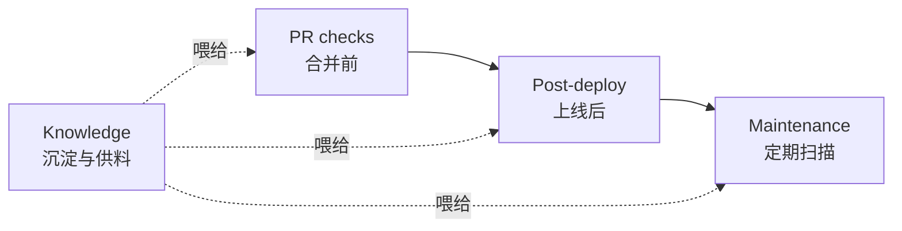

写代码变便宜之后，瓶颈消失了吗？Sonar 的 staff software engineer Andrew Finch 在 2026 年 11 月的 AI Engineer CODE 峰会上给出的答案是一套「软件工厂的四个验证回路」，以及一句更尖锐的判断：写代码已经不稀缺了，稀缺的是**信心**。

他给的不是一套工具清单，而是一个可逐项对照的分类学：当产线变成软件工厂，怎么用分层验证把它变安全——以及为什么**安全**才是「软件工厂」这个词里真正难的那一半。

## 瓶颈跟着自动化走

「软件工厂的四个验证回路」这套框架，Finch 是从最熟悉的 SDLC 主循环讲起的：需求进规划、规划变成代码、代码变成 PR、review 与 CI 之后合并、部署、用户反馈再回流成新的需求。这条链在 AI 之前每一环都有人守着。

agentic coding 做的事是「自动化一路追着瓶颈跑」——写代码这一环被拿下了，于是瓶颈后移到 review；review 也开始被自动化，注意力再往后移到部署、监控、告警分流、规划。**软件工厂不是突然出现的，它是这条链条被逐段自动化之后剩下的形状。**

Finch 提出的问题因此很具体：如何在这条自动化过的链条上叠加足够的验证层，让人敢相信产出的软件符合预期、没有 bug、没有安全漏洞。

有个细节值得单独拎出来。他的同僚、自动字幕和官方演讲稿在这一句上出现了三种写法：`Tar`、`Tarek`、`Tariq`。Sonar 官方「About」页把 CEO 列为 **Tariq Shaukat**，那句 "Code is abundant, confidence is not." 出自他。名字这么小的一个错，在演讲稿里却会被原样抄进几千人的笔记——**这是任何依赖转录材料的内容都必须自己回一手核一遍的典型案例**。

## 四个回路，各答一个问题

Finch 的方法论是 defense in depth，具体化为**加更多回路**，而不是加更多检查项。他挑了四个展开：

| 回路 | 回答的问题 | 何时跑 |
|---|---|---|
| PR checks | 这个改动该不该合并？ | 每次 push，合并前 |
| Post-deploy verification | 部署后的真实行为符合预期吗？ | 上线后持续 |
| Maintenance | 当前代码库里有没有新问题？ | 定期扫描，与开发并行 |
| Knowledge | agent 怎么才能第一次就做对？ | 持续沉淀，供料给其余三者 |

关键在于**这四个回路回答的是不同的问题，所以补上一个不会让另外几个变得多余**。这是 defense in depth 在工程语境里的实际含义：不是同一个检查跑十遍，而是把「验证」这件事在时间轴上摊开，让每个时间点都有对应的证据来源。



## PR 回路：把审查做宽，但把关放在证据上

这是多数团队已经有的那个回路：PR → CI 检查 → code review。Finch 说现在已经很常见的是 agent 自动 push fix 回应 review comment，循环往复直到 PR 变绿。

他的关键洞察是**在 PR 阶段发现问题，永远比 merge 进代码库之后更便宜**——这是唯一让「把 review 做宽」这件事在成本上成立的理由。于是检查项可以叠得很厚：

- AI code review 与 static analysis；
- **Functional validation**：对照 ticket 要求，验证这个 PR 是否真的实现了它；
- Team rules / coding conventions：是否遵守团队规约；
- Knowledge：调用公司文档、过往 review 与 outage 中沉淀的经验；
- Cross-repo checks：会不会 break 别的仓库；
- Cross-PR analysis：与其他 open PR 是否冲突；
- Security review：漏洞、secrets、依赖；
- End-to-end testing：在浏览器里真的点开操作一遍；
- **Risk assessment**：计算 blast radius，把 PR 分级为 low / medium / high。

这一堆检查的结果汇入 merge gate（每次 push fix 后重跑）。而 Finch 强调的原则是最容易被跳过的那一条：

> "It's important to gate that merge decision, not just on the fact that a test ran or that it passed, but on the evidence."

把关的标准不能是「测试跑过了」——那是一个**状态**，不是**证据**。review findings、quality gate 结果、漏洞清单、risk level，这些具体的东西被记录到 PR 上，逐项对照团队自定义的 mergeable 标准核验，闸门才算足够强。

一个绿色的 CI 徽章不说明哪些 findings 被考虑过、接受了什么风险、预定行为是否真的被测过。这两者的差别，是「谁说过 ok」与「有什么能复核」的区别。

这与[「CI 阻止，Agent 修正」](/blog/agent-native-development-practices/)里那条边界是同一件事的两面：那条讲的是「谁有权推翻 CI 的结论」，这条讲的是「CI 的结论凭什么可信」。只有后者立住了，前者的授权才有意义。

### 风险分级是枢纽，不是清单里普通的一项

值得单独强调的是 risk assessment 在这套设计里的位置。它不是九个检查项中的一个，它是**决定人还要不要看这个 PR 的那个开关**。

Finch 描述的终局是：开 automatic merge blocking，对 low-risk change 开 auto approve，对特定类型 PR 开 auto merge，人的 review 带宽被释放出来专审 high-risk 变更。这解释了一件反直觉的事——**变更量涨了 10 倍而质量没降，不是因为 review 变快了，而是 review 的对象被分流了**。

没有可靠的风险分级就直接上 auto merge，等同于把闸门拆掉。清单可以照抄，但分级能力得自己长出来。

## 部署后与维护：抓 PR 抓不住的东西

后两个回路处理的是 PR 阶段原理上看不见的问题。

**Post-deploy verification** 目前「very much in its early stages」，方向是让 AI 系统读 production logs、traces、metrics，验证真实环境里的行为是否符合预期——pre-merge 的测试替代不了对真实运行的观察。这之上已出现两类实践：**agentic rollout**（agent 决定扩大 rollout、回滚、关掉 feature flag）和 **AI outage monitoring**（辅助定位 root cause 与修复 outage）。Finch 明确说这一块还在早期，并没有展示 agent 能在无限制条件下安全控制生产发布。

**Maintenance loop** 与主开发循环并行：定期扫描整个 codebase，做与 PR 阶段类似的检查，发现问题就自动开 remediation PR。它抓的是三类 PR 时刻不可能发现的东西——merge 之后才披露的依赖漏洞、团队后来才学会的新规则，以及 **slow drift**：重复度和复杂度在单个 PR 上不可见地缓慢累积。

这一层有个容易被忽略的性质：**检查单位从 diff 变成了当前代码库**。所以即使每一个原始 PR 都通过了当时能做的全部检查，仓库仍然可能需要维护。

## 知识回路：唯一有复利的那一层

Finch 说 knowledge loop 对越来越多公司变得关键。每家公司都有大量 knowledge——文档、product spec、业务决策、以及过往 review 和 outage 学到的教训。**agent 拿到这些知识后表现更好**，这一点他已经观察到。

但这一层有个前提常被跳过：知识必须先 **curated**，再喂给其余所有回路的 agent。不是把历史文本一股脑塞进上下文，而是先筛出有用的部分。

它对 coding agent 尤其有效，因为收益落在最前面：知识到位，第一次就做对的概率更高、issue 更少，**进而减少 review 阶段的来回轮次**。Finch 的原话是 "fewer review laps at the review stage"——review 轮次是成本项，知识是杠杆。

这一点与[多 Agent 团队那篇](/blog/multi-agent-team-system-prompts/)讲的「证据优先」是同一个约束的两端：那边要求每个角色交付可被下游验证的产物，这边要求验证所用的知识本身经过筛选。两者都在解决同一件事——**让「已经过了」这个判断有东西可查**。

对比另外三个回路就更清楚：它们是检测器，成本随代码量和变更量线性增长；知识回路让缺陷在源头就不产生。它也是自动化最容易被忽略的前置投资——**先有知识沉淀，automerge 才有安全边界**。

## 工厂是 dim，不是 dark

Finch 没有把结论讲成「关灯运行」。他被问到能不能直接跑一个 dark factory 时，回答是 "probably not, not right now"：

> "I like to say the factory runs dim, not dark."

人的专业能力仍必须在这些环节介入：审计 risky code、核验 evidence、确认系统确实按预期工作；处理例外——rollback、incident；**review architecture**（他明确说 agent 目前还很不擅长这个）；以及供给「why」——product intent、trade-off、业务决策，也就是驱动所有 agent 和所有回路的知识。

最根本的一条在最后：

> "we engineer the factory ourselves... we're sort of moved into this era where we're building the software factory as a whole"

工程师的角色变成了自己来 engineer 这座工厂。这句话的分量在于它同时是**授权和责任**——你被授权决定哪些信号触发工作、什么算充分的证据、自动化拿到多大权限、系统什么时候停下来找人。

## 落到你的团队：一张对照表

Finch 自己说这是提纲挈领的 framework talk，没有产品 demo。这套框架最实用的用法是当 checklist 用——对照自己团队，看四个回路里哪几个还空着：

| 回路 | 你的现状 | 最小可行做法 |
|---|---|---|
| PR checks | 只有 CI + 人看 | 加一条 functional validation：PR 是否真的实现了 ticket |
| Post-deploy | 靠用户报障 | 让 agent 读 logs 回答「这次发布的行为符合预期吗」 |
| Maintenance | 只在 code review 时看 | 定期扫一遍，开 remediation PR |
| Knowledge | 散在各人脑子里 | 先把过往 review 的高频 finding 整理成一份可检索的清单 |

## FAQ（常见问题）

**我们的 merge gate 到底在 gate 什么？**
如果答案是「测试跑过了」，那它 gate 的是一个状态，不是证据。Finch 要的是后者：review findings、quality gate 结果、漏洞清单、risk level 被记录到 PR 上，逐项对照团队自定义的标准核验。

**我们能算出这个 PR 的 blast radius 吗？**
算不出就说明分级能力还没有。而分级能力是 auto approve 的前置条件——没有它就开 auto merge，等同于把闸门拆掉。

**我们的知识是 curated 的，还是只是堆在那？**
未整理的历史文本塞进上下文，不等于知识被用上了。Finch 强调知识要先经过 curation 再喂给各个回路的 agent。收益也落在这里：一次做对的概率更高，issue 更少，review 轮次更少。

**这套框架适用于任何团队吗？**
它假设你已经有一个能跑的 CI 与部署流程——四个回路是加在既有流程上的分层，不是从零搭产线。而且它处理的是「验证」问题，不是「需求正确」问题：evidence 证明的是改动按预定方式工作，预定方式对不对，四个回路都管不了。

## 它不解决什么

这套框架有明确的边界，Finch 自己划的：

- **post-deploy verification 还很早期**。他描述的是「大家都在实验的方向」，并明确说这场 talk 提出的是验证应该放在哪里，不是展示 agent 已经能无限制地安全控制生产发布。
- **架构审查是当前最弱的一环**。agent 还不擅长，而架构恰恰是最难事后补救的层次——这也是「dim, not dark」里 dim 的具体所指。
- **风险分级不是自动获得的**。框架给了你「应该分级」这个原则，没给你「怎么可靠地分级」的方法。后者是你自己的工程问题。
- **它假设你已经有一个能跑的 CI 与部署流程**。四个回路是加在既有流程上的分层，不是从零搭一条产线。

还有一层更根本的：**这套框架处理的是「验证」问题，不是「需求正确」问题**。所有 evidence 证明的是「这个改动按预定方式工作」，而预定方式本身对不对，四个回路都管不了。

## 关于这篇的取材与核验

本文整理自 Andrew Finch 在 AI Engineer CODE 2026 的 talk《Building a Safe Software Factory》（2026-11-11，Continental 4–6 Mainstage）。原始材料有两份，我两份都核过：

- 官方 talk 页（附 306 段带时间戳的完整 transcript）；
- 官方 Day 1 中英对照演讲稿。

文中引用的英文原句均按官方 transcript 逐条比对，时间戳用官方 transcript 的**直播全局时钟**（与官方 talk 页一致，约 3:10:06–3:24:30）。注意官方另有一版按 Day 1 全程录屏计的时间戳，与直播时钟相差约 26 分钟，两套不可混用。

有两处一手核验的结果与常见转述不同，值得记一笔：

**Sonar CEO 的名字。** 官方 transcript 的自动字幕写作 `Tar`，官方演讲稿写作 `Tarek`，而 Sonar 官方「About」页列的是 **Tariq Shaukat**。本文采用后者。同类的 `Gitar`（Sonar 的 AI code review 产品，官方英文转写作 `Guitar`）也是按官方产品名校正的。

**「10× 变更量」来自官方摘要，不在演讲正文里。** 官方 talk 的 description 写的是 "teams are shipping 10× more changes than they did two years ago"，但逐句核对 transcript 后可以确认：正文里没有这个数字的表述。这是个典型的「摘要里有、演讲里没有」——引用时要标明出处是官方摘要。

想核对现场录像的段落，可以直接拉官方 transcript：

```bash
curl -s https://ai.engineer/api/code/reading-download/transcripts/andrew-finch.md \
  | grep -nE 'abundant|blast radius|dim, not dark'
```

## 参考资料

- [AI Engineer CODE 2026：Building a Safe Software Factory（官方 talk 页，含完整 transcript）](https://ai.engineer/code/2026/talks/andrew-finch)
- [AI Engineer CODE 2026 官方日程（sessions.json，可按 talk 检索时间与场地）](https://ai.engineer/code/2026/sessions.json)
- [Sonar 官方团队页（确认 CEO 为 Tariq Shaukat、Gitar 为旗下 AI code review 产品）](https://www.sonarsource.com/company/about/)
- [AI Engineer：Tariq Shaukat 演讲者页（bio 与 2026 年 Gitar 收购）](https://ai.engineer/speakers/tariq-shaukat)

*原文：Andrew Finch "Building a Safe Software Factory"，AI Engineer CODE 2026*
*[原文链接](https://ai.engineer/code/2026/talks/andrew-finch)*
