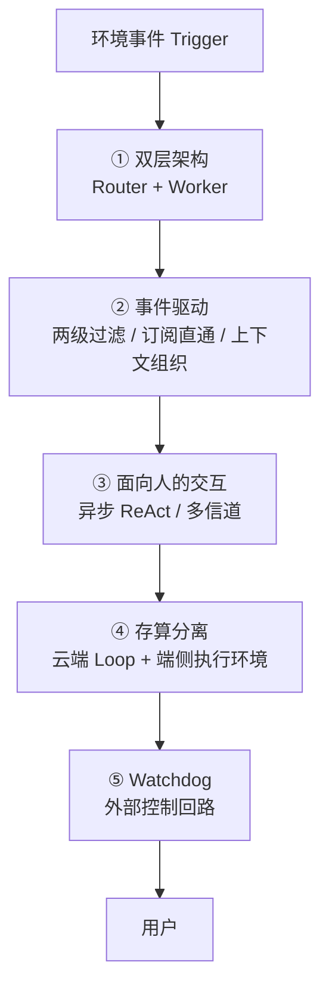
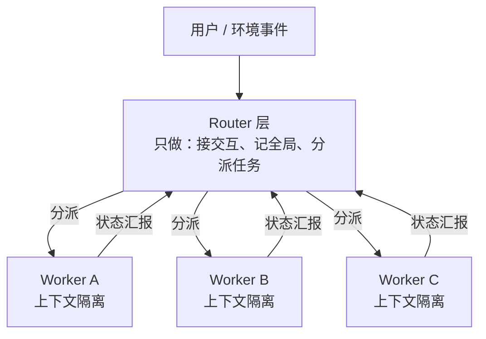
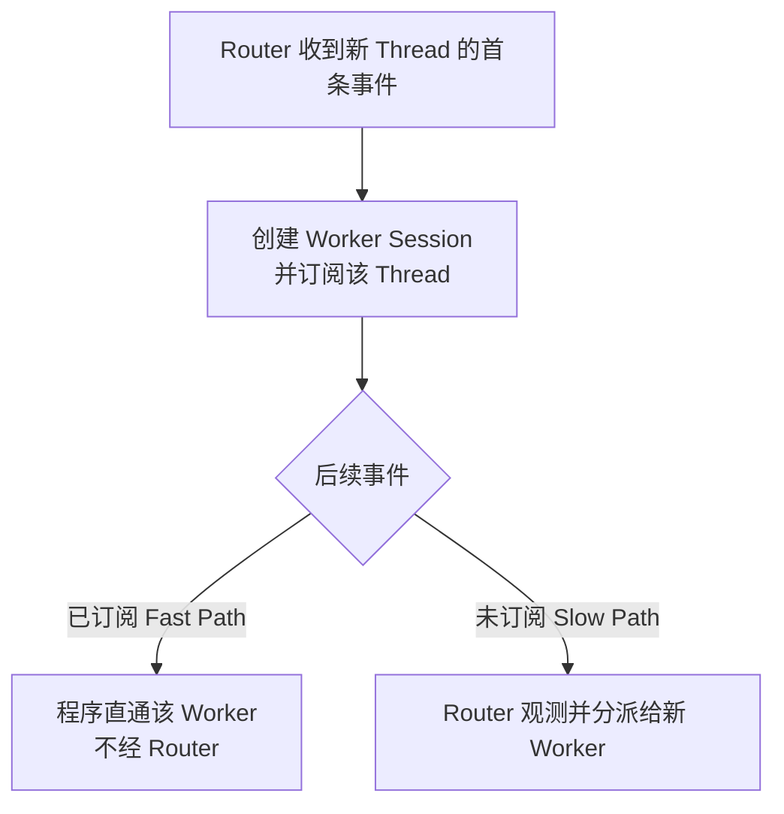

Super-agent 是 DeepSeek Harness 团队给一种新 Agent 形态起的名字。过去一年，Coding Agent 证明了模型能自己用工具解决复杂问题，人需要持续盯着敲命令的场景越来越少。个人助手这类新形态随之出现：接进 IM、日程、邮件、代码平台，持续看着信息流，顺手处理事务。

但撞上了一堵墙。这堵墙不在模型侧，而在人这一侧。

DeepSeek Harness 团队在 2026 年 10 月 31 日发布的《Super-agent 设计探索：迈向更自主的 Agent 系统》里给了一个判断：**单任务的上限取决于模型能力，多任务的上限取决于人的注意力。** 他们的观察是，一个人通常只能同时跟进 3 到 5 个活跃 Session。

本文拆解这套架构的五个模块、原文给出的两组实验数据，以及作者自己列出的四个未解问题。原文明确声明这是架构思路探讨，不是产品功能介绍。

## 一、为什么"单会话 Agent"注定走不远

现行设计以单一 Session 为基本单位，各 Session 彼此独立。用户并行推进多项工作，就得手动切换并记住每个 Session 的上下文。

三个具体痛点：

| 痛点 | 表现 | 本质 |
|---|---|---|
| 单会话同步阻塞 | 一个长任务跑着，新指令只能排队 | 一个 Session 一次只能干一件事 |
| 多任务上下文混乱 | 5 个任务的内容混在一处，互相干扰 | 上下文既是技术问题，也是项目管理问题 |
| 本地设备离线即停机 | 笔记本合盖，Agent 就死了 | 计算、状态、环境三者焊死在同一台机器 |

在现有本地单会话 Agent 上接 CLI、MCP 或外部连接器，这三个问题一个都解不了。

文章里有一句话是全文的思想内核：

> **Session 应当是系统的实现细节，而不应是用户的认知负担。**

过去让人手动管会话，本质上是底层 LLM API 时代的设计惯性——因为 API 就是「一个 chat session 一个上下文」，产品就长成了这样。一旦把产品形态和底层 Session 解耦，「怎么管任务」就变成一个独立的产品问题，而不是技术约束的副产品。

## 二、四个特征与五个模块

Super-agent 要同时满足四个特征：

- **连续**：在 IM 里说"用方案 A"，到 GitHub PR 评论里改成"用方案 B"，它知道换了主意，不用你去翻"会话 X 的上下文里有没有 Y 这条信息"。
- **高效**：响应快，且能同时高质量推进多个复杂任务，不用等上一个命令跑完才接下一条。
- **主动**：不用逐条下令，持续观察环境事件、主动推进值得处理的事，不需要介入时闭嘴。
- **持久**：始终在线，直接接进真实工作环境，长期运行遇异常能自己恢复。

单个 ReAct Loop 撑不住这四条，底层必须换架构。支撑它们的是五个模块：

值得注意的是这套设计的来源：它没有发明新理论，而是把计算机系统领域的经典思路搬进了 Agent 系统——分层调度对应负载均衡，快慢路径对应 Fast Path / Slow Path，存算分离对应分布式系统，Watchdog 对应外部控制回路。

作者对这种「相似约束导出相似架构」的判断给了一个更一般的理由：无论做个人助手还是面向研发团队的 Agent，只要目标是「持续在线、并发响应环境事件」，底层大概率会撞上同一批问题；而这批问题在操作系统和编译器领域已经研究了几十年。

## 三、模块一：把全局连续性和高并发拆到两层

底层会话组织面临一个根本权衡：每条事件都进同一个 Session，上下文最连续但吞吐最低；每条事件新开独立 Session，吞吐最高但结果彼此割裂、多个 Session 各自回你造成交互混乱。

解法是拆成两层：

**Router 层**是常驻的全局路由层，承接所有入口的人类交互，跨任务的信息和决策在这里汇总——它是全局的序点（Sequence Point）、协调点和记忆。为避免成为瓶颈，Router 在设计上不执行具体任务，甚至可以不配 Bash 工具。

这里容易被误解成 Agent Team 的那种 "lead"。原文明确做了区分：

| | Agent Team 的 Team Lead | Super-agent 的 Router |
|---|---|---|
| 介入深度 | 深入理解任务细节、规划子步骤、高频协调成员 | 只管任务之间的高层关联与分派 |
| 自身推理负载 | 很重 | 轻 |
| 是否自己执行 | 通常也参与执行 | 明确不执行 |

实务结论是：**Router 层的任务常常没有想象中复杂，用较轻量的模型往往就能兼顾速度与效果**；Worker 直接决定结果和代码质量，通常要配最强的模型。

Router 为什么不容易被压垮？因为它内部就是一个常驻 LLM Session，而事件会**批处理**：上一轮推理期间到达的 Trigger 积压下来，在下一次调用里一并注入。Router 每步都是长输入、短输出，把 N 条 Trigger 合并进一次 API 调用是在 Prefill 阶段并行计算，单次请求耗时的增长远慢于批处理大小。

规模再大时 Router 也可以水平切分成多个会话，但权衡依然存在：**切分粒度越细，Router 并发吞吐越高，分片之间的记忆与上下文连续性越低**。在全局记忆问题被解决之前，这个权衡无法回避。

Worker 层有三个设计点值得留意：Worker 之间默认不通信，各自独立推进；Worker 内部还能再嵌套 Subagent，对上层 Router 保持透明；订阅关系是多对多的——多个 Worker 订阅同一个 Thread 时都会收到事件通知，**不用点对点通信就能知道彼此在干什么**，冲突有机会自行发现解决。

## 四、模块二：事件驱动，让 Agent 变"主动"

过去 Agent 的输入是人在会话里敲的字。现在输入是环境里冒出来的半结构化事件——群聊消息、邮件提醒、代码审查评论、CI 运行结果，统称 **Trigger**。

### 两级过滤：先做便宜的判断

接入真实群聊后，事件流是明显的"高噪音、低触发率"。每条消息都调一次大模型，延迟和钱都受不了。

借用操作系统的快慢路径：

| 层级 | 用什么 | 做什么 | 成本 |
|---|---|---|---|
| 程序层（Fast Path） | 确定性代码 | 查来源、群组范围、白名单：仅响应明确请求 / 作为候选事件 / 直接忽略 | 低延迟、低成本 |
| 语义层（Slow Path） | LLM + 提示词 | 对通过准入的候选，判断是否需要行动 | 高延迟、高成本 |

语义层同时是面向人的扩展点——可以随时用提示词开关策略、新增策略，不用改代码。

### 订阅与直通：别让所有事件都过 Router

如果已分配任务的后续事件还要 Router 转发，Router 依然是瓶颈。所以事件路由也分快慢两条路。

同一个 PR、同一个 IM 话题、同一封邮件串下的连续事件构成一条 **Thread**：

订阅关系是多对多的：一个 Worker 可订阅多个 Thread，一个 Thread 也可被多个 Worker 订阅。输出侧仍然由 Worker → Router → 用户，保证对外只有一条声音。

### Inline & Spill：把上下文窗口当 Cache 管

输入从「有限的人类提示词」变成「环境持续产生的半结构化事件」后，注入多少就成了关键：

> 注入过多 → 挤占窗口、稀释注意力；注入过少 → 模型反复调工具读，执行步数暴涨。**浪费上下文窗口，就是浪费模型的智能。**

两个操作：

- **Inline**：把近期很可能用到的信息直接内联进上下文，省掉一次工具调用往返。
- **Spill**：超出窗口预算或低频使用的完整信息留在窗口外，窗口内只留引用/摘要。

配合局部性（Locality）思想可以逐步展开：先只给当前对象的 ID 和摘要；再附上紧密关联对象的 ID 和时空相邻的内容——比如内容前 50 字、IM 消息的前后相邻消息、被回复的那条消息、代码评论所在评审讨论里的相邻评论；超出上限则截断，但**保留续读入口**，模型需要完整内容时再调工具读。

### 链式召回：顺着线索一张网找回来

Router 不能把所有任务的全量历史塞进自己的窗口，但当你在跨信道提起某个旧任务时，它必须能把上下文找回来。

把 Inline & Spill 一致地应用到系统里所有对象上，就得到一个按需展开的多跳检索机制——**链式召回（Chain of Recall）**。给 Trigger、Thread、Worker Session 都赋予唯一 ID，注入时内联紧密关联对象的 ID，这些对象在底层构成一张引用图。由于每次工具调用召回的对象本身也遵守 Inline & Spill，它返回的结果里又会内联下一跳的摘要与 ID——模型就能从当前事件出发，顺着引用关系逐跳按需召回上下文。

### 投机执行：不确定要不要，就先做一份

借鉴 CPU 的投机执行（Speculative Execution）：结果不确定会不会被采用时，先在后台试着来一发，有价值就交付，没价值就丢弃。

DeepSeek Harness 内部用户群配了一条「静默复现并修复」策略：群里有人反馈问题或讨论方案时，Agent 后台先尝试复现并找修复方案，**只有确认了问题且找到简单修复方案才交付**，否则全程安静。投机执行的关键是交付门槛：不确认就不出声，不制造噪音。

## 五、模块三与四：交互解耦与存算分离

### 异步 ReAct Loop：从半双工到全双工

经典 ReAct Loop 的问题是模型发起一次同步 `run()` 工具调用后循环阻塞，直到工具跑完返回，期间会话对任何新输入都无响应。

解法是把耗时调用改成异步的 `start()` / `stop()`：调用 `start()` 立即收到"已启动"，后台执行完成后结果作为新事件消息投递回会话，模型也可调 `stop()` 主动终止超时的后台命令。前台对话与后台任务由此解耦。

原文注明：这套异步任务机制**已经在 DeepSeek Harness 中实现，但尚未默认开启**。

### 多信道交互：输出要匹配信道的带宽

把终端交互原样搬进群聊，冗长的推理过程和密集的工具调用会瞬间造成信息过载。双层架构已经解决了一半——推理和工具调用都被隔离在 Worker 内部——但还得按信道定制交互规范：

| 信道 | 风格 | 规范 |
|---|---|---|
| IM 等即时通讯 | 低打扰、轻量 | 像人类同事一样只在需要决策或验收时才发通知；只问直接问题、给简短结论。原文提到一条验证过的硬性规定：**单次回复不超过 100 词** |
| GitHub / 邮件 / 文档 | 结构化、高信息密度 | 按项目规范写完整的问题背景、改动说明与验证结果 |

### 存算分离：让 Agent 24 小时在线

本地 Agent 的默认状态是推进 Agent Loop 的**计算**、需要持久保存的**状态**、代码仓库和本地工具链等**执行环境**，三者焊在同一台设备上。

解法分两步：

**第一步，计算与状态分离。** 计算做成无状态的，放进云端弹性计算容器；Session 等状态存进数据库。计算容器可水平扩展、可重启替换，连续性由持久化存储保障。

**第二步，计算与执行环境分离。** 常见的两种思路都有问题：在云端起沙箱、拉代码、重建同步环境——真实环境含未提交的本地修改、私有凭据、内网服务依赖、同步成本极高还容易信息遗漏；要求用户放弃本地环境迁往云端——迁移成本过高。

> **既然难以复制和同步的是环境本身，就不必让执行环境跟着 Agent Loop 上云。**

解法是 Agent Loop 在云端跑，**重状态的执行环境留在原地**，端侧只部署一个不保存会话状态的轻量 daemon，只负责执行命令、返回结果。这带来 BYOM（Bring Your Own Machine）、跨设备切换、以及支持间歇在线设备。

这一思路与 Anthropic 的「脑手分离」（Decoupling the brain from the hands）一致，区别在场景：Anthropic 那篇讲托管服务、按需创建的沙箱和客户 VPC 内资源；这里首先要接入的是用户日常使用、可能间歇在线的个人机器，上面有未提交的修改和本地凭据。

### Watchdog：系统之外的巡检员

要实现持久在线，光有存算分离不够，还得能从异常中自动恢复。持久在线的分布式系统很难仅靠主系统内部逻辑保证长期可靠运行，需要在主系统**之外**引入一个独立的外部控制回路，即 **Control Loop**。

光靠传统的进程存活探测或监控脚本也不够，因为很多异常不是进程崩溃，而是**模型陷入无效循环或偏离目标**：

> 不只要监控基础设施的存活，还要监控任务本身的进展。

做法是在主系统外部配置一个独立的 Watchdog Session，用定时消息驱动。它处理接口报错、状态恢复失败等基础设施故障，**由模型判断各个 Worker 是否有实质进展、方向是否偏离整体目标**，发现异常及时介入修复，遇到外部偶发故障持续复查直至恢复。

妙处在于 Watchdog 本身也是具备完整工具能力的 Agent Session，维护者可以直接用自然语言问它故障原因，或让它在线改主系统的行为——增删提示词、调整触发规则。

## 六、两组实验数据，以及它们不能证明什么

原文自述：**实验基于合成负载与简化环境，部分设置还可以更加严谨，以下结果仅作为初步参考。** 这句限定必须跟着数字一起读。

### 消融实验（端到端）

用群聊和 GitHub CI 消息流驱动四种方案：Super-agent、去掉直通的 Super-agent、单 Session+Subagent（中性提示）、单 Session+Subagent（提示优先委派）。单次实验约 300 条消息，其中约 20 条是工作请求，其余是闲聊、跟进、叫停和 CI 消息。编码工作用一个只消耗时间的工具代替——所以测的是**调度与协作能力，不是执行能力**。每种方案跑 5 次。

| 方案 | p50 | p95 |
|---|---|---|
| Super-agent | 12.4 分钟 | 15.7 分钟 |
| 单 Session + Subagent（中性提示） | — | 29.5 分钟 |
| 单 Session + Subagent（提示优先委派） | — | 仍慢于 Super-agent |

两个细节值得注意。**中性提示下，模型在 5 次运行中一次都没有调用 Subagent**，所有工作都在主 Session 里干，还不断被新消息打断。改成提示优先委派后，5 次中有 4 次进行了委派，时间缩短但仍慢——剩下 1 次它判断工作"很小"就自己干了，形成一条长尾。

结论不是"提示词工程没用"，而是：**双层架构在系统层面让 Router 不直接执行、Worker 只接收所订阅 Thread 的消息**，比在单 Session 里靠提示词和模型临场判断分不分工更可靠。

去掉直通机制后的代价与收益：

| 指标 | 完整版 | 去掉直通 | 变化 |
|---|---|---|---|
| 任务完成时间 | 12.4 / 15.7 分钟 | 基本一致 | 不受影响 |
| Router 需做的决定数 | 基准 | — | 约 +30% |
| 总读缓存 token | 2323 万 | 3177 万 | 约 +37% |

即：**直通机制不提升任务完成质量与速度，但为 Router 节省了可观的 token 与推理开销**。反过来，Super-agent 的 token 消耗高于单 Session——这是用更多 token 换更短、更稳定的完成时间。

### Router 层批处理压测

Router 调真实模型、Worker 用 Mock 模型，把需要决定的 Trigger 到达速率从约 1 条/分钟提到约 40 条/分钟。

| 指标 | 1 条/分钟 | 40 条/分钟 |
|---|---|---|
| 平均 batch 大小 | 1.0 | 2.8 |
| 单次请求耗时 | 2.5 秒 | 3.9 秒 |
| 单个决定分摊的推理时间 | 6.4 秒 | 1.6 秒 |

单次请求耗时只涨了 1.56 倍，远慢于 batch 大小 2.8 倍的增速，于是单个决定分摊的推理时间降到约 1/4。这也解释了为什么在消融实验里即使去掉直通、把 Router 峰值负载推高，仍没触及单 Router 的吞吐瓶颈——**在目前团队规模下，没必要过早水平切分 Router 而牺牲全局上下文连续性**。

### 这两组数字不能证明什么

- 负载是合成的，编码工作用"只消耗时间的工具"替代，测的是调度不是编码质量。
- 「单个决定分摊的推理时间下降」是 Router 层独立压测的结果，Worker 是 Mock 模型，不能直接外推到端到端。
- 每种方案只跑 5 次，样本量小到不足以支撑显著性判断。
- 原文没有给出与其它具体 Agent 框架的横向对比。

## 七、四个未解问题

作者自己列出的开放问题，比已给出的方案更能说明这套架构现在的成熟度。

**8.1 如何扩展双层架构。** Router 何时需要水平切分、粒度怎么划、同层 Worker 何时需要直接通信、拓扑如何选——尚无定论。一个值得探索的方向是系统与模型的协同设计：对 Router 的事件判别、批量分派、上下文召回做专项训练。另外，当运行周期拉长到**跨月乃至更长**，长程记忆会成为扩展性的主要瓶颈。

**8.2 脱离 Session 之后如何与 Agent 协作。** 以聊天窗口为中心的交互是路径依赖的结果，未来可能更多发生在领域特化的界面里（直接活在 GitHub Issue/PR 中）。而且在模型能力过渡期内，很多任务仍需人中途参与——如何兼顾"随时介入、接管、实时协同"与"后台自主推进的效率"？最终形态很可能高度定制化。

**8.3 上下文边界与 A2A。** 组织决定怎么配备 Super-agent，本质是在划分上下文共享与隔离的边界。一旦有多个隔离实例（个人助手 vs 团队共用），跨边界的 A2A 如何安全可靠地协作，仍待探索。

**8.4 安全与隐私——最大的风险点。** 原文的判断很直接：

> **如果没办法很好解决安全与隐私问题，Super-agent 只能在一个很小且可信的范围里工作。**

两个具体风险。其一，跨设备连接被攻破：云端 Agent Loop + 端侧轻量 daemon 的设计默认建立在「云端与端侧彼此受信任」的前提上，但云端持续接入外部环境事件、端侧存着私有代码和凭据——一旦云端 Agent Loop 遭遇服务端入侵或提示词注入被攻破，它连接的全部端侧设备都面临被控制的潜在风险。其二，凭据泄露：即使云端没被攻破，只要端侧凭据能进入模型上下文，正常执行过程中也存在泄露风险。因此还需要设计机制，让 Agent **在不接触凭据本身的情况下使用凭据**。

## 八、可以借鉴到自己项目上的六点

这不是一篇「照着做」的教程，但里面有几点几乎可以立刻用在自己项目上。

| # | 可借鉴点 | 怎么用 |
|---|---|---|
| 1 | **Fast Path / Slow Path 两级过滤** | 事件类系统里先用确定性代码筛（来源/白名单/正则），只把候选喂模型，能省掉大部分推理成本和延迟 |
| 2 | **Inline & Spill** | 把「常用资料摊桌上、完整档案放档案室」用起来。上下文当 Cache 管，别把窗口当垃圾桶 |
| 3 | **Router 不干重活，Worker 配强模型** | 分层分模型：路由/分诊用轻量模型，执行用最强模型。这条对降本立竿见影 |
| 4 | **直通机制省 token** | 已归属任务的后续事件别再走中央节点。原文实测：总读缓存 token 省约 37%、Router 决定数少约 30% |
| 5 | **异步工具调用（start/stop）** | 长耗时工具别用同步 `run()`，改 `start()` 立即返回 + 后台完成后投递结果。DeepSeek Harness 已实现但未默认开启 |
| 6 | **多信道输出规范** | 给 IM 定一个硬上限（比如 100 词），给 GitHub/邮件定结构化模板。**同一条内容在不同信道要重新裁剪** |

另外两条认知层面的提醒：

- **别让 Session 变成用户的概念。** 如果你的产品要求用户手动记住「上次干到哪了」，那是设计债。
- **监控任务进展，不只监控进程存活。** 「模型陷入无效循环」比「进程崩溃」更常见，后者靠 liveness probe 就能发现，前者不行。

## 参考资料

- [Super-agent 设计探索：迈向更自主的 Agent 系统](https://mp.weixin.qq.com/s/zoS7GlReWPhfCjENGxXCdg) — DeepSeek Harness 团队，2026-10-31（原文明确声明为架构思路探讨，非产品功能介绍）
- [deepseek-ai/dsh-superagent-prototype](https://github.com/deepseek-ai/dsh-superagent-prototype) — 原型仓库，MIT 许可，仓库自述「仅为验证技术路线而提供的原型，并非 DeepSeek 的正式产品」
- 进阶阅读：[Super-agent 原型源码：工单、授权与订阅的领域模型](/blog/super-agent-domain-model-tickets-and-mandates/) — 上面五个模块在原型代码里的概念与授权规则
- 进阶阅读：[Super-agent 执行层：槽位、后台作业与故障恢复](/blog/super-agent-execution-layer-worker-slots/) — Worker 槽位、后台作业时限与失败重建
- 关联阅读：[拆解 DeepSeek Harness](/blog/deepseek-harness-agent-runtime/) — PTC 与创造模式、Cordis 底层
- 关联阅读：[Cordis：时空可组合性](/blog/cordis-spatiotemporal-composability/) — 「一切皆插件」的形式化根基
