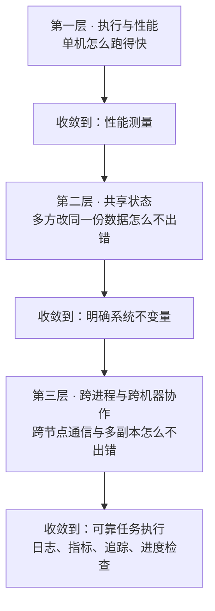
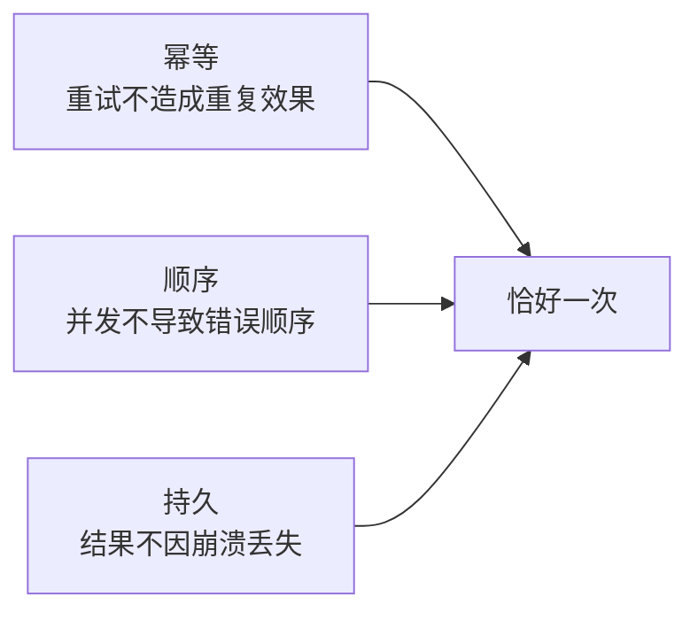

「系统设计的三层」不是三组知识点，而是三个必须分别回答的问题。最容易犯的错是把它当成清单：缓存、限流、分库分表、Raft、幂等，一条条背下来，真到设计一个具体系统时还是不知道从哪儿下手。

问题在于这些机制不在同一个层次上。缓存解决的是「取数据太慢」，事务解决的是「两个写入互相踩」，Raft 解决的是「多个副本谁说了算」。它们回答的是不同层的问题，混在一起看就只剩一堆名词。

这篇给一个三层框架，把这堆名词按「哪一层出错」重新排一遍。

## 一、为什么值得分层：越往上层，故障越不局部

三层的区别不只是「单机还是分布式」，而是**故障的传播范围**。

| 层 | 前置假设 | 破坏后果 | 核心保障手段 |
|---|---|---|---|
| 执行与性能 | 单机资源足够，故障只会是进程崩溃 | 慢、卡、抖动，但**结果仍然正确** | 缓存、流水线、事件循环、有界队列、锁 |
| 共享状态 | 数据能持久化，进程会崩但机器不丢盘 | 数据损坏、丢失更新、读到脏值 | 事务与隔离级别、WAL、MVCC、B+ 树与 LSM 树 |
| 跨进程与跨机器协作 | 网络会延迟、丢包、乱序、重复，节点会挂 | 脑裂、脏读、重复扣款、状态永久丢失 | 共识、幂等键、序号与版本、租约与隔离令牌 |

关键在最后一列和倒数第二列的关系：

单机层的错误通常表现为**性能退化**，重试能解决。正确性层的错误表现为**数据损坏**，需要 WAL 加恢复流程。分布式层的错误表现为**状态永久性错误**——脑裂之后，即使所有节点都恢复，系统也可能无法自动收敛。

这决定了两件事。第一，第三层不能靠事后补偿，必须把「不允许的错误」在设计阶段就排除掉。第二，如果你不知道一个方案的瓶颈属于哪一层，你也没法判断它需要什么保障。

## 二、第一层：执行与性能

这一层的核心命题只有一句：**大部分时间不是在算，而是在等数据。**

三条主路径：

**减少数据访问成本。** 虚拟内存与地址转换是这一支的起点——页表、TLB、缺页处理决定了「取一个字节」的真实代价。TLB 未命中要走慢路径，缺页风暴能让一个本来算得很快的程序卡死。往上叠缓存与局部性：缓存行、命中率、替换策略。伪共享和颠簸是两个最常见的反模式。想深入这一支，可以从 [一次加法为什么这么慢：内存层级全景](/blog/cpp/slowest-add-memory-hierarchy/) 和 [Linux 内存与 PageCache](/blog/linux-memory-and-pagecache/) 入手，多核机器还要看 [NUMA 非一致性内存访问](/blog/non-uniform-memory-access-numa/)。

**增加并行与重叠。** 流水线与投机执行把「等」藏在计算后面，代价是预测错误时要能撤销未提交的结果。异步 I/O 与事件循环把等待转成就绪事件与回调，再唤醒任务调度。[I/O 多路复用：select、poll、epoll 与 io_uring](/blog/io-multiplexing-select-poll-epoll-io-uring/) 讲的是这条线上最常被问的一段。

**控制资源争用。** 锁、原子操作、内存序保护共享状态；有界队列与背压限制生产者跑得比消费者快太多。

三条路径最后都收敛到同一个节点：**性能测量**。缓存、调度、锁的改造效果，必须用吞吐量、尾延迟、队列长度三个量来验证，只看均值会被平均值骗过去。方法论层面可以参考 [高性能低延迟手册](/blog/high-performance-low-latency-handbook/)。

这一层有个容易忽略的前置假设：**它假定故障只会是进程崩溃**。一旦出现「机器不丢盘但进程崩了」或者「网络上另一个节点拿到的数据比我还旧」，这一层的所有保障都不够用了，得往上走。

## 三、第二层：共享状态

这一层回答的是：**多方同时改同一份数据，怎么保证结果正确。**

三个分支，对应三种不同的失败。

### 并发修改：事务与隔离级别

两阶段锁、MVCC 与快照、乐观并发控制，是三条主要路线。这里最容易踩的是隔离级别：选低了会脏读、幻读，选高了会撑爆版本链。更隐蔽的是**写偏斜**——快照隔离（SI）并不保证可串行化，两个事务各自读到的快照都是合法的，合起来的结果却违反了业务约束。

### 崩溃与重启：WAL

预写日志的规则很简单：先持久化日志，再修改数据。崩溃恢复时用 Redo 重放已提交的操作，必要时用 Undo 撤销未提交的部分，再用检查点决定从哪里开始恢复。

反模式也很明确：没落 WAL 就改数据等于丢数据；没有撤销逻辑，脏数据会污染恢复后的新状态；日志无限增长而不做检查点，磁盘迟早撑爆。存储引擎侧的实践可以看 [HBase 写路径](/blog/hbase/09-write-path/) 和 [Compaction 机制](/blog/hbase/12-compaction/)。

### 高效查找：B+ 树与 LSM 树

这两者是读写放大与空间代价的取舍。B+ 树读得快、写有随机 I/O；LSM 树顺序写快，代价是写放大、读放大、空间放大三者里必须选两个。

### 收敛点：明确系统不变量

事务和 WAL 两条路径最后都指向同一件事——**不管走哪条路，你都要能证明「系统状态永远满足某些性质」**。

这是这一层最容易被跳过的一步。很多团队把事务级别调对了、WAL 加上了，却从来没写下过「这个系统的不变量是什么」。结果就是没法验证：你连要保证什么都不知道，怎么知道有没有保证住。

实践上要做的：把不变量显式写出来，用状态机描述合法迁移，再用故障注入去验证它。三者缺一，正确性就只能靠运气。

## 四、第三层：跨进程与跨机器协作

这一层的前置假设最弱：**网络会延迟、丢包、乱序、重复，节点会挂。** 三个分支对应三类问题。

### 通信不确定

超时不等于失败——这是分布式系统里最反直觉的一条。请求超时了，对方可能已经执行成功，也可能根本没收到。所以重试必须配幂等键和结果去重，否则一次超时就是一次重复扣款。

共识（Raft 一类）解决的是另一件事：多个副本对「日志顺序」达成一致。但要注意它的边界——**共识只保证日志顺序，不保证读写语义**。Raft 之上还需要一整套读协议才能实现线性一致读，细节可以看 [Kafka KRaft 共识](/blog/kafka/10-kraft-consensus/) 和 [Raft 与线性一致性](/blog/paper-reading/raft-iml-js/)。

### 多副本状态

乱序与迟到、分片与数据迁移。分片迁移的过程中会出现「同一份数据在两边都存在」的窗口，这时旧分片如果还能接受写入，就会出现丢更新。

### 资源与权限边界

租约与隔离令牌、身份认证与操作授权、限流背压与故障隔离。租约这一支的经典陷阱是**租约过期瞬间的双写窗口**——旧持有者以为租约还有效，新持有者已经拿到了锁。[分布式锁](/blog/distributed-locks/) 和 [Redlock 真的安全吗](/blog/translate/is-redlock-safe/) 讨论的就是这个。

## 五、最漂亮的设计：一个原语解决三个问题

把上面这些分支放在一起看，会浮出一个非常干净的结论。

| 分支 | 遇到的问题 | 收敛到 | 机制 |
|---|---|---|---|
| 通信不确定 | 旧请求迟到、旧 Leader 下发指令 | **序号、版本、任期** | 比较逻辑标识，拒绝过期写入 |
| 多副本状态 | 乱序、迟到、迁移中双份数据 | **序号、版本、任期** | 同上 |
| 资源与权限边界 | 租约过期后旧持有者写入 | **序号、版本、任期** | 同上（隔离令牌） |

三个看起来毫无关系的问题——乱序迟到、分片迁移双份、租约过期双写——用的是同一个答案：

> **一切写入都携带一个可比较的逻辑标识，接收端拒绝任何不比当前标识新的写入。**

Raft 的任期、数据库的版本号、分布式锁的隔离令牌，本质上是同一个东西。任期是「Leader 的版本号」，版本号是「数据的任期」，隔离令牌是「锁持有者的版本号」。

认识到这一点之后，很多设计题的解法会变得机械：先问「这个系统里什么会被并发修改」，再问「我能不能给每次写入挂一个单调递增的标识」，最后问「接收端凭什么判断该拒绝」。

## 六、三个必答问题与一个收敛检查

有了框架，怎么用？

**第一步，定位。** 判断你说的瓶颈属于哪一层：

- CPU 打满、上下文切换多、队列积压 → 第一层
- 数据被覆盖、读到脏值、恢复后不一致 → 第二层
- 副本不一致、脑裂、重复执行 → 第三层

**第二步，补设计。** 任何方案都要能回答三个问题：

1. 缓存和局部性在哪？
2. 事务边界在哪、WAL 写在哪？
3. 跨机幂等靠什么键？

三个问题对应三层。答不上来的那一层，就是你方案里的空白。

**第三步，收敛检查。** 方案末尾必须有一个收敛节点。缺性能测量等于无法验证优化有没有效果；缺系统不变量等于无法证明结果正确；缺可靠任务执行等于无法保证「恰好一次」。

「恰好一次」不是靠一个机制实现的，它需要三个条件同时成立：

少任何一个，你得到的都是「至少一次」或者「最多一次」，而不是恰好一次。而这三条对应的正是前面三层：幂等属于第三层的通信不确定，顺序属于第三层的多副本状态，持久属于第二层的 WAL。

## 七、这份框架不解决什么

三层框架的边界得说清楚，否则容易变成新的清单背诵。

**它不给容量估算。** 一个系统需要多少机器、多少分片、多少连接数，取决于具体负载和延迟目标，这套分层只能告诉你该测什么，不告诉你该配多少。

**它不覆盖组织与成本。** 团队边界、发布流程、云成本结构都会真实影响架构选择，但这些不在技术分层里。

**它的第三层结论依赖一个前提：你确实需要跨机一致性。** 很多业务用最终一致就够了，硬上共识只会增加延迟和运维负担。先确认业务能不能接受短暂不一致，再决定要不要走第三层。

**它不能替你决定优先级。** 分层告诉你机制属于哪一层，但不能告诉你现在该先修哪一层。那是取舍问题——先看当前最贵的故障在哪一层，再决定投入。

一份地图的价值不在于覆盖全部地形，而在于让你知道自己在哪儿。

## 进阶阅读

这篇是总览，每一层的机制在这三篇里展开：

- [单机为什么慢：执行与性能层](/blog/execution-and-performance-layer/) — TLB 三档成本、伪共享、内存序、有界队列背压、尾延迟
- [共享状态：并发修改、崩溃与查找](/blog/shared-state-correctness-layer/) — 隔离级别、写偏斜、WAL 与 ARIES、B+ 树与 LSM 树
- [跨机器协作：网络会骗你](/blog/cross-machine-coordination-layer/) — 幂等键、Raft 多数派、线性一致读、隔离令牌

## 参考

- Martin Kleppmann [《数据密集型应用系统设计》](https://dataintensive.net/)第 5 章（事务）、第 7 章（共识）
- Diego Ongaro, John Ousterhout. *In Search of an Understandable Consensus Algorithm*（Raft 原始论文）
- Leslie Lamport. *Time, Clocks, and the Ordering of Events in a Distributed System*
