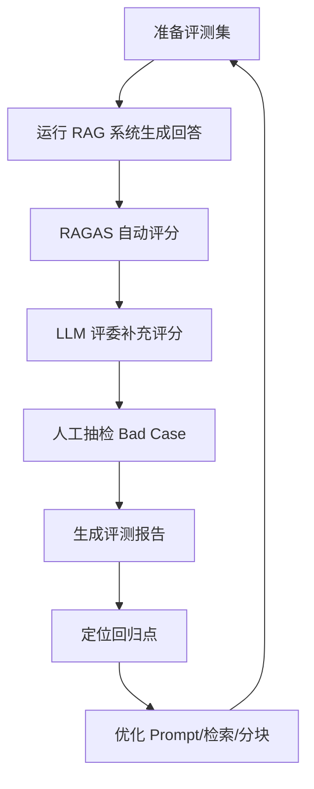

先说一个具体场景。某个周二下午，团队的 AI 客服项目再次陷入僵局：算法工程师说「我优化了 prompt，回答准确率明显变高了」，产品经理问「可是用户投诉量怎么没降」，运营负责人说「我抽查了 50 条，感觉有一半还是答非所问」。三个人争了三个小时，最后发现**大家对「准确率」的定义都不一样**。评测的三层指标要解决的就是这件事：把「准确率」这个词拆成模型能力、任务完成度、业务价值三个互不等价的层次，每一层对应一个不同的决策。

小林的准确率是内部测试集上的分类正确率；老张看的是用户是否满意；运营说的是回复是否符合公司政策。

这不是团队水平问题，是评测体系的问题。**没有统一的评测标准，每次优化都像在黑暗中扔飞镖——听着很响，却不知道中没中靶。**

本文整理自《工程化 AI 应用实战：8 个核心技术栈解析》第 05 篇「AI 系统评测方法」。评测设计的通用原则（采样、评分器选择、留出集与过拟合两层）另有专门文章讨论：[Eval 设计与自动爬坡](/blog/eval-design-and-hillclimbing/)，评测框架的源码级剖析见 [DeepEval v4](/blog/deepeval-v4-evaluation-framework/)。本文只讲它们没覆盖的那一层：**指标该分几层，以及这套分层怎么落到一个具体系统上。**

文中 RAGAS 的 API 以 [官方文档](https://docs.ragas.io/) 为准，版本相关的差异已在第五节标注。

## 一、评测不是一次性考试，是三层

如果把 AI 应用看作一个系统，评测应该分三层：

| 层 | 回答的问题 | 典型指标 |
|---|---|---|
| **模型能力层** | 模型会不会做 | 分类 F1、ROUGE、困惑度 |
| **任务完成度层** | 系统做对了没 | RAG 问答准确率、工具调用成功率、政策符合度 |
| **业务价值层** | 值不值得做 | 用户满意度、人工介入率、响应时间、成本 |

**很多团队只测第一层。** F1 提升了 5 个点就宣布这一轮优化成功——但用户投诉没降、人工介入率没变、每次会话的 token 成本还涨了。

这三层不是「从难到易」的难度排序，而是**三个不同的决策问题**：

- 模型能力层回答「要不要换模型」；
- 任务完成度层回答「要不要改检索、改 prompt、改工具描述」；
- 业务价值层回答「这个功能该不该继续投入」。

一个系统的 F1 从 0.8 涨到 0.85，同时人工介入率从 30% 涨到 35%，这不是「优化有 50% 效果」——**这是优化起作用了，但方向错了**。只看第一层，你根本不会发现。

**三层要一起看，才能避免「局部最优，全局崩盘」。**

## 二、指标要按任务类型选，不是按分数高低选

不同任务需要不同指标，这一点没有争议，但实践中常被简化成「用 LLM 打分」。

| 任务类型 | 指标 | 注意事项 |
|---|---|---|
| 分类（意图识别、情感、过滤） | Accuracy / Precision / Recall / F1 | 有标准答案，优先用精确指标 |
| 生成（摘要、翻译、文案） | ROUGE / BLEU / METEOR | 与人类「觉得好」并不完全一致，别当唯一依据 |
| 问答 / RAG | Faithfulness、Answer Relevance、Context Precision、Context Recall | 关注生成内容是否基于检索结果 |
| Agent（多步任务） | 任务完成率、平均步数、工具调用准确率、人工接管率 | 完成率之外，步数分布往往更能说明问题 |

选指标的原则是**和业务目标对齐**，而不是「哪个看起来高级用哪个」。分类任务硬上 LLM 评委，是把一个确定性问题变成不确定性问题。

## 三、LLM 评委：设计原则比工具重要

没有标准答案的场景（开放问答、客服回复、创意写作）只能靠 LLM-as-a-Judge。用一个更强或更中立的模型评估另一个模型的输出。

四条设计原则：

**评估维度要单一。** 不要问「这个回答好不好」，而要问「这个回答是否基于提供的文档」「是否回答了用户的问题」「是否存在幻觉」。一个笼统的问题会得到一个笼统的分数，而笼统的分数没法指导优化。

**评分标准要明确，且可核查。** 这里要和[评测设计那篇](/blog/eval-design-and-hillclimbing/)的结论对齐：1–5 分的问题不只是不精确，它把「为什么」藏起来了。写成可判定的断言（rubric），judge 才能给出可以复核的理由。

**要有 few-shot 示例。** 告诉 judge 你的标准长什么样，比在提示词里描述「请严格评分」有效得多。

**必须做人工抽检校准。** 不要完全相信模型评委——定期用人工标注校准它的偏差。judge 和被测模型同源时，自我偏好偏差会更严重。

**LLM-as-a-Judge 不是万能药。** 它擅长评估格式、忠实度、相关性，不擅长评估创意好坏、品牌语气、文化敏感点。后者仍然需要人。

## 四、评测集是地基

评测集（Golden Set）是评测体系的地基。一个好的评测集应该具备：

- **代表性**：覆盖真实业务中的典型问题和边缘 case，不是随便找几条数据；
- **稳定性**：不频繁变动，否则无法横向比较不同版本的效果；
- **可解释性**：每条数据都知道它测的是什么能力，方便定位回归点；
- **分层设计**：按难度或场景分层，比如简单问题、边界问题、恶意问题。

**构建评测集时不要贪多。初期 50–200 条高质量标注数据，往往比 10000 条低质量数据更有价值。** 因为评测集的本质是「信任锚点」——你信它，才愿意根据它的结果做决策。

这里有个具体的设计细节值得强调：**评测集里必须包含「应该回答不知道」的 case。** 比如知识库问答系统里，「去年双十一的优惠活动是什么」——如果知识库里没有 2025 年的活动记录，正确行为是「建议查询历史归档」，而不是编一个。一个只会答「有优惠」的评测集，测不出幻觉。

## 五、端到端流水线：RAG 场景

把上面的原则落到一个具体系统上。下面以企业内部知识库问答（RAG）为例。

**第一步：定义评测维度。** 至少四个：

1. 检索质量——检索到的文档是否与问题相关（Context Precision / Recall）；
2. 回答忠实度——回答是否基于检索到的文档，没有编造（Faithfulness）；
3. 回答相关性——回答是否真正回答了用户问题（Answer Relevance）；
4. 回答可用性——是否符合企业政策、语气是否合适（人工评估或 LLM 评估）。

**第二步：准备评测数据。**

```python
eval_data = [
    {
        "question": "公司年假最多可以休几天？",
        "ground_truth": "根据 2026 年员工手册第 12 条，入职满一年的员工每年可享受 5 天带薪年假。",
        "expected_sources": ["2026-employee-handbook.pdf"],
        "category": "policy",
    },
    {
        "question": "试用期员工有年假吗？",
        "ground_truth": "试用期员工不享受年假，转正后按当年剩余月份折算。",
        "expected_sources": ["2026-employee-handbook.pdf"],
        "category": "policy",
    },
    {
        # 故意设计的"超出范围"问题，用来测试系统是否会幻觉
        "question": "去年双十一的优惠活动是什么？",
        "ground_truth": "知识库中没有 2025 年双十一活动信息，建议查询历史归档。",
        "expected_sources": [],
        "category": "out_of_scope",
    },
]
```

第三条是整套数据里最值钱的一条。

**第三步：跑自动评测。** 这里有个坑值得单独说：**RAGAS 的 API 在 0.2.0 之后改过**，网上流传的多数教程代码在当前版本下跑不起来。

```python
import asyncio
from ragas import EvaluationDataset, SingleTurnSample, evaluate
from ragas.metrics import (
    AnswerRelevancy,
    ContextPrecision,
    ContextRecall,
    Faithfulness,
)

samples = []
for item in eval_data:
    # 这里调用你的 RAG 系统生成 answer 和检索到的 contexts
    answer, contexts = run_your_rag_system(item["question"])
    samples.append(
        SingleTurnSample(
            user_input=item["question"],
            response=answer,
            retrieved_contexts=contexts,
            reference=item["ground_truth"],
        )
    )

dataset = EvaluationDataset(samples=samples)

metrics = [
    Faithfulness(),
    AnswerRelevancy(),
    ContextPrecision(),
    ContextRecall(),
]

# evaluate() 在 0.2.0+ 是异步的，必须放进 asyncio.run()
result = asyncio.run(evaluate(dataset=dataset, metrics=metrics))
print(result)
```

三处迁移点，抄代码前先确认你的版本：

- **指标从函数变成类。** 0.1.x 是 `from ragas.metrics import faithfulness`（小写函数），0.2.0+ 是 `from ragas.metrics import Faithfulness` 并实例化 `Faithfulness()`。小写名字在新版本里已经不存在。
- **`evaluate()` 变成异步。** 0.2.0+ 必须 `asyncio.run(evaluate(...))`，同步调用会挂住。
- **样本字段改名。** `user_input` / `response` / `retrieved_contexts` / `reference` 是现在的字段名，早期版本用的是 `question` / `answer` / `contexts` / `ground_truth`。

另外注意导入路径在 0.2.x 的小版本间也动过：`SingleTurnSample` 早期从 `ragas.dataset_schema` 导入，后续版本统一到 `ragas` 顶层。照抄时以你安装版本的官方文档为准。

**第四步：补一层自研 LLM 评委。** 「回答可用性」这种偏主观、且贴着自家政策的维度，通用指标覆盖不了，自己写一个更合适：

```python
import json

def judge_answer(question: str, answer: str, policy: str) -> dict:
    prompt = f"""你是一名严格的企业知识库质量评估员。请根据以下标准对回答进行评分（1-5 分）。

评分标准：
1 分：回答完全错误或与问题无关
2 分：回答部分正确但包含明显错误
3 分：回答基本正确但缺少关键细节
4 分：回答正确且完整
5 分：回答正确、完整、简洁，并符合企业沟通语气

企业政策摘要：{policy}

用户问题：{question}
系统回答：{answer}

请按以下 JSON 格式输出评分和理由：

{{
    "score": 1-5,
    "reason": "评分理由",
    "issues": ["问题1", "问题2"]
}}

"""

    response = llm_client.complete(prompt)
    return json.loads(response)
```

注意这里返回了 `issues` 列表——**这是给第三步的 bad case 分析用的**，评委的输出不该只是扔进报表的一个分数。

**第五步：把评测挂进流水线。**



一个健康的评测流水线应该能回答三个问题：

- 这次改动让哪个指标提升了多少？
- 哪些 case 出现了回归？
- 下一步应该优化检索、prompt 还是模型？

**第三个问题是这套体系真正的价值所在**——它把「改什么」这件事从猜测变成了定位。

## 六、三个典型误区

**误区一：用通用 benchmark 代替业务评测。**

有人看到 MMLU、C-Eval、HumanEval 分数很高，就认为自己的应用没问题。但通用 benchmark 测的是模型能力，不是你的业务场景。一个在 MMLU 上得分 90 的模型，可能在你的客服场景里表现很差，因为它没见过你的政策文档、你的用户说法、你的业务术语。

通用 benchmark 可以作为**模型选型的参考**，不能替代业务评测。你的评测集才是衡量应用效果的金标准。

**误区二：评测集和训练集混用。**

更隐蔽的错误：用 prompt 调优时反复看同一批测试数据，甚至把测试数据里的答案泄露到 prompt 示例里。这会导致「评测集过拟合」——模型在这批数据上表现很好，一上线就露馅。

严格区分调优数据和评测数据。评测集一旦确定，就应该像代码里的测试用例一样被保护起来。每次 prompt 改动前先跑一遍，确认没有 regression。如果需要新增评测数据，要单独评审，避免污染。

**误区三：只看平均分，不看 bad case。**

「准确率 92%」听起来不错，但如果那 8% 的 bad case 全是高客单价用户的投诉，或者全是涉及资金安全的错误，对业务的伤害可能远超数字本身。

**分层看指标：**

- 不同类别问题的准确率；
- 关键场景的 bad case 分布；
- 人工介入率和介入原因；
- 用户满意度与模型评分的相关性。

每次评测后，**花 30% 的时间看平均分，70% 的时间分析 bad case**。只有知道什么场景还做不好，优化才有方向。

## 七、工具选型

| 维度 | 关键问题 | 推荐做法 |
|---|---|---|
| 是否有标准答案 | 是 / 否 | 有则用精确指标；无则 LLM 评委 + 人工抽检 |
| 任务类型 | 分类 / 生成 / 问答 / Agent | 见第二节的对照表 |
| 数据量 | 大 / 小 | 数据量大可自动化；数据量小优先保证每条质量 |
| 迭代频率 | 高 / 低 | 迭代频繁需要 CI 化评测流水线；迭代低可定期人工评估 |
| 成本敏感 | 是 / 否 | LLM 评委有调用成本，可先用规则/轻量模型筛选，再用强模型复核 |
| 可解释性要求 | 高 / 低 | 要求高时，评分必须附带理由和具体 bad case |

工具层面：

- **RAG 评测**：RAGAS、ARES、TruLens
- **通用 LLM 评测**：OpenAI Evals、EleutherAI LM Evaluation Harness
- **LLM 评委**：自研 + LangSmith 等记录平台
- **人工标注**：Label Studio、Prodigy、自研标注平台

**不要一开始就追求「完美工具」。** 先用一个 YAML 文件记录评测集和指标，用 Python 脚本跑起来，等流程跑顺了再考虑上平台。工具服务于流程，流程服务于决策。

## FAQ

**Q：评测集要多大才够？**
A：初期 50–200 条高质量标注通常比上万条低质量数据更有价值。评测集的作用是提供可信的决策锚点，不是统计意义上完备的抽样。样本量真正的下限由「你要检测多小的改进」决定——[评测设计那篇](/blog/eval-design-and-hillclimbing/)给了噪音预算的算法。

**Q：三层指标都要自己实现吗？**
A：不用。模型能力层大量指标可以直接从 sklearn 之类拿现成的；任务完成度层常用 RAGAS 这类工具；业务价值层通常需要自建，因为它的定义跟你的业务强绑定。

**Q：LLM 评委和人工标注哪个更重要？**
A：不是二选一。LLM 评委负责规模化，人工抽检负责校准。只做其中一个都会出问题：只有评委，偏差没人发现；只有人工，评测集跟不上迭代速度。

**Q：评测结果不稳定怎么办？**
A：先别急着改系统。题目歧义、judge 对相同输出给出不同结论、effort 参数没生效、上一轮残留的文件或 git 历史把答案递给了 agent——这些都会造成方差。评测不稳定的阶段，先怀疑评测自己。

## 相关阅读

- 评测设计方法论：[Eval 设计与自动爬坡：为什么你的评测在骗你](/blog/eval-design-and-hillclimbing/) — 采样、评分器、留出集与过拟合两层
- 评测框架源码级：[DeepEval v4：把 LLM 评测变成断言](/blog/deepeval-v4-evaluation-framework/) — pytest 宿主、三种 Eval Mode、DAG 决策图
- Agent 侧成本：[每个 Agent 任务的 token 成本](/blog/agent-token-cost-per-task/) — 业务价值层里的成本项怎么算
- 相关：[AI 时代软件工程的变与不变](/blog/ai-era-software-engineering/) — 为什么反馈环是 AI 时代最稀缺的工程能力
- 相关：[AI 原生 SDLC 实战手册](/blog/ai-agent/ai-native-sdlc-playbook-anthropic/) — 把评测挂进流程的具体位置
