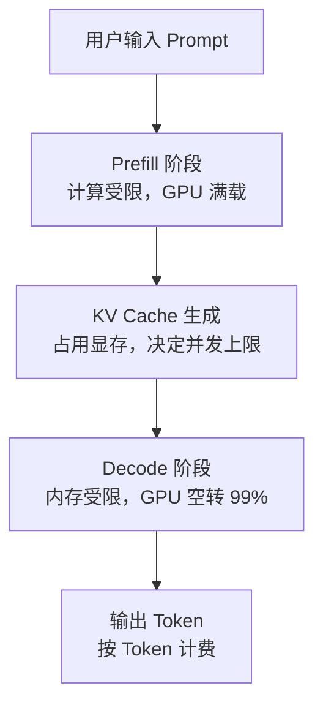

# 算力与 Token 经济学：用生活类比讲透 AI 的真实成本

这是一篇建立直觉的文章：不用数学推导，只用生活类比和具体数字，让非硬件背景的人也能理解「一个 Token 到底贵在哪里」。

## 一、Token：语言的标准纸箱

Token 是模型「一次能处理的最小碎块」——不是字，不是词。

| 语言 | 示例 | Token 切分 |
|------|------|-----------|
| 英文 | `"chatting"` | `"chat"` + `"ting"`（2 tokens） |
| 英文 | `"I love AI"` | 3 tokens |
| 中文 | `"聊天"` | 1–2 个 token（取决于 tokenizer） |

**类比**：Token 就像快递的「标准纸箱」——不管里面装的是书还是衣服，一律按箱计费。模型处理语言也是按箱收费，不按内容轻重。

记住这个量级：1 个中文字 ≈ 1–2 token，一篇 1000 字中文文章 ≈ 1000–2000 token。

## 二、FLOPS：GPU 的计算肌肉

FLOPS = 每秒浮点运算次数，衡量芯片算算术的速度。类比工厂的「工人数量 × 工人手速」。

| GPU | FP16 算力 | 价格 |
|-----|----------|------|
| A100 | 312 TFLOPS | ~$10,000 |
| H100 | 989 TFLOPS | ~$30,000 |
| B200 | ~2,250 TFLOPS | ~$40,000 |

看起来 H100 算力是 A100 的 3 倍、贵 3 倍，很合理？**错了**——实际推理时 H100 可能只有 A100 的 2–3 倍速度，而且大部分时间在空转。原因在第四节。

## 三、2N 公式：一个 Token 的计算税

最核心的公式：**每生成 1 个 token ≈ 2N 次浮点运算**（N = 模型参数量）。因为生成每个 token 时模型要把所有参数过一遍，每个参数大约做 2 次运算（一乘一加）。

| 模型 | 参数量 N | 每 Token FLOPs |
|------|---------|---------------|
| GPT-2 | 1.5B | 3 GFLOPS |
| Llama 3 8B | 8B | 16 GFLOPS |
| Llama 3 70B | 70B | 140 GFLOPS |

算一笔账：一次对话输入 2000 token、输出 1000 token，用 Llama 3 70B——

- Prefill（处理输入）：2000 × 140 GFLOPS = 280 TFLOPs
- Decode（逐字生成）：1000 × 140 GFLOPS = 140 TFLOPs
- **总计 420 TFLOPs**，相当于一块 H100 满负荷跑 0.42 秒。

但实际要花 10–30 秒。**利用率只有 1–4%。**

## 四、利用率之殇：超跑在乡间小路上

H100 的硬件参数：算力 989 TFLOPS（发动机），内存带宽 3350 GB/s（路宽）。关键概念是**算术强度**——每搬运 1 字节数据能做多少计算：

| 场景 | 算术强度 | 瓶颈 | 利用率 |
|------|---------|------|--------|
| Prefill（处理输入） | ~4096 FLOPs/byte | 算力 | 接近 100% |
| Decode（逐字生成） | ~1 FLOP/byte | 内存带宽 | **~1%** |

用图书馆写论文来类比：

- **Prefill** = 一次性借 100 本书回宿舍慢慢看——搬运少、计算多，瓶颈是「你看书的速度」。
- **Decode** = 每次需要新资料就跑一趟图书馆，每次只看一页——搬运频繁、计算少，瓶颈是「你跑图书馆的速度」。

H100 在 decode 阶段就像一辆法拉利在乡间小路送快递：发动机轰鸣，速度上不去，因为路太窄。

这解释了三个行业现象：升级算力没用、升级带宽才有用（H200 相对 H100 主要提升带宽）；Groq、Cerebras 这些推理芯片创业公司的机会在「更宽的路」；以及**输出 token 比输入 token 贵**——decode 阶段硬件利用率极低。

## 五、KV Cache：随时间膨胀的记忆税

模型生成时要记住之前所有 token 的信息，这个「记忆」就是 KV Cache。类比写论文的草稿纸：论文越长，草稿纸越多，桌面越挤。

关键洞察：KV Cache 大小公式里除了「上下文长度」，其他项都是模型部署时固定的。所以**每增加 1 个 token 上下文，KV Cache 就增加一份固定大小的税**。以 Llama 3.1 70B 为例：

| 上下文长度 | KV Cache 大小 | 类比 |
|-----------|--------------|------|
| 4K | ~2.1 GB | 一张高清照片 |
| 32K | ~16.8 GB | 一部 4K 电影 |
| 128K | ~67.2 GB | 整个操作系统 |

一块 H100（80GB 显存）部署 70B 模型（INT4 约 35GB），剩余显存决定并发上限：

| 上下文长度 | 每用户 KV Cache | 并发用户数 | 每用户每小时成本（$2.5/h 租金） |
|-----------|---------------|-----------|------------------------------|
| 4K | ~2.1 GB | ~21 人 | $0.12 |
| 32K | ~16.8 GB | ~2–3 人 | $0.83（7x） |
| 128K | ~67.2 GB | 装不下 | $2.50+（20x+） |

**长上下文贵的原因不是计算贵，而是一个长对话把其他用户都挤走了。**

## 六、Token 工厂：黄仁勋的新范式

传统数据中心卖算力（$/FLOPS）、存储（$/GB）、带宽（$/Gbps）。黄仁勋提出的新范式是 **Token 工厂**：数据中心变成 Token 生产工厂，核心公式是 `Revenue = Tokens/Watt × 可用电力`。

类比：传统模式卖面粉（算力），Token 工厂卖面包（Token）——面粉只是原料。

| GPU | TDP | 吞吐（tok/s） | Tokens/Watt |
|-----|-----|-------------|-------------|
| A100 | 400W | ~500 | 1.25 |
| H100 | 700W | ~2,000 | 2.86 |
| B200 | 1,000W | ~5,000 | 5.00 |

B200 每瓦产 5 个 token，A100 只有 1.25 个——效率差 4 倍。在电力受限的数据中心，同样的电力配额，B200 能服务 4 倍的用户。而现代 AI 数据中心每机架功率密度 30–50kW（传统 5–10kW），一个 100MW 数据中心只能支撑约 5 万块 H100——**瓶颈不是 GPU 数量，而是电力容量**，这就是为什么科技巨头都在建核电站、收购能源公司。

## 七、成本拆解：一个 Token 到底多少钱

以 Llama 3.1 70B、H100 部署为例，自托管底线成本随利用率变化：

| 利用率 | 每百万 Token 成本 |
|--------|-----------------|
| 100%（理论最优） | $0.40 |
| 60%（良好运营） | $0.67 |
| 30%（一般运营） | $1.33 |
| 10%（差运营） | $4.00 |

对比 API 定价：Groq 上 Llama 3.1 70B 约 $0.70/M tokens（1.75x 底线），GPT-4o-mini $0.60–1.20，Claude Sonnet $3–15，GPT-4 $10–60（25–150x）。差距去哪了？硬件成本只占 20–30%，其余是工程优化（vLLM、TensorRT-LLM）、运维团队、可靠性工程、安全审核和利润。**自托管便宜的前提是：你有足够的利用率、工程师和流量，否则 API 虽贵但省心。**

## 八、三大优化杠杆（按省钱效果排序）

**批处理（Batching）——20–40x 吞吐提升。** batch=1 是出租车一次拉 1 人，batch=32 是一次拉 32 人：吞吐从 ~50 tok/s 提升到 ~2000+ tok/s。批处理是唯一能带来 10 倍以上提升的单一优化，其他优化都只有 30–50%。

**量化（Quantization）——30–40% 免费午餐。** FP16 → FP8 → INT4，模型体积 100% → 50% → 25%，吞吐提升 1.3–2x，质量损失极小。就像压缩图片：体积变小，肉眼几乎看不出区别。

**框架效率——同一硬件翻倍。** PyTorch 原生 1x，vLLM 1.5–2x，TensorRT-LLM 2.5–3x。vLLM 的核心创新 PagedAttention 像操作系统管理内存一样管理 KV Cache，避免显存碎片。

## 九、端侧推理：边际成本趋近于零

| 场景 | 云端成本 | 端侧成本 |
|------|---------|---------|
| 1 次对话 | $0.01 | $0（已付电费） |
| 10,000 次对话 | $100 | $0 |

端侧推理的真正优势不是单价便宜，而是**总量不随使用量增长**。假设一款 AI 助手产品有一万用户：用量 50 次/月时云端月成本 $50,000 vs 端侧 $10,000（模型授权）；用量 500 次/月时云端涨到 $500,000，端侧还是 $10,000。用量超过 100 次/月，端侧开始大幅省钱——**Always-on AI（常驻监听、实时翻译）在云端计费模式下经济上根本不可行。**

代价也明确：模型上限 1–3B 参数、上下文约 32K、模型更新要下载、硬件碎片化。

## 十、总结

核心结论：

1. **Token 是 AI 的货币**：一切成本都折算成 token。
2. **2N 公式是税基**：模型越大，税率越高。
3. **Decode 是浪费重灾区**：$30,000 的 GPU 生成文字时利用率只有 1%。
4. **KV Cache 是隐形杀手**：128K 上下文成本是 4K 的几十倍，因为显存被占满、并发骤降。
5. **利用率是最大杠杆**：同一硬件，利用率差 10 倍，成本差 10 倍。
6. **Token/Watt > FLOPS**：衡量 AI 效率的正确指标是每瓦 token 数。
7. **端侧是 Always-on 的唯一出路**：云端线性计费 vs 端侧固定成本的剪刀差。

一句话总结：**AI 推理的成本结构就像一家餐厅——食材（算力）不贵，房租（显存）和人工（利用率）才贵。Token 是菜单上的价格，KV Cache 是座位数，Decode 是上菜速度。想赚钱，不是买更多食材，而是让更多座位坐满、上菜更快、每道菜更省电。**

---

**延伸阅读**

- [从 FLOPS 到美元：LLM 推理成本的数学推导](/blog/llm-inference-cost-deep-dive/) —— 进阶篇，含 Self-Attention 单层 FLOP 推导、算术强度与 Roofline 分界线、CPM 与 Spot 报价、Prefill-Decode 分离
