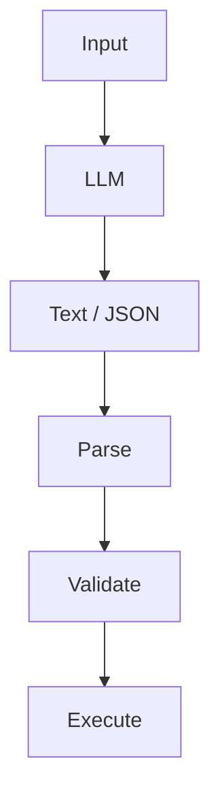
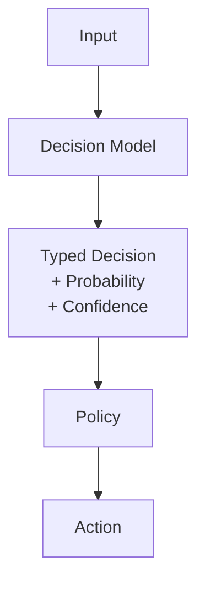
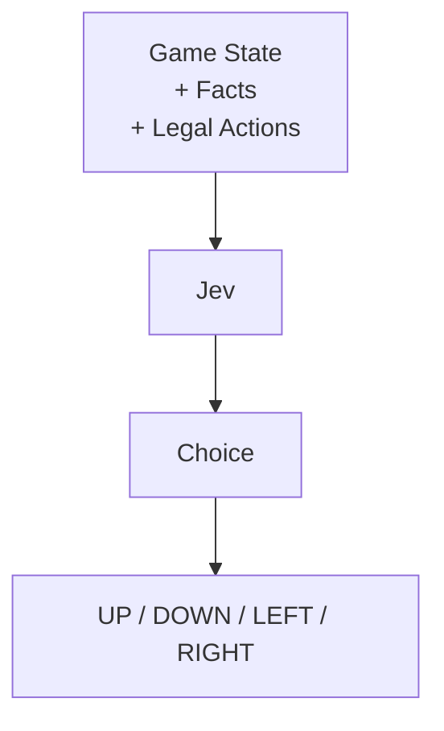
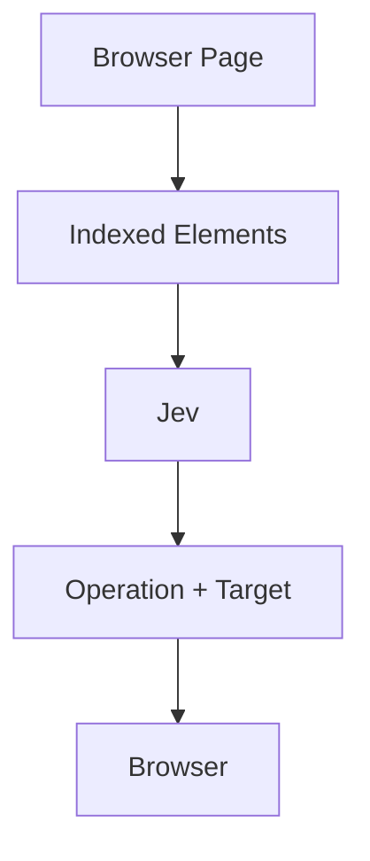
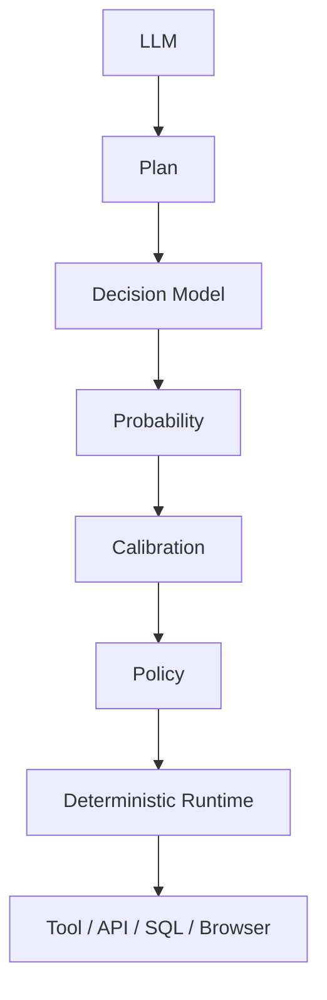

# Jev 开源生态调研与复现手册

调研目标：寻找类似 TypeSafe / System One / Jev 的开源项目，并能在本地完成安装、运行、验证和二次开发。本文是调研结果的完整梳理。

## 一、核心思想：Decision 不是 Generation

传统 LLM 应用的路径是「生成 → 解析 → 校验 → 执行」：



System One / Jev 的路径完全不同——模型直接产出带概率和置信度的类型化决策：



区别不只是少了几步。传统路径里，「确定性信息」和「决策」混在一起由 LLM 生成；Jev 路径里，**确定性信息由程序生成，AI 只负责 Decision**。这是整个生态最重要的工程思想。

## 二、项目全景：四个层次

| 层次 | 项目 | 定位 |
|------|------|------|
| ① API / Protocol | OpenJev | 本地 System One Runtime |
| ② Model | JevLike / OpenJev / Laya | 训练、推理、开箱即用三条路线 |
| ③ Application / Demo | TypeSafe Snake / Doom / PocketJev | 实时决策演示 |
| ④ Agent Runtime | Jev Ultrafast / Jev Browser | 浏览器 Agent |

## 三、模型三方对比

三个「Model」类项目是这个生态的核心，放在一起看：

| 维度 | JevLike | OpenJev | Laya |
|---|---|---|---|
| 定位 | 自己训练 Decision Model | 本地 System One Runtime | 开源版 Jev（pip 即用） |
| 训练 | 需要（synthetic → train） | 不需要 | 不需要 |
| API Key | 不需要 | 不需要（需 HF 登录下载 Gemma） | 不需要 |
| 硬件 | CPU / MPS / CUDA | Apple Silicon + MLX | CPU / GPU（T4 即快） |
| 安装 | `uv pip install -e` | `make setup` | `pip install laya` |
| 决策原语 | choice | choice / score / noul | choice / score / noul |
| 适合 | 研究「如何训练」 | 研究「推理 / API」 | 快速落地 / 替代 Jev |

选择建议很直接：**研究训练 → JevLike；研究推理/API → OpenJev；直接落地 → Laya。**

### Laya 与官方 Jev 的量化对比

Laya（Convai Innovations，Apache 2.0）是目前最接近「开源版 Jev」的项目，非自回归、单次前向直接输出结构化决策：

| 指标 | Laya | Jev |
|---|---|---|
| 延迟 p50 | 32.8 ms | 236–276 ms |
| typed-decisions 准确率 | 0.766 | 0.727 |
| ECE（温度拟合后） | 0.081 | 0.144 |
| License | Apache 2.0 自托管 | 闭源 API，$0.042/1M |

Jev 仍在高基数 choice（40–77+ 选项）、软分布匹配、原始 calibration 上领先。注意：**Laya 是「用于特化的快速基座」，不是零样本决策引擎**——基座 checkpoint 在 typed-decisions 上接近随机，要玩好需要微调（仓库自带 Kaggle notebook，2×T4 约 4–5 小时）。

### Laya 最小上手

```python
from laya import Router

router = Router(preload=True)      # 预载避免语言切换时 7-10s 冷启动重建
result = router.predict(state, questions)
```

关键实践：`Router(preload=True)` 做成常驻进程，每次 predict 约 33ms；权重首次下载后缓存在 `~/.cache/huggingface/hub/`，可用 `HF_HOME` 改位置。三种决策原语：choice（标签+概率+置信度）、score（等级+分布）、noul（校准后的 P(true)），内置 router/guard/moderation/triage 四套 preset。

## 四、两个关键 Demo 的工程思想

### TypeSafe Snake：确定性信息由程序生成

[sorrycc/typesafe-snake](https://github.com/sorrycc/typesafe-snake) 是体验「Jev + 实时决策 + 游戏」的最佳入口。它**不是**把游戏画面扔给 LLM——代码先计算合法走位、食物距离、可达格子、死路、兜底走法，然后把「状态 + 事实 + 合法动作」交给 Jev 做选择：



API Key 通过 Hono proxy（`server/index.ts`）转发，浏览器只请求 `/api/decide`，Key 不暴露。官方控制台 early access 需要排队，免排队方案是走 Vercel AI Gateway 的 Jev 模型。

### Jev Ultrafast： chooses instead of generating

[browser-use/jev-ultrafast](https://github.com/browser-use/jev-ultrafast) 是目前最值得研究的 Browser Agent Demo，定位一句话：**"A browser agent that chooses instead of generating."** 核心过程：



模型输出的是 `{"operation": "CLICK", "target": 7}` 这样的选择，而不是 `document.querySelector(...)` 这样的代码——这是和传统 Browser Agent 的本质区别。Inspector 里可以观察每次决策的 probability、confidence、latency。官方 Google Flights 示例不使用任何网站专用脚本，完全根据当前页面 observed elements 决策。也可以作为 Python 库直接调用（`from jev_ultrafast import Agent`）。

## 五、推荐复现路线（4 天）

第一次研究不要一上来跑 Browser Agent。环境：Python 3.12 + Node.js + pnpm + uv + Git，推荐 macOS Apple Silicon（OpenJev 的本地模型路径依赖 Metal GPU）。

**Day 0（可选）：Laya 快速体验。** `pip install laya` 一分钟看到 Typed Decision 效果，无训练、无 API Key，先建立直观印象。

**Day 1：JevLike——理解如何训练。**

```bash
git clone https://github.com/vinnylarouge/jevlike.git && cd jevlike
uv venv && source .venv/bin/activate
uv pip install -e '.[dev]'
jevlike-data synthetic --output data/synthetic
jevlike-train data/synthetic/train.jsonl \
  --validation data/synthetic/validation.jsonl \
  --output runs/synthetic.pt
jevlike-eval runs/synthetic.pt data/synthetic/test.jsonl
```

评估输出 Top-1/Top-3 accuracy 和 calibration 指标。官方建议用 shuffled-context control 检查模型是否真的利用了 context 而不是记住候选项。训练支持 CPU / Apple MPS（`--device mps`）/ CUDA。

**Day 2：OpenJev——理解推理与 API。**

```bash
git clone https://github.com/daseinlabs/open-jev.git && cd open-jev
make setup    # uv sync + 创建 Python 3.12 环境 + 下载 Gemma 3 4B（gated，需 HF 登录）
make serve    # http://localhost:8000
make health && make request
make check    # 验证 cached batched scoring 与 naive re-encoding 一致性
make bench    # 重点观察 context cached vs context repeated
make doom     # ViZDoom Demo：Frame → Action Menu → OpenJev → Best Action
```

`make bench` 里 context cached 和 context repeated 的对比，对理解 Jev 为什么能快速做大量 candidate scoring 非常重要。注意 OpenJev 的 confidence 是基于 entropy 的近似，不要与 TypeSafe 官方实现视为等价。

**Day 3：TypeSafe Snake——理解 Runtime。**

```bash
git clone https://github.com/sorrycc/typesafe-snake.git && cd typesafe-snake
cp .env.example .env   # 填入 TYPESAFE_API_KEY
pnpm install && pnpm dev   # Web: http://localhost:5188
pnpm test && pnpm typecheck
```

重点阅读顺序：`src/game/engine.ts` → `analysis.ts` → `controller.ts` → `src/jev/prompt.ts` → `server/index.ts`。

**Day 4：Jev Ultrafast——理解 Agent。**

```bash
git clone https://github.com/browser-use/jev-ultrafast.git && cd jev-ultrafast
uv sync && cp .env.example .env   # TYPESAFE_API_KEY + OpenRouter 配置
uv run browser-harness --doctor   # 检查 Chrome 连接
uv run jev                        # http://127.0.0.1:8766
```

重点读 `jev_ultrafast/agent.py`：每次 Decision 记录 probability / confidence / latency / operation / target / usage，执行后重新 observe browser state。

## 六、复现成功的判断标准

不要只看「程序启动了」。每个项目分五层验证：

1. **Level 1 启动**：Server / Web UI 能起来
2. **Level 2 模型调用**：Input → Model → Output 成功
3. **Level 3 Decision**：能拿到 Choice + Probability + Confidence
4. **Level 4 Runtime**：Decision → Action → 环境状态真实改变
5. **Level 5 Evaluation**：能量化 Accuracy / Latency / Calibration / Cost

如果准备自己实现，建议统一记录这些指标：Top-1/Top-3 Accuracy、Calibration、P50/P95 Latency、Token 消耗、单次 Decision 成本、Action 成功率、Fallback 率。

## 七、其他项目速览

- **[Jev Browser](https://github.com/AnotiaWang/jev-browser)**：更复杂的 Browser Agent 编排，建议先跑通 Ultrafast 再看它
- **[Jev Doom Agent](https://github.com/AnotiaWang/jev-doom-agent)**：OpenJev Doom 的对照实验，研究重点是「实时状态 → 有限动作空间 → 低延迟决策」
- **[PocketJev](https://github.com/daseinlabs/pocketjev)**：本地设备 + Vision + Decision（Camera → Vision Model → Candidate Actions → Decision），建议理解 OpenJev 后再研究
- **[Awesome Jev](https://github.com/AnotiaWang/awesome-jev)**：生态索引，覆盖 Snake/Doom/Tetris/Pac-Man/Mario/Gomoku/Browser/MCP/Computer Use
- **[LoomFlow](https://github.com/Anurich/LoomFlow)**：注意它**不是** System One——走「LLM → Structured Output → Pydantic → Validation → Retry」路线，适合用来和 Decision Model 路径做对比

## 八、最终架构建议

如果准备自己实现一个 TypeSafe-like 系统，推荐模块划分：

```text
my-system-one/
├── model/       # scorer / calibration / inference
├── decision/    # choice / score / boolean / schema
├── policy/      # threshold / fallback / router
├── runtime/     # agent / tools / executor
├── sdk/         # python / typescript
├── examples/    # snake / browser / finops / sre / nl2sql
└── benchmark/   # accuracy / latency / calibration / cost
```

整体数据流：



这是从这些开源项目中最值得抽象出来的一条技术路线：**LLM 负责理解和规划，Decision Model 负责选择，Policy 负责控制，Runtime 负责执行。**

---

**项目索引**

- JevLike：<https://github.com/vinnylarouge/jevlike>
- OpenJev：<https://github.com/daseinlabs/open-jev>
- Laya：<https://github.com/NandhaKishorM/laya>
- TypeSafe Snake：<https://github.com/sorrycc/typesafe-snake>
- Jev Ultrafast：<https://github.com/browser-use/jev-ultrafast>
- Awesome Jev：<https://github.com/AnotiaWang/awesome-jev>
