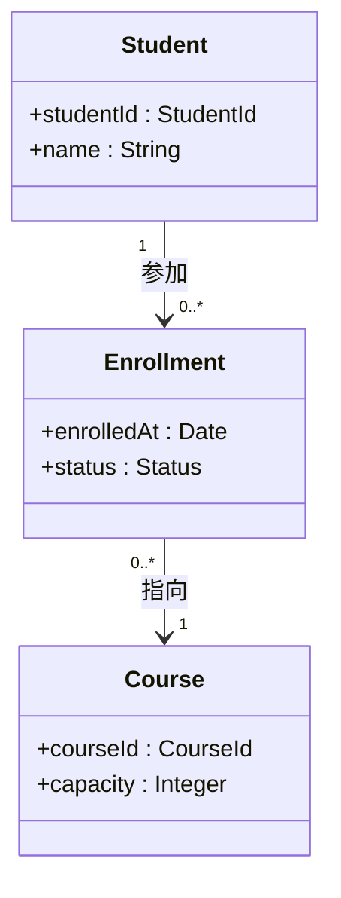
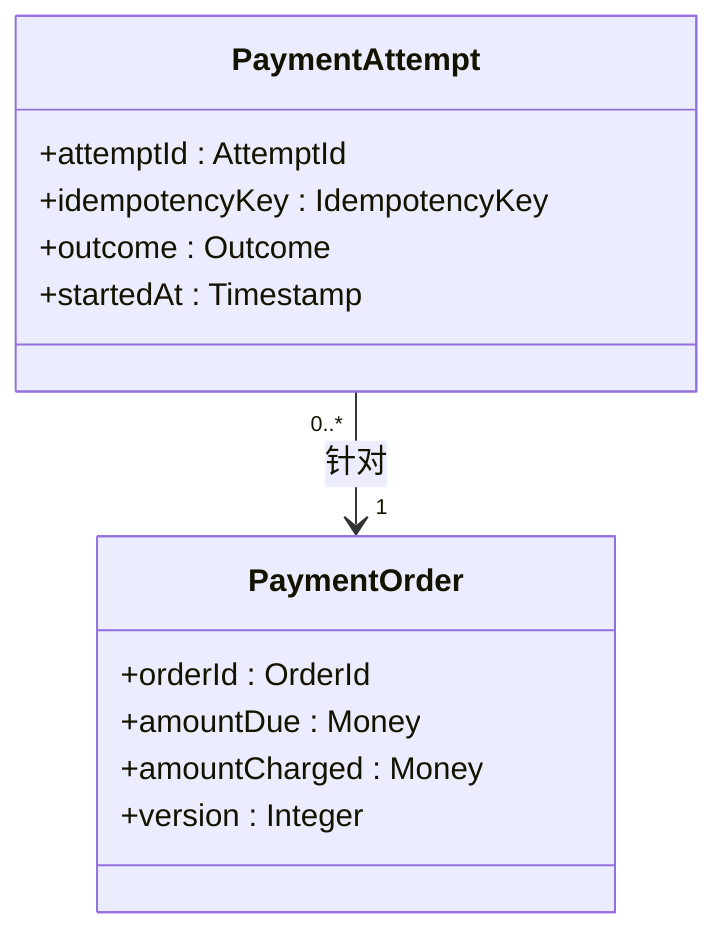
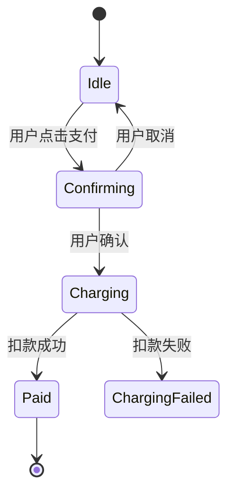
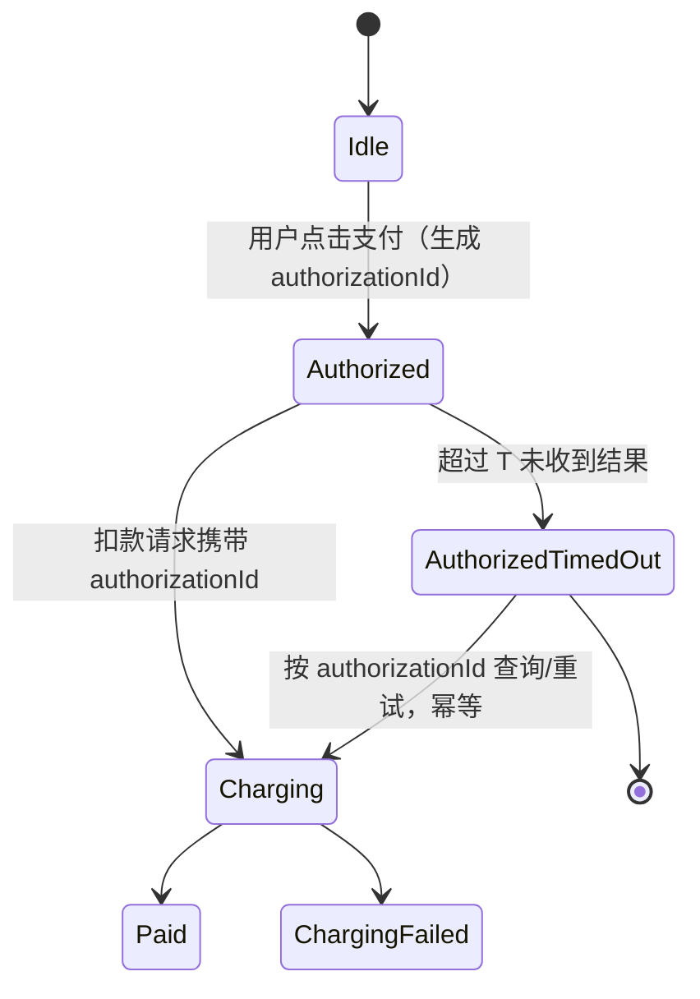
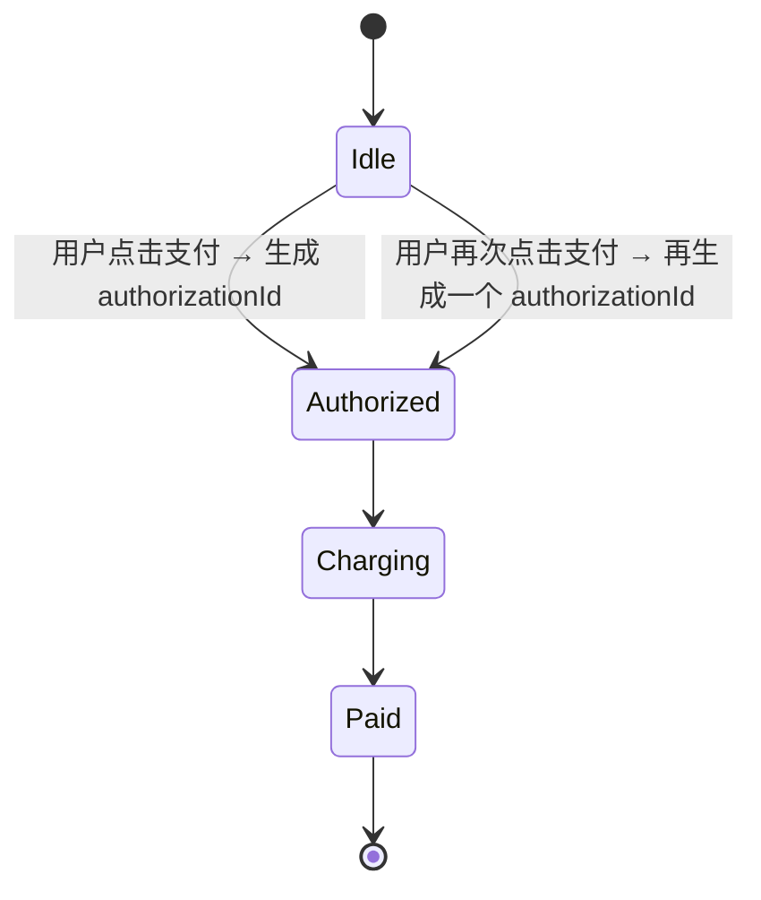
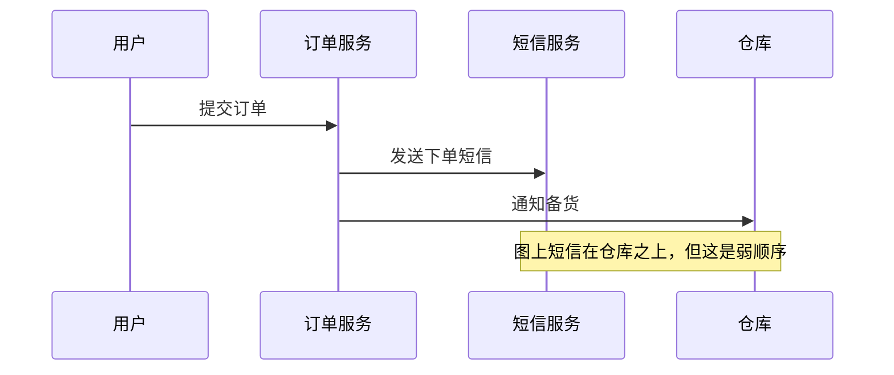

读 UML 规范最没效率的方式，是把它当图形大全从头背到尾。有用的读法是**带一个贯穿全篇的问题去读**：**哪些意图必须明确固定下来，哪些选择可以留白？** 下面这组 UML 建模五问就来自这样的读法——带着这个问题读规范，会发现五个彼此独立的设计问题。它们都不要求你记住某种图形，而是要求你回答建模者真正面对的决策困境。

本文整理自南京大学《生成式软件工程》2026 秋第 5 讲「重新阅读 UML」一节（主讲：jyy），[原始讲义](https://jyywiki.cn/GSE/2026/lect5.md)。建模练习与 OCL 风格的约束写法为本文补充，配套的可运行代码在讲义的 [L05-契约式设计](https://jyywiki.cn/GSE/2026/) 目录里。

贯穿全篇的例子是**支付**，以及讲义点名的那句：**用户连续点击两次「支付」，究竟算一次授权，还是两次？**

## 一、图与模型：意义保存在哪里

UML 区分**模型**（元素、关系、约束）与**图**（对模型一部分的展示）。同一个模型可以有不同视图，分别突出结构、状态或交互。

判据很干脆：**一张图没有画出某项信息，不足以说明底层模型不存在这项信息。**

以选课为例，「学生与课程之间存在选课关系」回答不了每人能选多少门课、一门课能容纳多少人——这些数量约束属于模型（多重性）。某张介绍整体结构的图省略了多重性标注，不能仅凭省略的画面替模型作决定。

还有一个容易被忽略的工程细节：UML 规范本身把语义落实为机器可读取的数据。规范正文与随附的规范性 XMI 文件冲突时以后者为准（[规范第 2 节](https://www.omg.org/spec/UML/2.5.1/PDF#page=45)）。推广到自己的项目就是一句可执行的规则：

> 凡是需要跨工具、跨时间保留的意图，都应当找到显式的数据表示。

### 建模练习：把多重性写成约束

为「学生选课」建模，至少显式表达下面四个数量约束，并写成 OCL 风格的约束，而不是只画一根线：



四个问题里，只靠这张图回答不了三个：

| 问题 | 只靠图够吗 |
|------|-----------|
| 一个学生最多能选几门课？ | ❌ 需要模型级约束（未在图中标注） |
| 一门课最多容纳多少人？ | ❌ `capacity` 的多重性未表达 |
| 选课记录从属于学生吗？ | ⚠️ 图上画了箭头，但「从属于」不等于「随学生一起销毁」 |
| 已退课的记录还在不在？ | ❌ 需要 `status` 的取值域与状态迁移 |

对应的 OCL 风格约束：

```text
context Student inv:
    self.enrollment->size() <= self.maxCourses

context Course inv:
    self.enrollment->select(e | e.status = Enrolled)->size() <= self.capacity

context Enrollment inv:
    self.status in {Enrolled, Dropped, Completed}

-- 学生删除时，选课记录怎么办？生命周期没有默认答案，必须显式决定
```

**画图时容易犯的错**：把「一个学生参加 0..* 条选课记录」当成「学生被删除时这些记录一起删掉」。图上的一根箭头同时暗示了访问方向、所有权和生命周期——这正是第四个问题要拆开的东西。

## 二、契约与实现：这次成立，还是每次都应成立

> 一个实现成功处理过一次请求，并不能自动说明它在所有约定场景下都会满足要求。

UML 用**前置条件、后置条件、不变量、协议状态机、多重性**表达「必须满足的要求」。讲义给的例子极好：**一个查询支付状态的操作，如果声明为查询，就不应该顺手改变系统状态**；「查询是否付款」不能暗中完成一次扣款。

继承带来结构相似的问题：`isSubstitutable` 可以表达「子类可替代父类」，但讲义明确限定——写下这个声明，并不等于工具已经证明所有行为都满足它（[规范第 6.3.3 节](https://www.omg.org/spec/UML/2.5.1/PDF#page=57)）。

自然语言也一样：「任何重试都不能重复扣款」是一个清楚的意图，困难在于**这句话不会自动检查后面的实现**。

结论：**在 AI 生成代码之前写下约束，在代码生成之后用测试、检查或验证把它们联系起来。**

### 建模练习：把「不重复扣款」写成可检查的表达式

为「支付授权 + 扣款」写一个规约骨架，让「任何重试都不能重复扣款」变成可检查的表达式：



```text
-- 前置条件：调用者要保证什么
context PaymentOrder::charge(amount : Money, key : IdempotencyKey) : Outcome
pre: amount > 0
     and amount <= self.amountDue - self.amountCharged
     and self.status = Pending

-- 后置条件：实现者要保证什么（含禁止类约束）
post: self.amountCharged = old self.amountCharged + amount
      and (outcome = Charged implies self.amountCharged = old self.amountCharged + amount)
      and (outcome = Rejected implies self.amountCharged = old self.amountCharged)
      -- 禁止：任何重试都不得让累计扣款超过应付金额
      and self.amountCharged <= self.amountDue

-- 类不变量：对象在对外可用的稳定状态下必须满足
context PaymentOrder inv totalChargedNeverExceedsDue:
    self.amountCharged <= self.amountDue

-- 查询就是查询：readPaymentStatus 不得改变任何状态
context PaymentOrder::readPaymentStatus() : PaymentStatus
post: self.amountCharged = old self.amountCharged
```

**这个练习真正要产出的东西不是图，是那份 `pre/post/inv` 文本。** 图告诉你有哪些类，规约告诉你它们承诺什么。讲义那句话在这里落地：**承诺可以先写在自然语言里，再根据问题的代价和工具能力，落实为接口契约、状态机、断言、测试或验证条件。**

`readPaymentStatus` 的后置条件是「一次成立不等于每次成立」的最小例子：让某个实现顺手在查询里扣一次款，这条 `post` 立刻失效，而正常路径的测试很可能照样通过。

## 三、留白也是一种决定

UML 的交互语义区分**合法执行轨迹**和**非法执行轨迹**，而这两个集合不一定覆盖所有可能的轨迹，因此存在**尚未规定**的行为（[规范第 17.1.2 节](https://www.omg.org/spec/UML/2.5.1/PDF#page=608)）。

支付场景的三分法：

| 类别 | 例子 |
|------|------|
| **合法** | 用户确认支付，系统扣款成功，再返回成功结果 |
| **非法** | 用户没有确认，系统已经扣款 |
| **尚未规定** | 用户确认后请求超时，系统是否自动重试 |

第三类不能当成已经获得业务认可的行为。讲义强调：**决定没做，必然带来追问链**——

> 如果实现者自行选择自动重试，就必须进一步回答：**一次超时是否可能意味着扣款已经完成？怎样保证再次请求不会重复扣款？**

讲义还做了一个精细辨析，避免两种「留白」被混为一谈：

- **语义变化点（semantic variation points）**：语言本身把某些语义选择留给使用环境；
- **这份模型没写完**：这份模型还没有约束某种情况。

### 建模练习：把「尚未规定」画出来

为「用户点击支付」画状态机，然后为超时这个状态画出两种不同解释。

**解释 A：超时是一次授权失败**（尚未规定的部分交给实现者自行决定）



这个模型对 `ChargingFailed` 之后的重试没有任何表态——既没说会自动重试，也没说不会。「尚未规定」的集合里就藏着 `Charging --超时--> Charging` 这条轨迹。

**解释 B：把「一次点击 = 一次授权」写进模型**



**解释 C：把「一次点击 = 两次授权」写进模型**（同样是合法的另一种解释）



三者的差别不是实现细节，而是**业务决定**：

- 解释 B 需要一个「同一笔授权的幂等键」，并且要回答「超时后查得到吗、查不到怎么办」；
- 解释 C 需要回答「两次点击产生两次授权，钱会不会被扣两次」——**这正是第二节里那条「累计扣款不得超过应付金额」约束要接住的地方**。

**建模者要交付的不是「选一个」，而是：明确写出现在选的是哪个、另一个会带来哪些必须一并回答的问题。**

### 练习 2：连续点击两次「支付」

这是讲义点名的那道题。用户在手机上点了「确认支付」，网络卡住，用户又点了一次，系统收到了两次请求。

| 解释 | 模型里的写法 | 必须一并回答的问题 |
|------|-------------|-------------------|
| **算两次授权**（每次点击生成一个授权对象） | 关联多重性 `0..*`，每次点击创建一个 `Authorization` 实例 | 两个授权分别扣款怎么办？界面上如何让用户知道已经有一笔在途？「取消」要不要同时撤销两个？ |
| **算一次授权**（幂等键把第二次请求折叠掉） | 用一个 `IdempotencyKey` 唯一索引；第二次请求返回第一次的结果 | 超时后查询不到结果时怎么办？用户看到「处理中」会不会再点第三次？ |
| **算两次请求、一次授权**（请求与授权分离） | `PaymentRequest 0..* --> Authorization 1` | 这个模型最贴近现实，但也最贵——它要求「把一次点击变成一次授权」这一步本身有明确的原子性和幂等性保证 |

**建议**：不要在建模阶段回避这个问题。把它写进模型（哪怕写成 `{尚未决定}`），并把追问链一起记录下来。

## 四、不同的含义，需要不同的表达

自然语言和随手画的图，经常让**一个记号同时承担多种没有说清楚的含义**。讲义拆出的三组区分：

- 两条记录当前属性值相同，**并不说明它们是同一个对象**（相等性 ≠ 同一性）；
- 修改其中一个，另一个是否跟着改变，**取决于身份和共享关系**；
- 把某类对象定义成另一类的特化，与规定某个集合中的成员必须属于另一个集合（集合约束），**是不同层面的约束**。

关联关系上，规范把**聚合、可导航性和关联端的所有权**分开表达，并且明确**废弃了「可导航即所有权」的旧约定**（[规范第 11.5.4 节](https://www.omg.org/spec/UML/2.5.1/PDF#page=244)）。

时间顺序也一样：交互图上的上下位置不能总被解释为全局串行执行，`seq` 表示**弱顺序**——来自不同生命线、不同片段的事件仍可能交错（[规范第 17.6.3.11 节](https://www.omg.org/spec/UML/2.5.1/PDF#page=625)）。

### 建模练习：把一根箭头拆成三个问题

对「学生 — 选课记录 — 课程」这条链，逐个回答下面三问：

| 维度 | 问题 | 学生—选课记录 | 选课记录—课程 |
|------|------|--------------|--------------|
| **可导航性** | 从谁出发能找到谁？ | 从学生能找到他的选课记录 | 从选课记录能找到课程；从课程能反查选课记录吗？ |
| **所有权** | 这一端的属性归谁拥有？ | 选课记录由学生「拥有」 | 课程**不**拥有选课记录，它是课程的属性 |
| **生命周期** | 谁先销毁？ | 学生被注销时，已归档的选课记录**应当保留**（历史事实） | 删除一条选课记录**不应**删除课程 |

**第三行的答案必须显式写出来**，因为「删除一个学生的选课信息，显然不应该顺手删除整门课程」这件事，如果不写，默认实现很可能会按聚合的语义去做级联删除。

讲义那句判断值得刻下来：

> **不能因为画了一根箭头，就默认这些问题都已经获得了相同答案。**

### 建模练习：弱顺序

把「下单后同时发短信通知和扣库存」画成交互图，然后回答：**图上的上下位置是否意味着顺序？**



结论：**这不是串行。** `seq` 只保留各片段内部的顺序和同一生命线前后片段的顺序；`S` 与 `W` 的事件仍然可以交错。

**如果业务确实要求「库存锁定成功之后才能发短信」**，那必须用明确的约束表达（例如把 `S` 的调用放进 `W` 的成功分支），而不是靠「把它画在上面」。

## 五、模型本身也需要检查

既然模型由明确的元素和关系组成，就可以**像检查程序的类型一样，检查模型是否满足结构上的规则**。**OCL（Object Constraint Language）** 表达这类条件：类型、多重性、活动中的输入输出兼容性。

**元模型**规定「模型可以由什么组成、它们怎样关联」，MOF 为这类定义提供基础。UML 的 Profile 可以为特定领域增加标记和约束，但**扩展需要尊重原有语义**——

> 否则大家都声称使用同一个语言，一个工具理解的「对象」却可能是另一个工具眼中的完全不同的东西。

讲义对检查能力做了及时的降温：

> 通过模型的良构性检查，**只说明它符合被检查的建模规则，并不自动证明所有实现都符合业务需要。一个语法完全正确的支付模型，仍然可能遗漏重复扣款问题。**

而且规范里还有标注 **"Cannot be expressed in OCL"** 的约束（[ObjectFlow 的约束](https://www.omg.org/spec/UML/2.5.1/PDF#page=471)就是这种情况）——不能据此宣称所有语义都已实现机械判定。

### 建模练习：给支付模型写一组良构性约束

```text
-- 【良构性】能被工具机械判定
context PaymentAttempt inv:
    -- 输入输出兼容：outcome = Charged 必须有时间戳
    self.outcome = AttemptOutcome::Charged implies self.chargedAt.isDefined
    -- 幂等键不能为空
    self.idempotencyKey.isDefined

context PaymentOrder inv:
    -- 多重性：至少有一个 attempt 才能变成 Paid
    self.status = Paid implies self.attempt->notEmpty()

-- 【业务正确性】工具判不了，需要人保持
--  ✗ 没有任何 OCL 约束能证明「任何重试都不会重复扣款」
--    → 只能写成接口契约 / 属性测试 / 形式化验证
--  ✗ 没有约束能判断「用户点两次支付是不是一次授权」
--    → 这是模型里必须显式表态的业务决定
```

**画完这张表之后，练习才真正完成。** 因为它逼你承认：检查能力有边界，而边界之外的部分仍然要有人持续维护。

## 六、把五个问题合起来看

| # | 设计问题 | 关键判据 | 一旦搞错会怎样 |
|---|---------|---------|--------------|
| 1 | 图与模型 | 图没画 ≠ 模型没有；跨工具保留的意图要有显式数据表示 | 靠截图传递设计，工具接不上，语义分裂 |
| 2 | 契约与实现 | 一次成立 ≠ 每次成立；写下约束，生成后再检查 | 重试、超时、并发这些组合没人覆盖 |
| 3 | 留白也是决定 | 合法 / 非法 / **尚未规定** 三分，第三类不等于已认可 | 模型没表态的地方被实现者悄悄填上 |
| 4 | 不同含义要分开 | 可导航性 / 所有权 / 生命周期是三件事；`seq` 是弱顺序 | 级联删除删掉不该删的；顺序靠画图位置猜 |
| 5 | 模型也要检查 | 良构性可机检，但**检查通过 ≠ 业务正确** | 「语法正确的支付模型仍然可能遗漏重复扣款」 |

最后回到读法本身。讲义说：**不必先决定 UML 是否还流行，才能从它的设计里学习**；即使某种工具不再常用，**创造它时面对的问题和采用的第一性原理，仍然可以指导今天的软件开发**。

这份练习的目标不是产出几张 UML 图，而是养成一个提问习惯：

> **这个决定我写下来了吗？写下来的那份，是给别人看的图，还是机器能读的数据？是「已经决定」，还是「尚未决定」？**

## 相关阅读

- 原始讲义：[《生成式软件工程》2026 秋第 5 讲](https://jyywiki.cn/GSE/2026/lect5.md) — 本文整理自其中的「重新阅读 UML」一节
- UML 规范：[Unified Modeling Language (UML) Version 2.5.1](https://www.omg.org/spec/UML/2.5.1) — 文中引用的章节号均出自这份规范
- OCL 规范：[Object Constraint Language](https://www.omg.org/spec/OCL/) — 表达约束的配套语言
- 契约式设计入门：[Applying "Design by Contract"](https://ieeexplore.ieee.org/document/161279) — Bertrand Meyer 原文
- 相关：[AI 时代的软件工程的变与不变](/blog/ai-era-software-engineering/) — 写代码变便宜之后，什么变贵了
- 相关：[AI 原生 SDLC 实战手册](/blog/ai-agent/ai-native-sdlc-playbook-anthropic/) — 把「已决定 / 绝不能发生 / 尚未决定」落到流程上
